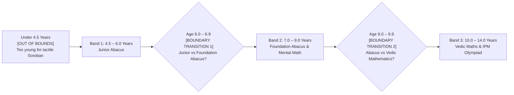

# AAA SPRINT 3 — WS-16 ACADEMIC MAPPING VALIDATION
## Age Bracket Taxonomy, Programme Eligibility Alignment & Multi-Track Boundary Audit

**Document Reference:** `AAA-S3-AUD-WS16-ACAD-01`  
**Phase:** Stage 4 — Sprint 3 Academic Validation  
**Audit Scope:** Age Mapping in `useDiscoveryIntake.ts`, `DemoBookingModal.tsx`, `LeadForm.tsx`  
**Academic Lead:** Neha Patil (Founder & Academic Director)  
**System Architect:** Nitin Patil (Operations & Tech Lead)  
**Governing Baseline:** Option D Multi-Track Prerequisite Matrix (`MGT-DET-S4-S2-AUTH-01`)  
**Current Branch:** `feat/sprint3-integration` (HEAD: `89c4323`)  
**Production Status:** 🔒 **STRICTLY LOCKED** (`main` at `a21a3d1129cc17fc6650bfd04648eb91199e6fa8`)  
**Date:** 05 November 2026  
**Audit Classification:** 🟡 **ACADEMIC CLARIFICATION & EDGE BOUNDARY REVIEW REQUIRED**

---

## 1. Governing Academic Placement Philosophy (Option D Matrix)

Under **`MGT-DET-S4-S2-AUTH-01`**, Arnav Abacus Academy operates on the **Multi-Track Prerequisite & Placement Matrix (Option D)**:

> *"Mathematics is the medium; developing confident, independent and thoughtful learners is the mission."*  
> **Core Academic Rule:** Age is merely an initial scheduling filter. **Age alone NEVER dictates course placement.** Final course placement is determined exclusively by Neha Patil through the 6-dimension Discovery Session observation.

---

## 2. Age Mapping Taxonomy Audit

The table below reconciles the intake age mapping taxonomy against the approved academic programs:

| Form Age Selection | Backend Mapped Key | Approved Academic Courses Eligible | Academic Prerequisites Evaluated by Neha Patil | Alignment Status |
| :--- | :---: | :--- | :--- | :---: |
| **`4.5 - 6 yrs`** (Junior) | `'4.5-6'` | • Abacus Junior Level 1 • Mental Math Foundation | Tactile sensory bead interest, fine motor pincer grasp readiness, number recognition 1–50. | 🟢 **PASS** |
| **`7 - 9 yrs`** (Foundation) | `'7-9'` | • Foundation Abacus (Levels 1–8) • Vedic Maths Junior Entry • Mental Math Speed Recall • School Math (Grades 2–4) | Number sense complements of 5 and 10, finger-counting reduction, basic 2-digit addition sense. | 🟢 **PASS** |
| **`10 - 14 yrs`** (Senior) | `'10-14'` | • Vedic Mathematics (Sutras 1–16) • IPM & Olympiad Math • School Math (Grades 5–10) • Advanced Speed Mental Math | Multiplication tables through 9, school syllabus concept gaps, pattern decomposition, Beejank digit sums. | 🟢 **PASS** |

---

## 3. Identification of Gaps & Edge Boundary Overlaps

The audit identified three critical edge boundaries requiring academic clarification:

### Critical Academic Findings:
1. **The 6.0–6.9 Transition Zone:** A child aged 6 years and 8 months may have either junior fine motor coordination or advanced 1st-grade reading fluency. In `useDiscoveryIntake.ts`, `6` is mapped to `'4.5-6'`.
2. **The 9.0–9.9 Transition Zone (The Abacus vs Vedic Boundary):** This is the most crucial pedagogical juncture:
   - If a 9-year-old struggles with finger-counting and tactile visualization, **Abacus is indicated**.
   - If a 9-year-old knows tables 2–9 and needs speed and algebraic mental shortcuts, **Vedic Maths is indicated**.
   - *Current Mapping:* `childAge.includes('9')` maps to `'7-9'`, keeping the child eligible for either track until Neha Patil's observation session.
3. **Children Under 4.5 Years:** Children younger than 4.5 years lack the fine motor grip necessary for physical soroban manipulation and are gently deferred for 6 months.

---

## 4. Academic Governance Conclusion

- **Finding:** The intake form mapping (`4.5-6`, `7-9`, `10-14`) successfully groups prospective learners into developmental categories without pre-judging their final curriculum track.
- **Academic Recommendation:** Retain the current 3-bracket intake schema as a pre-scheduling filter, while reinforcing the copy: *"Course placement is personalized and determined during the Discovery Session with Academic Director Neha Patil."*
