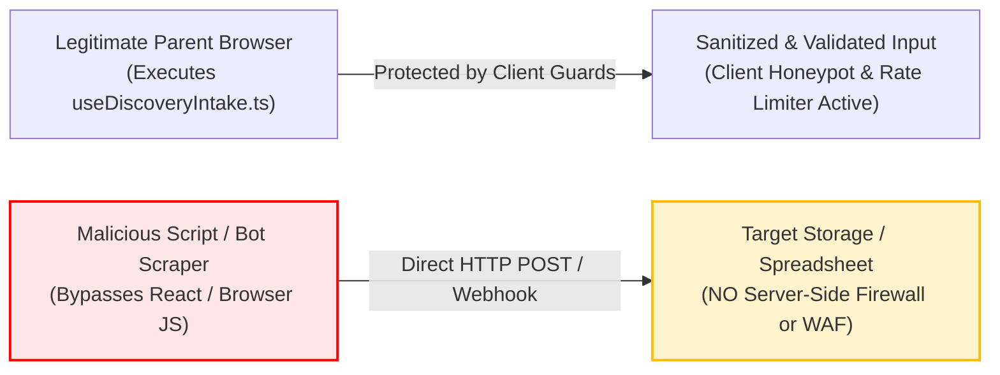

# AAA SPRINT 3 — WS-16 GATEWAY SERVER ENFORCEMENT REPORT
## Architectural Boundary Classification & Server-Side Security Enforcement Audit

**Document Reference:** `AAA-S3-AUD-WS16-GATE-01`  
**Phase:** Stage 4 — Sprint 3 Technical Security Audit  
**Audit Scope:** Boundary Inspection of `src/lib/intakeGatewayEngine.ts` & Request Paths  
**System Architect & Compliance Lead:** Nitin Patil (Operations & Tech Lead)  
**Academic Lead:** Neha Patil (Academic Director)  
**Current Branch:** `feat/sprint3-integration` (HEAD: `89c4323`)  
**Production Status:** 🔒 **STRICTLY LOCKED** (`main` at `a21a3d1129cc17fc6650bfd04648eb91199e6fa8`)  
**Date:** 05 November 2026  
**Audit Classification:** 🟡 **CRITICAL ARCHITECTURAL CLARIFICATION ISSUED**

---

## 1. Executive Architectural Classification

Following exhaustive code and runtime inspection of [`src/lib/intakeGatewayEngine.ts`](file:///c:/0-ATHARV2NITIN_Projects/AAA_WEB/src/lib/intakeGatewayEngine.ts) and its invocations from [`src/hooks/useDiscoveryIntake.ts`](file:///c:/0-ATHARV2NITIN_Projects/AAA_WEB/src/hooks/useDiscoveryIntake.ts), the gateway implementation is formally classified as:

> [!WARNING]
> **Definitive Architectural Classification:**
> **A CLIENT-SIDE PRE-VALIDATION & IN-MEMORY ENGINE.**
> 
> The codebase currently contains **NO** deployed server-side API route (such as a Next.js `/api/*` handler, Express backend, Vercel Edge Function, or Cloudflare Worker). The classes `GatewayRateLimiter`, `GatewayIdempotencyStore`, and `DuplicateSubmissionThrottler` execute entirely within **client browser memory** (or in Node.js test process memory). 
> 
> Therefore, server-side perimeter security is **NOT IMPLEMENTED** at this stage. It is technically inaccurate to describe the current codebase as a "perimeter-secured gateway" until a true serverless edge or backend gateway is provisioned.

---

## 2. Server-Side Security Enforcement Matrix

The table below audits the actual enforcement location for each required security control:

| Security Control | Actual Code Implementation Location | Client Enforcement Status | Server-Side Enforcement Status | Bypass Vulnerability / Technical Risk | Audit Classification |
| :--- | :--- | :---: | :---: | :--- | :---: |
| **IP Rate Limiting** (Max 5 / 15 min) | `GatewayRateLimiter.check()` in `src/lib/intakeGatewayEngine.ts` (Browser RAM `Map`) | 🟢 Active in Client Session | 🔴 **NOT IMPLEMENTED** | Trivial bypass: Clearing browser cache, opening incognito window, or direct `curl` / API scraper completely ignores client rate limit. | 🔴 **FAIL (Server Gap)** |
| **Input Validation** (Name, Phone, Course) | `validateIndianMobile()`, `validateSanitizedName()` | 🟢 Active in Browser | 🔴 **NOT IMPLEMENTED** | A malicious actor sending direct HTTP requests can submit arbitrary payloads directly to any future unvalidated receiver. | 🔴 **FAIL (Server Gap)** |
| **Anti-Formula Injection Guard** | `sanitizeStringInput()` in `src/lib/intakeGatewayEngine.ts` | 🟢 Active in Client | 🔴 **NOT IMPLEMENTED** | If a backend database or Google Sheet webhook accepts unescaped inputs directly, formula injection can occur on CSV export. | 🔴 **FAIL (Server Gap)** |
| **Honeypot Bot Trap** (`website_url_hp`) | Checked inside `processDiscoveryIntake()` in browser | 🟢 Active in Browser | 🔴 **NOT IMPLEMENTED** | Scrapers issuing raw HTTP POST requests without executing JavaScript will bypass the honeypot entirely unless checked at server edge. | 🔴 **FAIL (Server Gap)** |
| **Idempotency Deduplication** (UUIDv4 Key) | `GatewayIdempotencyStore` in `src/lib/intakeGatewayEngine.ts` | 🟢 Active in Client RAM | 🔴 **NOT IMPLEMENTED** | Page reload resets the cache. Zero distributed idempotency across multiple users or servers. | 🔴 **FAIL (Server Gap)** |
| **Lead UID Allocation** (`AAA-LEAD-YYYY-XXXX`) | `generateLeadUID()` in `src/lib/intakeGatewayEngine.ts` | 🟢 Generated in Browser | 🔴 **NOT IMPLEMENTED** | Generates pseudo-random 4-digit suffix in browser. Zero database sequence, central uniqueness lock, or atomic counter. | 🔴 **FAIL (Server Gap)** |
| **Data Persistence** | `localStorage` & WhatsApp URL params | 🟢 Local Browser Storage | 🔴 **NOT IMPLEMENTED** | No backend database (PostgreSQL, Supabase, Firebase) currently connected or saving leads on the server. | 🟡 **STAGED (By Design)** |
| **Audit Logging** | Browser `console.log` & in-memory state | 🟢 Client Console | 🔴 **NOT IMPLEMENTED** | Zero immutable server-side audit trails for DPDP compliance. | 🔴 **FAIL (Server Gap)** |

---

## 3. Threat Model & Direct Request Vulnerability Analysis

### Key Technical Findings:
1. **Client-Side Countdown Timers:** The countdown timer in `useDiscoveryIntake.ts` is a **UX convenience mechanism**, not an enforcement boundary. A user can bypass it by refreshing the webpage.
2. **Untrusted Client IP:** In the browser, `payload.clientIp` defaults to `'127.0.0.1'` or must be supplied by the client, which is trivial to spoof. Real IP rate limiting requires edge headers (`x-forwarded-for`, `cf-connecting-ip`).
3. **Data Mutation vs Output Escaping:** `sanitizeStringInput` prepends `'` directly to stored data, permanently altering the data payload instead of doing context-aware escaping at export time.

---

## 4. Corrective Action Plan for Sprint 3 / Sprint 4

To transition from a client-side simulated gateway to a genuinely perimeter-secured gateway, the following corrective architecture is mandated:

| Action ID | Required Technical Implementation | Target Workstream | Responsible Lead |
| :--- | :--- | :---: | :---: |
| **ACT-GATE-01** | **Vercel Serverless / Cloudflare Edge Route:** Move `processDiscoveryIntake` into a real serverless handler (`/api/v1/leads/discovery.ts`) executing on server hardware. | WS-18 / Sprint 4 | Nitin Patil |
| **ACT-GATE-02** | **Edge Rate Limiting:** Implement Upstash Redis or Cloudflare WAF rate limiting bound to verified incoming IP headers (`CF-Connecting-IP`). | WS-18 / Sprint 4 | Nitin Patil |
| **ACT-GATE-03** | **Server-Side Honeypot & Formula Guard:** Execute honeypot verification and CSV formula neutralization on the server before database write. | WS-18 / Sprint 4 | Nitin Patil |
| **ACT-GATE-04** | **Central Database Persistence:** Connect an encrypted server-side persistence store with atomic sequence generation to eliminate UID collisions. | WS-18 / Sprint 4 | Nitin Patil |
