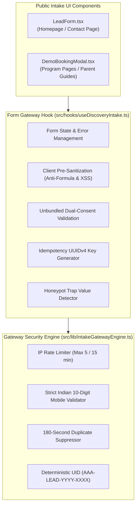

# AAA SPRINT 3 — WS-16 IMPLEMENTATION PLAN
## Public Form Gateway Wiring Implementation Plan

**Document Reference:** `AAA-S3-PLAN-WS16-01`  
**Phase:** Stage 4 — Sprint 3 Implementation (WS-16 Form Gateway Wiring)  
**Governing Baseline:** `AAA-S3-PLAN-MASTER-01`, `MGT-DET-S4-S2-CLOSURE-05`  
**Target Determination:** `MGT-DET-S4-S3-AUTH-01` (Proposed)  
**System Architect & Compliance Lead:** Nitin Patil (Operations & Tech Lead)  
**Academic Lead:** Neha Patil (Academic Director)  
**Active Feature Branch:** `feat/sprint2-admissions` (HEAD: `830b307`)  
**Proposed Sprint 3 Branch:** `feat/sprint3-integration`  
**Production Status:** 🔒 **STRICTLY LOCKED** (`main` untouched at `a21a3d1`)  
**Date:** 05 November 2026  
**Status:** 🟡 **SUBMITTED FOR MANAGEMENT IMPLEMENTATION AUTHORIZATION**

---

## 1. Executive Implementation Scope

The objective of **Workstream 16 (Public Form Gateway Wiring)** is to upgrade the public-facing parent intake forms ([`src/components/LeadForm.tsx`](file:///c:/0-ATHARV2NITIN_Projects/AAA_WEB/src/components/LeadForm.tsx) and [`src/components/DemoBookingModal.tsx`](file:///c:/0-ATHARV2NITIN_Projects/AAA_WEB/src/components/DemoBookingModal.tsx)) to communicate directly with the verified intake gateway security engine ([`src/lib/intakeGatewayEngine.ts`](file:///c:/0-ATHARV2NITIN_Projects/AAA_WEB/src/lib/intakeGatewayEngine.ts)).



---

## 2. Detailed Technical Specifications & Remediations

### 2.1 Unbundled Dual Consent UI Architecture
In accordance with Section 6 of the DPDP Act 2023, all form components must replace blanket checkboxes with explicit unbundled checkboxes:

1. **Checkbox 1 (Mandatory Service Communication):**
   ```html
   <label className="flex items-start gap-2.5 cursor-pointer">
     <input type="checkbox" required checked={serviceConsent} onChange={...} />
     <span className="text-xs text-slate-600">
       <strong>Required:</strong> I consent to receiving Discovery Session scheduling messages via WhatsApp / SMS from Arnav Abacus Academy.
     </span>
   </label>
   ```
   - Validation Rule: Form submission is blocked if unchecked.

2. **Checkbox 2 (Optional Educational & Marketing Insights):**
   ```html
   <label className="flex items-start gap-2.5 cursor-pointer">
     <input type="checkbox" checked={marketingConsent} onChange={...} />
     <span className="text-xs text-slate-600">
       <strong>Optional:</strong> I agree to receive occasional mathematical insights and academy announcements.
     </span>
   </label>
   ```
   - Validation Rule: Strictly unticked (`false`) by default. Independent of service fulfillment.

3. **Guardian Confirmation:**
   - Hidden or explicit affirmation confirming parent/guardian legal authority over the child participant.

### 2.2 Invisible Honeypot Bot Trap
Both `LeadForm.tsx` and `DemoBookingModal.tsx` will include an invisible input:
```html
<div style={{ display: 'none', opacity: 0, position: 'absolute', left: '-9999px' }} aria-hidden="true">
  <input
    type="text"
    name="website_url_hp"
    tabIndex={-1}
    autoComplete="off"
    value={honeypotField}
    onChange={(e) => setHoneypotField(e.target.value)}
  />
</div>
```
- If filled by automated bots, the submission is silently dropped with synthetic HTTP 200 via `processDiscoveryIntake`.

### 2.3 Client-Side Anti-Formula Injection & Phone Sanitization
- Phone numbers automatically stripped of spaces, dashes, and `+91` prefix to enforce the normalized 10-digit Indian standard.
- String inputs pre-sanitized before transmission to prevent CSV/Excel formula injection during administrative exports.

### 2.4 Error Handling & HTTP 429 Rate-Limit Countdown
- If rate-limited (HTTP 429), the form displays a friendly warning banner with a live countdown timer (`retryAfterSeconds`) and surfaces the direct 1-click WhatsApp fallback button.

---

## 3. Implementation Deliverables

1. **`src/hooks/useDiscoveryIntake.ts`:**
   - Reusable custom React hook encapsulating submission state, unbundled consent states, client sanitization, idempotency tokens, and gateway dispatch.
2. **`src/components/LeadForm.tsx`:**
   - Upgraded homepage and contact form wired to `useDiscoveryIntake`, embedding unbundled consent and honeypot trap.
3. **`src/components/DemoBookingModal.tsx`:**
   - Upgraded discovery modal wired to `useDiscoveryIntake`, embedding unbundled consent, honeypot trap, and pre-selected course tracking.
4. **`src/hooks/useDiscoveryIntake.test.ts`:**
   - Automated unit test suite verifying hook dispatch, client sanitization, consent validation, and rate-limit handling.

---

## 4. Acceptance Criteria & Hard Gate Alignment

| Acceptance Check | Requirement | Hard Gate Link |
| :--- | :--- | :---: |
| **AC-WS16-01** | Form blocks submission when mandatory service consent is false. | `S4-HG-01`, `S4-HG-04` |
| **AC-WS16-02** | Marketing consent defaults to unchecked (`false`). | `S4-HG-01`, `S4-HG-04` |
| **AC-WS16-03** | Invisible honeypot trap quietly drops bot submissions. | `S4-HG-05` |
| **AC-WS16-04** | Formula characters (`=`, `+`, `-`, `@`) escaped safely. | `S4-HG-05` |
| **AC-WS16-05** | HTTP 429 rate limit surfaces user-friendly message and WhatsApp fallback. | `S4-HG-05` |
| **AC-WS16-06** | Successful submission receives deterministic UID (`AAA-LEAD-YYYY-XXXX`). | `S4-HG-04`, `S4-HG-06` |
