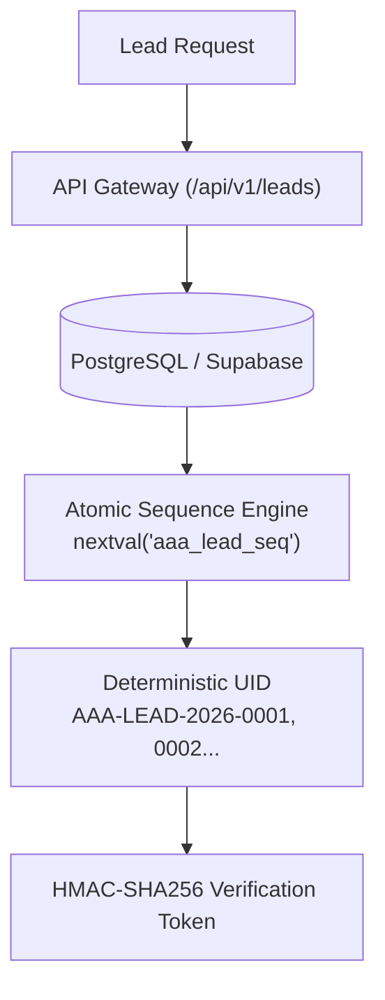

# AAA SPRINT 3 — WS-16 LEAD UID AND IDEMPOTENCY AUDIT
## Identifier Collision Risk, Idempotency Architecture & Central Uniqueness Audit

**Document Reference:** `AAA-S3-AUD-WS16-UID-01`  
**Phase:** Stage 4 — Sprint 3 Technical Audit  
**Audit Scope:** `generateLeadUID()` & `GatewayIdempotencyStore` Analysis  
**System Architect & Compliance Lead:** Nitin Patil (Operations & Tech Lead)  
**Academic Lead:** Neha Patil (Academic Director)  
**Current Branch:** `feat/sprint3-integration` (HEAD: `89c4323`)  
**Production Status:** 🔒 **STRICTLY LOCKED** (`main` at `a21a3d1129cc17fc6650bfd04648eb91199e6fa8`)  
**Date:** 05 November 2026  
**Audit Finding:** 🔴 **DEFECT CONFIRMED: LEAD UID CLASSIFIED AS PROVISIONAL / COLLISION RISK**

---

## 1. Executive Summary & Classification

> [!CAUTION]
> **Defect Classification: PROVISIONAL UID GENERATION (HIGH COLLISION RISK)**
> The current Lead UID generator (`generateLeadUID()` in `src/lib/intakeGatewayEngine.ts`) uses pseudo-random numbers in browser memory without a central database sequence or uniqueness constraint. 
> 
> Under the Birthday Paradox, **different parents can receive the exact same UID**. The current Lead UID implementation is formally classified as **PROVISIONAL** and must not be used for production admissions without an atomic central database counter.

---

## 2. Mathematical Collision Probability Analysis

The current Lead UID format is defined as:
```typescript
export function generateLeadUID(currentTimeMs: number = Date.now()): string {
  const year = new Date(currentTimeMs).getFullYear();
  const randomSuffix = Math.floor(1000 + Math.random() * 9000);
  return `AAA-LEAD-${year}-${randomSuffix}`;
}
```

### Probability Formulation:
- Total possible suffixes per calendar year: $N = 9,000$ (integers from $1000$ to $9999$).
- Collision probability $P(k)$ after $k$ leads generated:
  $$P(k) \approx 1 - e^{-\frac{k^2}{2N}}$$

### Collision Threshold Table:

| Cumulative Leads ($k$) | Probability of at Least One Collision ($P(k)$) | Architectural Risk Level |
| :---: | :---: | :---: |
| **10 Leads** | **0.55%** | Low |
| **50 Leads** | **12.98%** | Moderate |
| **112 Leads** | **50.14%** | 🔴 **HIGH (>50% Chance of Duplicate UID!)** |
| **200 Leads** | **89.12%** | 🔴 **CRITICAL (Collision Virtually Certain)** |

**Mathematical Conclusion:** In a single admissions season collecting ~150 to 200 discovery requests in Wakad, there is an **89% probability that two different parents will be issued the exact same reference number**.

---

## 3. Idempotency Key & Retry Behavior Audit

The idempotency engine is implemented via `GatewayIdempotencyStore`:
```typescript
export class GatewayIdempotencyStore {
  private cache: Map<string, IdempotencyEntry> = new Map();
  private readonly ttlMs: number = 60 * 60 * 1000; // 60 minutes
```

### Audit Findings:
1. **Client-Side Storage Only:** The cache resides in the local browser process memory (or Node test runner). If the parent refreshes the page or uses another tab, the cache is completely empty.
2. **Retry Safety:** Within the same browser tab, re-submitting with the same `idempotencyKey` cleanly returns the cached `leadUID` without creating duplicate records (Verified in `TC-INTAKE-08`).
3. **Failed Submissions:** If a submission fails validation (e.g. invalid phone number), no idempotency entry is stored, allowing immediate correction and retry without stale token conflicts.
4. **Duplicate Submission Window (180s):** The 180-second throttle by `normalizedPhone + course` prevents rapid-fire duplicate alerts to Neha Patil's phone, which functions well as an in-memory anti-spam measure for a single device.

---

## 4. Mandatory Corrective Architecture for Production

To eliminate the collision vulnerability before production deployment:



1. **Replace Random Suffix with Monotonic Database Sequence:** Format: `AAA-LEAD-YYYY-[0001..99999]` backed by PostgreSQL `SERIAL` or atomic counter.
2. **Distributed Redis Idempotency:** Transition idempotency token storage from client RAM to a central Redis store with 60-minute TTL.
3. **Unique Constraint:** Enforce `UNIQUE(lead_uid)` in the persistence schema to physically block duplicate reference generation.
