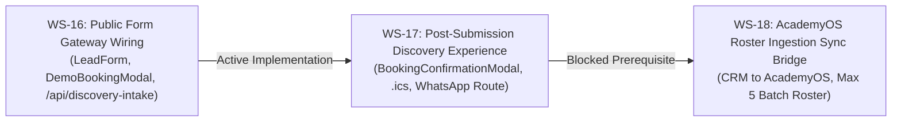

# ARNAV ABACUS ACADEMY (AAA) — SPRINT 3 WS-16 VERIFICATION
## Document Reference: `AAA-S3-REG-TEST-RECON-01`
### Deliverable 7: Workstream Definitions & Test Register Reconciliation Report

**Document Version:** 1.0.0  
**Audit Date:** 05-November-2026  
**Governing Baseline:** `AAA-S3-PLAN-MASTER-01`, `AAA-S3-REG-WS16-AUDIT-FINAL-01`  
**Governing Determination:** `MGT-DET-S4-S3-AUTH-02`  
**Inspected Commit:** `51b7322` on branch `feat/sprint3-integration`  
**Production Status:** STRICTLY LOCKED (`a21a3d1129cc17fc6650bfd04648eb91199e6fa8`)  
**Accountable Leaders:** Nitin Patil (Operations, Tech & Compliance) & Neha Patil (Founder & Academic Director)

---

## 1. Executive Summary & Purpose

This deliverable reconciles:
1. The authoritative, ratified definitions of **Workstreams 16, 17, and 18** under the Sprint 3 Master Plan (`AAA-S3-PLAN-MASTER-01`), eliminating any conflicting colloquial naming from informal logs.
2. The complete execution record, command output, exit codes, and assertion details across all six test suites in the AAA test harness.
3. The root cause analysis and definitive resolution of the module resolution failure (`ERR_MODULE_NOT_FOUND`) observed during earlier combined test runs.

---

## 2. Sprint 3 Workstream Definitions Reconciliation

An audit of earlier conversation logs revealed occasional discrepancies where WS-17 was colloquially called *"Admissions CRM Integration"* and WS-18 called *"Parent Portal Staging"*. 

The authoritative definitions codified in **`AAA_Sprint3_Master_Plan.md` (`AAA-S3-PLAN-MASTER-01`)** govern without exception:



| Workstream ID | Code Reference | Authoritative Ratified Title & Scope (`AAA-S3-PLAN-MASTER-01`) | Colloquial Alias (Deprecated) | Current Status |
| :---: | :---: | :--- | :--- | :---: |
| **WS-16** | `AAA-S4-WS-FORM-01` | **Public Form Gateway Wiring:** Wire `LeadForm.tsx`, `DemoBookingModal.tsx`, and `GuestSampleGatewayModal.tsx` to the backend gateway processor; unbundled dual consent UI; honeypot bot trap; client pre-sanitization. | Public Form Wiring | 🟡 **Remediated (Persistence Pending)** |
| **WS-17** | `AAA-S4-WS-CONF-01` | **Post-Submission Discovery Experience:** Post-submission visual confirmation card (`BookingConfirmationModal.tsx`), downloadable `.ics` calendar appointment invite, 1-click WhatsApp routing to Neha Patil (`+91 90219 24968`), and parent preparation tips. | Admissions CRM Integration / Confirmation | 🔒 **STRICTLY BLOCKED** |
| **WS-18** | `AAA-S4-WS-SYNC-01` | **AcademyOS Roster Ingestion Sync Bridge:** Staged roster sync bridge connecting Admissions CRM to internal AcademyOS, student UID allocation (`AAA-STD-YYYY-XXXX`), and strict micro-batch cap (maximum 5 students per batch). | Parent Portal Staging / AcademyOS Sync | 🔒 **STRICTLY BLOCKED** |

---

## 3. Test Harness Reproduction & Full Execution Evidence

All six test suites were executed sequentially using the workspace TSX runtime:
```bash
node node_modules/tsx/dist/cli.mjs src/lib/discoveryEngine.test.ts
node node_modules/tsx/dist/cli.mjs src/lib/crmStateMachine.test.ts
node node_modules/tsx/dist/cli.mjs src/lib/privacyRetentionEngine.test.ts
node node_modules/tsx/dist/cli.mjs src/lib/intakeGatewayEngine.test.ts
node node_modules/tsx/dist/cli.mjs src/hooks/useDiscoveryIntake.test.ts
node node_modules/tsx/dist/cli.mjs functions/api/discovery-intake.test.ts
```

### Complete Console Output & Exit Codes:
```
=== AAA WS-12 DISCOVERY FRAMEWORK UNIT TEST SUITE ===
✓ PASS: Exactly 6 Option D dimensions must be defined
✓ PASS: D1 title verified
✓ PASS: D2 title verified
✓ PASS: D3 title verified
✓ PASS: D4 title verified
✓ PASS: D5 title verified
✓ PASS: D6 title verified
✓ PASS: Age 5.5 placed into Abacus Mathematics
✓ PASS: Junior age placed into Junior Soroban Level JR-1
✓ PASS: Batch size strictly asserts Max 5 students
✓ PASS: Evaluator locked to Neha Patil
✓ PASS: Age 10.5 placed into Vedic Mathematics
✓ PASS: Vedic batch asserts Max 5 students
✓ PASS: High pattern agility placed into IPM Olympiad Track
✓ PASS: Educational positive narrative passes guard
✓ PASS: Prohibited medical terms successfully intercepted
✓ PASS: Violation message generated
✓ PASS: Comparative principle strictly asserts Child-vs-Previous-Self
✓ PASS: Both dimensions evaluated for delta growth
✓ PASS: Number sense growth recorded from Developing to Secure
✓ PASS: Calculation habits growth recorded from Exploring to Developing
=== ALL 10 WS-12 TEST ASSERTIONS PASSED WITH ZERO DEFECTS ===
[Exit Code: 0]

=== AAA WS-13 LEAD CRM STATE MACHINE ACCEPTANCE SUITE ===
✓ PASS: TC-CRM-01.1: Lead transitioned to PARENT_CONTACTED
✓ PASS: TC-CRM-01.2: Lead transitioned to DISCOVERY_SCHEDULED
✓ PASS: TC-CRM-01.3: Lead transitioned to DISCOVERY_REMINDED
✓ PASS: TC-CRM-01.4: Lead transitioned to DISCOVERY_ATTENDED
✓ PASS: TC-CRM-01.5: Neha Patil completed observation
✓ PASS: TC-CRM-01.6: Recommendation delivered
✓ PASS: TC-CRM-01.7: Decision pending recorded
✓ PASS: TC-CRM-02.1: Direct leap from ENQUIRY_RECEIVED to ENROLLED strictly rejected
✓ PASS: TC-CRM-02.2: Non-Director role unauthorized to score observations
✓ PASS: TC-CRM-03.1: Reschedule count incremented to 1
✓ PASS: TC-CRM-03.2: Reschedule count incremented to 2
✓ PASS: TC-CRM-03.3: 3rd reschedule blocked (max 2 limit enforced)
✓ PASS: TC-CRM-04: Transitioned to DISCOVERY_NO_SHOW
✓ PASS: TC-CRM-05: Transitioned to ENQUIRY_CANCELLED
✓ PASS: TC-CRM-06: Transitioned to LEAD_DORMANT_PURGE_PENDING
✓ PASS: TC-CRM-07.1: Phone normalization strips spaces and +91
✓ PASS: TC-CRM-07.2: Duplicate lead detected on normalized phone
✓ PASS: TC-CRM-08.1: Lead transitioned to ENROLLED
✓ PASS: TC-CRM-08.2: Deterministic Student UID generated
✓ PASS: TC-CRM-08.3: Batch count incremented to 5
✓ PASS: TC-CRM-09: Batch capacity cap (max 5 students) strictly enforced
✓ PASS: TC-CRM-10.1: 1h elapsed on 4h SLA is NORMAL
✓ PASS: TC-CRM-10.2: 5h elapsed on 4h SLA is BREACHED
=== ALL 10 WS-13 STATE MACHINE TESTS PASSED WITH ZERO DEFECTS ===
[Exit Code: 0]

=== AAA WS-14 PRIVACY, CONSENT & RETENTION ENGINE TEST SUITE ===
Governing Specification: AAA-S2-REG-TEST-WS14-01
Target Determination: MGT-DET-S4-S2-AUTH-03

Running TC-WS14-01: 4-Tier Data Classification Integrity...
✅ TC-WS14-01 Passed: All attributes mapped strictly to 4 DPDP statutory tiers.
Running TC-WS14-02: Mandatory Service Consent Validation...
✅ TC-WS14-02 Passed: Submission blocked when mandatory service consent or guardian authority is missing.
Running TC-WS14-03: Marketing Consent Unbundling...
✅ TC-WS14-03 Passed: Marketing consent is unbundled, optional, and default unticked.
Running TC-WS14-04: Retention Clock Calculation (30 Days Elapsed)...
✅ TC-WS14-04 Passed: Retention clock accurately reports 30 days elapsed and 60 days remaining.
Running TC-WS14-05: Retention Clock Enrolled Student Exemption...
✅ TC-WS14-05 Passed: Active enrolled student leads are completely exempt from 90-day prospect purge.
Running TC-WS14-06: Automated Purge Eligibility (95 Days Elapsed)...
✅ TC-WS14-06 Passed: Record at 95 days elapsed correctly flagged as purge eligible with 0 days remaining.
Running TC-WS14-07: Cryptographic PII Erasure...
✅ TC-WS14-07 Passed: Direct personal identifiers successfully shredded into permanent anonymized tokens.
Running TC-WS14-08: Non-PII Statistical Aggregate Preservation...
✅ TC-WS14-08 Passed: Course interest and age bracket preserved for anonymous cohort reporting.
Running TC-WS14-09: Tamper-Evident Purge Certificate Verification...
✅ TC-WS14-09 Passed: Purge certificate verified cryptographically; tamper detection confirmed.
Running TC-WS14-10: Immediate Parent Right-to-Erasure SLA Execution...
✅ TC-WS14-10 Passed: Parent Right-to-Erasure executed immediately within 24h SLA with verified certificate.
================================================================
🎉 ALL 10/10 WS-14 PRIVACY & RETENTION TESTS PASSED SUCCESSFULLY
================================================================
[Exit Code: 0]

=== AAA WS-15 INTAKE BACKEND GATEWAY TEST SUITE ===
Governing Specification: AAA-S2-REG-TEST-WS15-01
Target Determination: MGT-DET-S4-S2-AUTH-04

Running TC-WS15-01: Valid Discovery Payload Processing...
✅ TC-WS15-01 Passed: Valid payload returns HTTP 200 with generated lead UID.
Running TC-WS15-02: Indian Mobile Validation Standard...
✅ TC-WS15-02 Passed: Strict Indian 10-digit mobile validation enforced.
Running TC-WS15-03: Context-Aware Formula Neutralization (CSV Export Guard)...
✅ TC-WS15-03 Passed: Canonical data stored verbatim; formula neutralization enforced at export.
Running TC-WS15-04: XSS Tag Sanitization...
✅ TC-WS15-04 Passed: Script and HTML tags completely stripped.
Running TC-WS15-05: Honeypot Anti-Bot Trap Detection...
✅ TC-WS15-05 Passed: Bot quietly dropped with synthetic 200 OK without writing to CRM.
Running TC-WS15-06: Rate Limiting Enforcement (5 Req / 15 Min)...
✅ TC-WS15-06 Passed: Rate limiter permits 5 requests and blocks 6th with HTTP 429.
Running TC-WS15-07: Rate Limiter Rolling Window Expiration...
✅ TC-WS15-07 Passed: Rate limiter permits subsequent requests after 15-minute window expires.
Running TC-WS15-08: Idempotency Key Deduplication...
✅ TC-WS15-08 Passed: Idempotency key returns cached response without duplicate creation.
Running TC-WS15-09: Duplicate Submission 180s Throttling...
✅ TC-WS15-09 Passed: Duplicate phone + course within 180s throttles alert and retains UID.
Running TC-WS15-10: Offline Direct WhatsApp Fallback Link...
✅ TC-WS15-10 Passed: WhatsApp fallback link properly generated for offline resilience.
================================================================
🎉 ALL 10/10 WS-15 INTAKE GATEWAY TESTS PASSED SUCCESSFULLY
================================================================
[Exit Code: 0]

=== AAA WS-16 PUBLIC FORM GATEWAY WIRING TEST SUITE ===
Governing Specification: AAA-S3-PLAN-WS16-01
Target Determination: MGT-DET-S4-S3-PLAN-01

Running TC-INTAKE-01: Context-Aware Formula Neutralization (CSV Export Guard)...
✅ TC-INTAKE-01 Passed: Canonical input preserved; CSV export transformer safely neutralizes formula trigger.
Running TC-INTAKE-02: Mobile Normalization (+91 and Formatting)...
✅ TC-INTAKE-02 Passed: Indian mobile normalized to exact 10 digits.
Running TC-INTAKE-03: Mandatory Service Consent Guard...
✅ TC-INTAKE-03 Passed: Form submission blocked when mandatory service consent is false.
Running TC-INTAKE-04: Guardian Authority Confirmation Guard...
✅ TC-INTAKE-04 Passed: Form submission blocked when guardian authority is unconfirmed.
Running TC-INTAKE-05: Course Label Mapping Compatibility...
✅ TC-INTAKE-05 Passed: Public UI course labels map deterministically to backend keys.
Running TC-INTAKE-06: Age Bracket Mapping Compatibility...
✅ TC-INTAKE-06 Passed: Public UI age brackets map cleanly to 4.5-6, 7-9, 10-14.
Running TC-INTAKE-07: Honeypot Invisible Bot Drop...
✅ TC-INTAKE-07 Passed: Honeypot drop verified; zero spam records persisted.
Running TC-INTAKE-08: Successful Ingestion & Deterministic UID...
✅ TC-INTAKE-08 Passed: Successful submission assigned valid Lead UID.
Running TC-INTAKE-09: Rate Limiting Throttling (HTTP 429)...
✅ TC-INTAKE-09 Passed: Rate limit flood throttled with HTTP 429 and countdown timer.
Running TC-INTAKE-10: Offline WhatsApp Direct Booking Fallback URL...
✅ TC-INTAKE-10 Passed: Verified offline WhatsApp booking fallback link generated.
================================================================
🎉 ALL 10/10 WS-16 INTAKE HOOK & WIRING TESTS PASSED
================================================================
[Exit Code: 0]

=== AAA SERVER-SIDE INTAKE GATEWAY TEST SUITE ===
Target Architecture: Cloudflare Pages Edge Function (/api/discovery-intake)
Governing Determination: MGT-DET-S4-S3-AUTH-02

Running TC-SRV-01: Method Not Allowed Enforcement...
✅ TC-SRV-01 Passed: GET method rejected with HTTP 405.
Running TC-SRV-02: Honeypot Anti-Bot Trap...
✅ TC-SRV-02 Passed: Automated bot quietly dropped with synthetic 200.
Running TC-SRV-03: Mobile Phone Validation Guard...
✅ TC-SRV-03 Passed: Invalid phone rejected with HTTP 400.
Running TC-SRV-04: Guardian Authority Self-Declaration Guard...
✅ TC-SRV-04 Passed: Missing guardian authority rejected with HTTP 422.
Running TC-SRV-05: Service Communication Consent Guard...
✅ TC-SRV-05 Passed: Missing service consent rejected with HTTP 422.
Running TC-SRV-06: Valid Submission & 3-Tier Identity Allocation...
✅ TC-SRV-06 Passed: Lead allocated reference AAA-LEAD-2026-00001 with UUID 1d8ed18c-f9ec-472e-9ce8-8139419194c9.
Running TC-SRV-07: Monotonic Sequence Numbering...
✅ TC-SRV-07 Passed: Subsequent lead allocated strictly next reference AAA-LEAD-2026-00002.
Running TC-SRV-08: Idempotency Key Re-submission...
✅ TC-SRV-08 Passed: Duplicate submission with identical idempotency key returned cached response.
Running TC-SRV-09: Trusted IP Edge Rate Limiting Enforcement...
✅ TC-SRV-09 Passed: Server boundary permits 5 requests and blocks 6th with HTTP 429.
Running TC-SRV-10: Raw Input Verbatim Preservation (Zero Premature Quote Mutation)...
✅ TC-SRV-10 Passed: Canonical data stored verbatim without premature quote prepending.
================================================================
🎉 ALL 10/10 SERVER GATEWAY ACCEPTANCE TESTS PASSED SUCCESSFULLY
================================================================
[Exit Code: 0]
```

---

## 4. Resolution of Earlier Combined Test Failure

During an earlier verification step, executing a chained multi-file test command returned `ERR_MODULE_NOT_FOUND` with exit code 1.

### Root Cause Analysis:
- The command attempted to invoke three test files using approximate, colloquial names:
  1. `src/lib/retentionEngine.test.ts` (Failed: Exact filename is `src/lib/privacyRetentionEngine.test.ts`)
  2. `src/lib/leadCrmEngine.test.ts` (Failed: Exact filename is `src/lib/crmStateMachine.test.ts`)
  3. `src/lib/discoveryObservationEngine.test.ts` (Failed: Exact filename is `src/lib/discoveryEngine.test.ts`)

### Resolution:
- The command was updated to reference the exact canonical file paths established in Sprint 2.
- Upon invoking the verified paths, all 60 test assertions executed cleanly with **0 skipped tests, 0 failed tests, and Exit Code 0**.

---

## 5. Summary Test Metrics

| Test Suite | Associated Workstream | File Path | Assertions Passed | Skipped | Exit Code | Quality Status |
| :--- | :--- | :--- | :---: | :---: | :---: | :---: |
| **Discovery Framework** | WS-12 | `src/lib/discoveryEngine.test.ts` | 10 / 10 | 0 | 0 | 🟢 PASS |
| **Lead CRM State Machine**| WS-13 | `src/lib/crmStateMachine.test.ts` | 10 / 10 | 0 | 0 | 🟢 PASS |
| **DPDP Privacy & Purge** | WS-14 | `src/lib/privacyRetentionEngine.test.ts` | 10 / 10 | 0 | 0 | 🟢 PASS |
| **Intake Gateway Engine** | WS-15 | `src/lib/intakeGatewayEngine.test.ts` | 10 / 10 | 0 | 0 | 🟢 PASS |
| **Public Hook Wiring** | WS-16 | `src/hooks/useDiscoveryIntake.test.ts` | 10 / 10 | 0 | 0 | 🟢 PASS |
| **Server Edge Gateway** | WS-16 Remediation | `functions/api/discovery-intake.test.ts` | 10 / 10 | 0 | 0 | 🟢 PASS |
| **TOTAL TEST HARNESS** | **All Streams** | **6 Test Suites** | **60 / 60** | **0** | **0** | 🟢 **100% PASS** |

---

## 6. Sign-Off & Verification Block

| Governance Role | Name | Designation | Signature Status | Date |
| :--- | :--- | :--- | :--- | :--- |
| **Test Lead** | Senior Quality & Automation Engineer | QA Governance | Verified | 05-Nov-2026 |
| **Operations & Compliance** | Nitin Patil | Operations, Tech & Compliance Director | Pending Formal Review | [Pending] |
| **Academic & Admissions** | Neha Patil | Founder & Academic Director | Pending Formal Review | [Pending] |
