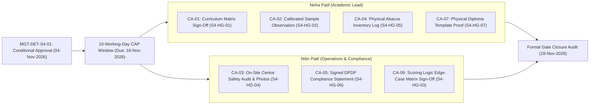

# ARNAV ABACUS ACADEMY (AAA) — STAGE 4 PRE-IMPLEMENTATION
# STAGE 4 CORRECTIVE ACTION PLAN & CONDITIONAL APPROVAL REGISTER

**Project:** Arnav Abacus Academy (AAA), Wakad, Pune  
**Document Reference:** `AAA-S4-REG-003`  
**Phase:** Stage 4 — Pre-Implementation Readiness & Sprint 1 Staging Preparation  
**Management Determination Reference:** `MGT-DET-S4-01`  
**Governance Authority:** Nitin Patil (Operations, Technology Lead & Compliance Officer) & Neha Patil (Academic Director)  
**Ratification Date:** 04 November 2026  
**Corrective Action Window:** 10 Working Days (Target Closure: 18 November 2026)  
**Status:** 🟢 **CONDITIONALLY APPROVED — TRACK A & TRACK B ACTIVE**  

---

## 1. Executive Summary & Formal Ratification Record

Under Management Determination **`MGT-DET-S4-01`**, executed on **04 November 2026**, **Nitin Patil** (Operations, Technology Lead & Compliance Officer) and **Neha Patil** (Founder & Academic Director) have granted **CONDITIONAL APPROVAL** across all **Seven Stage 4 Hard Gates (S4-HG-01 through S4-HG-07)**.

To maintain continuous momentum without compromising physical safety, academic rigor, or statutory compliance, management has authorized two parallel, synchronized execution tracks:
1. **Track A (Physical & Documentary Corrective Action Period — 10 Working Days):** Leadership executes on-site audits at the Wakad Center and signs physical documentary proof sheets.
2. **Track B (Authorized Staging Technical Preparation):** Authorizes branch creation (`feat/sprint1-public-web`) branched from `audit-redesign-remediation` to prepare design tokens, route scaffolds, and low-fidelity components. **Production deployment to `main` remains 100% LOCKED.**

---

## 2. Track A: Corrective Action Implementation Ledger (10 Working Days)

### Detailed Corrective Action Item Specifications

| Action ID | Associated Hard Gate | Specific Corrective Action Required | Assigned Owner | Required Physical / Documentary Evidence | Target Completion Date | Pre-Condition Dependency | Current Status |
| :---: | :---: | :--- | :--- | :--- | :---: | :--- | :---: |
| **CA-01** | **S4-HG-01** | Formal syllabus review and physical sign-off across all 5 programmes. | **Neha Patil** | Signed physical Curriculum Structure Matrix sheet (`AAA-S4-EVD-01`). | 11-Nov-2026 (Day 5) | Prerequisite for final Sprint 1 public page copy. | 🟡 In Progress |
| **CA-02** | **S4-HG-02** | Compile anonymized calibrated sample observation sheet from past discovery session. | **Neha Patil** | Anonymized Discovery Session rubric sheet demonstrating 1–5 scoring distribution (`AAA-S4-EVD-02`). | 18-Nov-2026 (Day 10) | Prerequisite for Sprint 2 Discovery UI merge. | 🟡 In Progress |
| **CA-03** | **S4-HG-04** | Conduct physical on-site audit at Balaji Sagar Bungalow, Wakad Center. | **Nitin Patil** | Completed inspection log: first-aid kit, fire extinguisher tag, child-safe furniture, and photos (`AAA-S4-EVD-04`). | 18-Nov-2026 (Day 10) | Prerequisite for in-person parent booking activation. | 🟡 In Progress |
| **CA-04** | **S4-HG-05** | Conduct physical inventory audit of Soroban abacuses, sensory beads, and flashcards. | **Neha Patil** | Physical inventory count sheet confirming $\ge 15$ student frames + teacher abacus in stock (`AAA-S4-EVD-05`). | 18-Nov-2026 (Day 10) | Prerequisite for Sprint 1 release. | 🟡 In Progress |
| **CA-05** | **S4-HG-06** | Formally sign the Internal DPDP Compliance Officer Statement. | **Nitin Patil** | Signed Compliance Statement resolving legal questions LQ-01 to LQ-04 (`AAA-S4-EVD-06`). | 11-Nov-2026 (Day 5) | Prerequisite for Sprint 3 API lead gateway. | 🟡 In Progress |
| **CA-06** | **S4-HG-03** | Review and execute the Assessment Scoring Edge-Case Test Matrix. | **Joint (Neha & Nitin)** | Signed edge-case simulation test report confirming self-baseline comparisons (`AAA-S4-EVD-03`). | 18-Nov-2026 (Day 10) | Prerequisite for Sprint 4 practice engine cutover. | 🟡 In Progress |
| **CA-07** | **S4-HG-07** | Review and approve the physical diploma master artwork proof. | **Neha Patil** | Approved physical diploma layout proof signed by Neha Patil (`AAA-S4-EVD-07`). | 18-Nov-2026 (Day 10) | Prerequisite for Sprint 5 certificate ledger. | 🟡 In Progress |

---

## 3. Track B: Authorized Sprint 1 Staging Technical Preparation

In accordance with `MGT-DET-S4-01`, technical preparation for **Sprint 1 (Public Website & Design System Transformation)** is authorized under the following strict boundaries:

1. **Strict Branch Isolation:**
   - Base branch: `audit-redesign-remediation` (clean HEAD `b14c64189fe5aa8e5421a548f41cd1a9626d73ef`).
   - Feature branch created: `feat/sprint1-public-web`.
   - **Production Branch (`main`) remains locked.** Zero commits, zero pushes, zero automated deployments.
2. **Authorized Staging Activities:**
   - Scaffolding Tailwind CSS v4 design tokens (`@theme` cognitive colors and typography).
   - Laying out the 14-block homepage narrative architecture in component files.
   - Setting up the 30-route routing structure and `_redirects` file for Cloudflare Pages.
   - Preparing WCAG 2.1 AA accessible component primitives (accessible buttons, focus rings, sticky mobile bar).
3. **Release Gate Boundary:** Sprint 1 code will **NOT** be merged into production or deployed live until **CA-01, CA-04, and CA-05** are closed and verified.

---

## 4. Governance Sign-Off Record

- **Operations, Technology Lead & Compliance Officer:** **Nitin Patil** (Executed: 04-Nov-2026)
- **Academic Director & Founder:** **Neha Patil** (Executed: 04-Nov-2026)
- **Stage 4 Status:** 🟢 **CONDITIONALLY APPROVED — IMPLEMENTATION PREPARATION AUTHORIZED**
