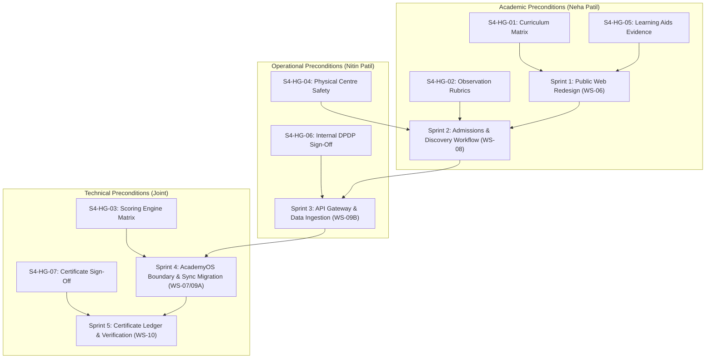

# ARNAV ABACUS ACADEMY (AAA) — STAGE 4 PRE-IMPLEMENTATION
# STAGE 4 DEPENDENCIES & RISK REGISTER

**Project:** Arnav Abacus Academy (AAA), Wakad, Pune  
**Document Reference:** `AAA-S4-REG-002`  
**Phase:** Stage 4 — Pre-Implementation Readiness  
**Governance Authority:** Nitin Patil (Operations, Technology Lead & Compliance Officer) & Neha Patil (Academic Director)  
**Date:** 04 November 2026  
**Status:** 🟡 **ACTIVE RISK REGISTER — HARD GATES OPEN**  

---

## 1. Executive Summary

This register identifies, classifies, and tracks all technical, operational, pedagogical, and statutory risks associated with transitioning from the approved Stage 3 Master Architecture into **Stage 4 Implementation**.

It establishes the binding dependency chain between the **Seven Stage 4 Hard Gates** and future code sprints, ensuring that no technical work begins without verified operational preconditions.

---

## 2. Master Pre-Implementation Dependency Chain

---

## 3. Pre-Implementation Risk Matrix

| Risk ID | Risk Category | Risk Description | Severity | Likelihood | Impact on Stage 4 | Mitigation Strategy | Owner | Resolution Target | Residual Risk |
| :---: | :--- | :--- | :---: | :---: | :--- | :--- | :---: | :---: | :---: |
| **RSK-S4-01** | Operational | Premature code changes in `src/` before Hard Gates are formally closed. | **CRITICAL** | Low | Violation of `AGENTS.md` Rule 7; potential regression of live student practice engine. | Enforce strict Git branch discipline; maintain implementation freeze until signed determination. | Nitin Patil | Hard Gate Audit | 🟢 Low |
| **RSK-S4-02** | Pedagogical | Curriculum progression discrepancies between public web pages and authentic classroom teaching. | **HIGH** | Medium | Parent confusion; misaligned learning expectations upon enrollment. | S4-HG-01: Neha Patil directly reviews and signs off all curriculum milestone tables before frontend coding. | Neha Patil | S4-HG-01 Sign-Off | 🟢 Low |
| **RSK-S4-03** | Safety & Audit | Absence of physical documentation for fire extinguisher service or first-aid kit during centre visits. | **HIGH** | Medium | Compliance violation under local Maharashtra municipal / shops & establishment safety standards. | S4-HG-04: Nitin Patil conducts on-site center audit and compiles photo-documented physical safety dossier. | Nitin Patil | S4-HG-04 Sign-Off | 🟢 Low |
| **RSK-S4-04** | Inventory | Shortage of student Soroban abacuses or flashcard sets during new batch launch. | **MEDIUM** | Low | Delayed start for newly admitted student cohorts. | S4-HG-05: Neha Patil audits physical inventory count (minimum 15 student frames verified in stock). | Neha Patil | S4-HG-05 Sign-Off | 🟢 Low |
| **RSK-S4-05** | Legal & Privacy | Ambiguity regarding minor child consent mechanisms under Indian DPDP Act. | **HIGH** | Low | Regulatory liability or parental privacy complaints. | S4-HG-06: Nitin Patil executes formal internal Compliance Officer Statement recording legal rationale on LQ-01 to LQ-04. | Nitin Patil | S4-HG-06 Sign-Off | 🟢 Low |
| **RSK-S4-06** | Data Integrity | Disruption to live student practice sync if JSONBlob cutover is executed prematurely. | **CRITICAL** | Medium | Existing students lose leaderboard scores and daily practice history. | 11-step migration workflow (`WS-11.6`) strictly sequenced into Sprint 4; 14-day dual-write monitoring enforced. | Nitin Patil | Sprint 4 Gate | 🟢 Low |
| **RSK-S4-07** | Brand & Reputation | Software-generated practice PDF certificates mistaken for accredited academic diplomas. | **MEDIUM** | Medium | Academy reputation compromised; potential false accreditation perception. | S4-HG-07: Software PDFs explicitly titled "Practice Achievement Record"; physical diplomas signed exclusively by Neha Patil. | Neha Patil | S4-HG-07 Sign-Off | 🟢 Low |
| **RSK-S4-08** | Financial | Unexpected cloud infrastructure bills exceeding the approved zero-outlay bootstrap model. | **LOW** | Low | Unbudgeted cash outlay for early-stage academy. | D-11-07 Bootstrap Model: Enforces Supabase Free Tier + Cloudflare Free Tier; monthly cost capped at $\approx ₹100$ (domain only). | Nitin Patil | Continuous | 🟢 Low |

---

## 4. Stage-Gate Acceptance & Verification

This register forms **Deliverable AAA-S4-REG-002** under Stage 4 Pre-Implementation. Gate status: **HARD GATES OPEN — IMPLEMENTATION FREEZE ACTIVE**.
