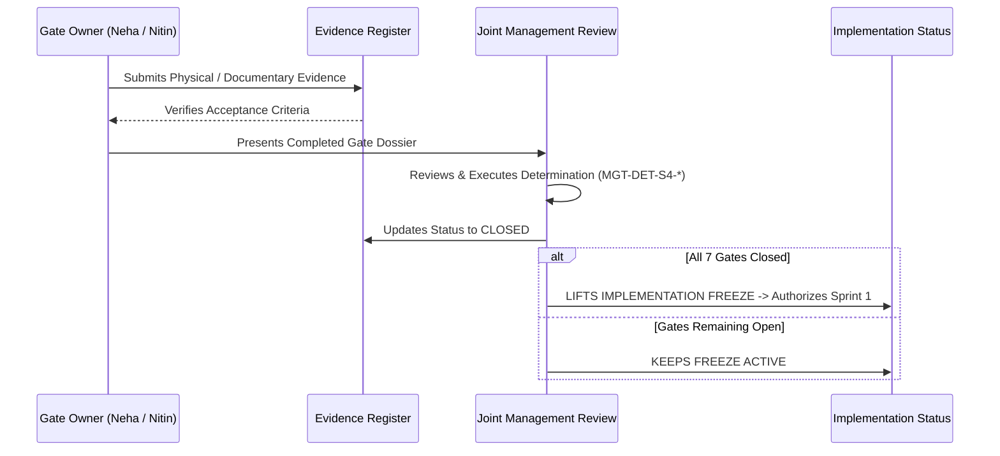

# ARNAV ABACUS ACADEMY (AAA) — STAGE 4 PRE-IMPLEMENTATION
# STAGE 4 GATE ACCEPTANCE CRITERIA

**Project:** Arnav Abacus Academy (AAA), Wakad, Pune  
**Document Reference:** `AAA-S4-DOC-002`  
**Phase:** Stage 4 — Pre-Implementation Readiness  
**Governance Authority:** Nitin Patil (Operations, Technology Lead & Compliance Officer) & Neha Patil (Academic Director)  
**Date:** 04 November 2026  
**Status:** 🟡 **DRAFT CRITERIA — HARD GATES OPEN**  

---

## 1. Scope & Gate Closure Mandate

In strict accordance with the Stage 2 Master BRD and Stage 3 Governance Charter, **no hard gate may be closed automatically**. 

Closing any of the Seven Stage 4 Hard Gates requires satisfying five mandatory closure criteria:
1. **Evidence Completeness:** 100% of required documentary, physical, or technical evidence items are cataloged in `AAA_Stage4_Hard_Gate_Evidence_Register.md` with status 🟢 **Available and Verified**.
2. **Designated Owner Review:** The assigned owner has thoroughly inspected the evidence and confirms operational authenticity.
3. **Formal Management Determination:** Execution of a signed management determination instrument (e.g., `MGT-DET-S4-01`).
4. **Resolution of Open Issues:** Zero critical or high-severity blockers remaining open against that gate.
5. **Traceability Logging:** The verification date, signatory, and evidence references are recorded in the central governance register.

---

## 2. Individual Acceptance Criteria for the Seven Hard Gates

### 2.1 S4-HG-01: Curriculum Structure Matrix Validation
- **Objective:** Establish the validated academic baseline across all 5 programmes (Abacus, Vedic, Mental, School Math, Olympiad) to guarantee pedagogical rigor before frontend course pages and practice engines are implemented.
- **Mandatory Deliverables:**
  1. Signed Curriculum Structure Matrix (`AAA-S4-EVD-01`).
  2. Level-by-level prerequisite and milestone completion criteria.
  3. Lesson duration breakdown (45 min Discovery, 60 min regular batch).
- **Enforcing Owner:** Neha Patil (Academic Director & Founder).
- **Reviewer:** Nitin Patil (Operations Lead).
- **Formal Acceptance Criteria:**
  - [ ] All 5 academic programmes have signed-off level progressions.
  - [ ] Junior vs Senior entry age bands verified (e.g., Abacus ages 4.5–9; Vedic ages 9–14).
  - [ ] Clear learning milestones defined for each level.
  - [ ] Zero fabricated curriculum claims or inflated timelines.
- **Residual Risk:** Low. Academic curriculum is well-established in center practice; documentary sign-off is the final step.

---

### 2.2 S4-HG-02: Skill-Pillar Diagnostic Rubric Validation
- **Objective:** Establish the authoritative qualitative observation rubrics for Discovery Sessions, ensuring child assessments focus on cognitive growth rather than clinical or comparative labeling.
- **Mandatory Deliverables:**
  1. Signed 6 Educational Observation Dimensions Rubric Sheet (`AAA-S4-EVD-02`).
  2. Signed 8 Child Development Intelligence Pillars Framework.
  3. Calibrated Sample Observation Sheet demonstrating real-world scoring distribution.
- **Enforcing Owner:** Neha Patil (Academic Director).
- **Reviewer:** Nitin Patil.
- **Formal Acceptance Criteria:**
  - [ ] Exact approved names retained: Working Memory, Spatial Visualization, Pattern Recognition, Processing Speed, Focus & Attention, Cognitive Flexibility.
  - [ ] Strict qualitative 1–5 scale applied; zero comparative percentiles.
  - [ ] Rubric explicitly states: *"Mathematics is the medium; developing confident, independent and thoughtful learners is the mission."*
  - [ ] Clear guidelines prohibiting psychological or clinical diagnostic labeling.
- **Residual Risk:** Low. Rubrics are fully designed in WS-08.

---

### 2.3 S4-HG-03: Student Assessment Scoring Engine Validation
- **Objective:** Verify the mathematical and algorithmic scoring engine that evaluates student practice attempts, ensuring child-versus-own-previous-progress principles are strictly upheld.
- **Mandatory Deliverables:**
  1. Scoring Engine Technical Specification (`AAA-S4-EVD-03`).
  2. Scoring Logic Edge-Case Test Report (testing rapid completion, 100% correct, 0% correct, time-outs).
  3. Reporting Template Proof showing self-baseline progress charts.
- **Enforcing Owners:** Neha Patil & Nitin Patil (Joint).
- **Formal Acceptance Criteria:**
  - [ ] Engine prioritizes self-baseline comparison over cohort ranking.
  - [ ] Zero public leaderboards displaying child names.
  - [ ] Zero algorithmic Child Intelligence Score (CIS).
  - [ ] Verified calculation of speed, accuracy percentage, and difficulty rating without runtime crashes.
- **Residual Risk:** Low. Built on verified practice components in `src/`.

---

### 2.4 S4-HG-04: Physical Centre Safety & Accessibility Evidence
- **Objective:** Guarantee that the physical premises at Balaji Sagar Bungalow, Wakad, are safe, child-friendly, accessible, and equipped for emergencies.
- **Mandatory Deliverables:**
  1. On-Site Physical Inspection Report (`AAA-S4-EVD-04`).
  2. First-Aid Kit Inventory & Inspection Log.
  3. Fire Extinguisher Service Tag & Electrical Inspection Record.
  4. Classroom Layout & Child Drop-Off/Pick-Up Safety Protocol.
- **Enforcing Owner:** Nitin Patil (Operations Lead).
- **Reviewer:** Neha Patil.
- **Formal Acceptance Criteria:**
  - [ ] First-aid kit inspected with unexpired supplies.
  - [ ] ABC dry chemical fire extinguisher tagged and accessible.
  - [ ] Classroom furniture child-safe with rounded edges and ergonomic seating.
  - [ ] Clear, safe egress routes and verified pick-up authorization procedures.
- **Residual Risk:** Moderate until physical on-site checklist is signed.

---

### 2.5 S4-HG-05: Physical Learning Aids & Bead Material Evidence
- **Objective:** Verify physical stock, condition, and authentic craftsmanship of physical Soroban abacuses, sensory flashcards, and Vedic learning aids.
- **Mandatory Deliverables:**
  1. Learning Materials Inventory Audit Sheet (`AAA-S4-EVD-05`).
  2. Bead Quality & Child-Safety Verification Checklist.
- **Enforcing Owner:** Neha Patil (Academic Director).
- **Reviewer:** Nitin Patil.
- **Formal Acceptance Criteria:**
  - [ ] Minimum 15 pristine 13/17-rod student abacus instruments in stock.
  - [ ] 1 master teacher demonstration abacus functional and mounted.
  - [ ] Bead materials non-toxic, smoothly sliding, with sturdy wooden/plastic frames.
  - [ ] Adequate sensory flashcard sets (0–99) and Vedic sutra practice charts.
- **Residual Risk:** Low. Physical materials exist at the center; inventory log required.

---

### 2.6 S4-HG-06: Internal DPDP Compliance Sign-Off
- **Objective:** Formally execute the internal compliance assessment under the Digital Personal Data Protection Act, 2023, validating minor child protections and operational SOPs without external legal fees.
- **Mandatory Deliverables:**
  1. Formally Signed Compliance Officer Statement (`AAA-S4-EVD-06`).
  2. Documentary resolution of Legal Questions `LQ-01` through `LQ-04`.
  3. Verification of 4-Field Enquiry Contract, Dual Unbundled Consent, and 90-Day Retention SOP.
- **Enforcing Owner:** Nitin Patil (Compliance Officer).
- **Reviewer:** Neha Patil.
- **Formal Acceptance Criteria:**
  - [ ] Nitin Patil signs Compliance Statement confirming parental phone OTP constitutes verifiable consent under current rules.
  - [ ] Educational practice telemetry confirmed exempt from commercial tracking restrictions.
  - [ ] 90-day automated purge SOP for non-enrolled inquiries formally bound to database design.
  - [ ] Zero-PII analytics verified to strip all minor names, phones, and emails.
- **Residual Risk:** Low. Complete technical and statutory analysis prepared in WS-10.1.

---

### 2.7 S4-HG-07: Student Certificate Verification Sign-Off
- **Objective:** Formalize the boundary separating browser Practice Achievement Records from official physical Level Diplomas, approve the Central Certificate Ledger schema, and verify tamper-evident HMAC models.
- **Mandatory Deliverables:**
  1. Certificate Governance Architecture Sign-Off (`AAA-S4-EVD-07`).
  2. Approved Master Artwork Proof for Physical Diplomas.
  3. Central Certificate Ledger Database Schema Specification.
- **Enforcing Owner:** Nitin Patil (Technology Lead).
- **Reviewer:** Neha Patil (Academic Director).
- **Formal Acceptance Criteria:**
  - [ ] Practice records explicitly labeled to prevent false accreditation claims.
  - [ ] Official diplomas require physical/cryptographic sign-off by Neha Patil.
  - [ ] QR code verification resolves to public page showing masked student name (`Atharv P.`) with zero minor PII exposed.
  - [ ] HMAC-SHA256 signing secret key management protocol defined for server-side vault.
- **Residual Risk:** Low. Architectural model ratified in WS-10.5.

---

## 3. Formal Gate Closure Process

