# ARNAV ABACUS ACADEMY (AAA) — STAGE 4 PRE-IMPLEMENTATION
# STAGE 4 IMPLEMENTATION AUTHORIZATION FRAMEWORK

**Project:** Arnav Abacus Academy (AAA), Wakad, Pune  
**Document Reference:** `AAA-S4-DOC-003`  
**Phase:** Stage 4 — Pre-Implementation Governance  
**Governance Authority:** Nitin Patil (Operations, Technology Lead & Compliance Officer) & Neha Patil (Academic Director)  
**Date:** 04 November 2026  
**Status:** 🟡 **DRAFT FRAMEWORK — IMPLEMENTATION FREEZE ACTIVE**  

---

## 1. Executive Summary & Purpose

The **Stage 4 Implementation Authorization Framework** defines the formal control protocols, sprint sequencing, stage-gate sign-offs, and verification mechanisms required to transition from pre-implementation readiness into active software development.

### 1.1 Non-Negotiable Core Principle
Under `AGENTS.md` Rule 7 (*"No Direct Production Pushes or Deployments"*), **implementation does NOT commence as an unconstrained coding free-for-all**. It proceeds across **structured, sequential sprints**, where each sprint is unlocked only after its prerequisite Hard Gates are verified and signed off by management.

---

## 2. Stage 4 Five-Sprint Implementation Phasing

```mermaid
flowchart LR
    subgraph Pre_Implementation["Pre-Implementation Phase"]
        HardGates["Seven Stage 4 Hard Gates<br/>(S4-HG-01 to S4-HG-07)"]
    end

    subgraph Sprint_Execution["Stage 4 Sprint Execution Lifecycle"]
        S1["Sprint 1: Public Web Redesign<br/>(WS-06 IA, Tokens, Routes)"]
        S2["Sprint 2: Admissions & Discovery<br/>(WS-08 Rubrics & Booking Flow)"]
        S3["Sprint 3: API Gateway & Data Ingestion<br/>(WS-09B Lead Gateway & Zero-PII)"]
        S4["Sprint 4: AcademyOS Boundary & Sync<br/>(WS-07 Boundary, WS-09A Dual-Write)"]
        S5["Sprint 5: Certificate Ledger & Verification<br/>(WS-10 HMAC Ledger & QR Verification)"]
    end

    subgraph Final_Release["Stage 5: QA & Release"]
        E2E["End-to-End Testing & Cutover"]
        ProdDeploy["Production Deployment"]
    end

    HardGates --> S1
    S1 --> S2
    S2 --> S3
    S3 --> S4
    S4 --> S5
    S5 --> E2E
    E2E --> ProdDeploy
```

### 2.1 Sprint Dependency & Scope Breakdown

| Sprint Ref | Sprint Title | Primary Architectural Deliverables Implemented | Prerequisite Hard Gates Required | Enforcing Sign-Off Lead | Exit Acceptance Criteria |
| :---: | :--- | :--- | :---: | :--- | :--- |
| **Sprint 1** | **Public Experience & Design System** | Tailwind v4 design tokens; 14-block homepage narrative; dedicated programme pages; 30-route map + 1 redirect; responsive mobile thumb-zones. | `S4-HG-01` `S4-HG-05` | Neha Patil (Copy/Design) & Nitin Patil (Tech) | 1. `npm run build` exits 0. 2. All 30 routes render without 404. 3. Zero PII in public code. 4. WCAG 2.1 AA contrast verified. |
| **Sprint 2** | **Admissions & Discovery Session Workflow** | 4-field enquiry modal; unbundled dual consent checkboxes; 6-dimension observation rubric UI; 14-state lead CRM dashboard. | `S4-HG-02` `S4-HG-04` | Neha Patil (Academic) & Nitin Patil (Ops) | 1. 4-field contract strictly enforced. 2. Transactional vs marketing consent recorded. 3. Zero comparative rankings displayed. |
| **Sprint 3** | **API Gateway & Zero-PII Data Ingestion** | Node.js Serverless Gateway (`POST /api/v1/leads`); server-side Zod validation; formula injection sanitizer (`'`); E.164 deduplication; GA4 query redaction. | `S4-HG-06` | Nitin Patil (Compliance Officer & Tech) | 1. Server strips formula prefixes (`=`, `+`, `-`, `@`). 2. Rate limiter blocks 6th req/10m. 3. GA4 hits verify zero PII in network tab. |
| **Sprint 4** | **AcademyOS Boundary & Dual-Write Persistence** | Boundary isolation wrapper; Supabase PostgreSQL connection pool; dual-write attempt adapter; local storage offline caching; 14-day parity monitor. | `S4-HG-03` | Nitin Patil & Neha Patil (Joint) | 1. Live `/practice/*` screens 100% operational. 2. Attempts write to DB and JSONBlob in parallel. 3. Zero attempt loss verified. |
| **Sprint 5** | **Certificate Central Ledger & Verification** | Central Certificate Ledger schema; HMAC-SHA256 signing worker; public QR verification page (`/verify/cert/:token`) showing masked student name. | `S4-HG-07` | Nitin Patil & Neha Patil (Joint) | 1. Practice records distinctly titled. 2. QR scan verifies authentic HMAC. 3. Zero minor PII leaked on verification page. |

---

## 3. Strict Pre-Implementation Implementation Freeze Protocol

To guarantee that no accidental or premature modifications occur in production directories:
1. **Source Code Locks:** Files in `src/` and `public/` remain strictly read-only until a formal **Sprint Authorization Determination** (e.g., `MGT-DET-S4-SPRINT-01`) is executed by management.
2. **Git Branch Isolation:** All Stage 4 development will occur on dedicated feature branches (e.g., `feat/sprint1-public-web`), branched cleanly from `audit-redesign-remediation`. Zero direct commits to `main`.
3. **Build Integrity Gate:** Every pull request must pass automated compilation (`npm run lint` and `npm run build`) with Exit Code 0 before review.

---

## 4. Stage-Gate Acceptance & Verification

This framework forms **Deliverable AAA-S4-DOC-003** under Stage 4 Pre-Implementation. Status: **HARD GATES OPEN — IMPLEMENTATION FREEZE FIRMLY ACTIVE**.
