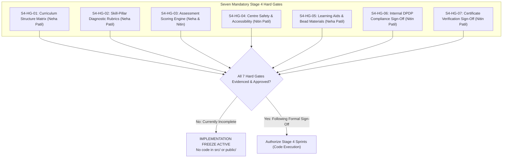

# ARNAV ABACUS ACADEMY (AAA) — STAGE 4 PRE-IMPLEMENTATION
# STAGE 4 READINESS ASSESSMENT: SEVEN MANDATORY HARD GATES BASELINE

**Project:** Arnav Abacus Academy (AAA), Wakad, Pune  
**Document Reference:** `AAA-S4-DOC-001`  
**Phase:** Stage 4 — Pre-Implementation Readiness Assessment  
**Predecessor Milestone:** Stage 3 Architecture & Design — FORMALLY CLOSED (`MGT-DET-S3-15`)  
**Governance Authority:** Nitin Patil (Operations, Technology Lead & Compliance Officer) & Neha Patil (Academic Director)  
**Date:** 04 November 2026  
**Status:** 🟡 **DRAFT — PRE-IMPLEMENTATION AUDIT (STAGE 4 IMPLEMENTATION FREEZE ACTIVE)**  

---

## 1. Executive Summary & Purpose

With the formal ratification of **`MGT-DET-S3-15`** on 04 November 2026, **Stage 3 (Architecture & Design)** is officially closed, having passed all gates from Gate 3.1 through Gate 3.6 and Gate 3-Exit.

However, in accordance with `AGENTS.md` Rule 7 and the Stage 3 Governance Framework, **passing Stage 3 does not automatically authorize production code writing or database provisioning in Stage 4**. 

Before writing a single line of production code in `src/`, deploying cloud resources, or executing database migrations, the academy must formally verify the **Seven Mandatory Stage 4 Hard Gates** established during Stage 2 (`ACT-WS04-01` through `ACT-WS04-27`).

### 1.1 Non-Negotiable Operational Mandate
- **Implementation Freeze Remains 100% Active:** Zero code changes in `src/` or `public/`.
- **Evidence-Based Gate Verification:** A gate is **NOT** ready for closure merely because its architectural design exists in `docs/03_solution_architecture/`. Real physical, academic, and operational evidence must be cataloged, audited, and approved.
- **Individual Gate Ownership:** Neha Patil retains exclusive validation authority over academic curricula, diagnostic rubrics, and physical bead materials; Nitin Patil retains authority over physical center safety, internal DPDP compliance, and certificate verification.

---

## 2. In-Depth Assessment of the Seven Stage 4 Hard Gates

---

### Gate 1: S4-HG-01 — Curriculum Structure Matrix Validation
- **Owning Authority:** **Neha Patil** (Academic Director & Founder)
- **Gate Objective:** Validate the complete syllabus, level progression milestones, prerequisites, age eligibility assumptions, and lesson architectures across all five AAA academic programmes:
  1. Abacus Mathematics (Foundation, Junior, Senior, Advanced, Grand Master)
  2. Vedic Mathematics (Junior, Senior, Speed Mental Tracks)
  3. Mental Mathematics (Sensory & Dictation Tracks)
  4. School Mathematics (Grades 1–10 CBSE, ICSE, Maharashtra State Board)
  5. IPM & Olympiad Mathematics (Grades 2–9 Problem Decomposition)
- **Available Evidence:** Complete specifications drafted in `docs/02_business_requirements/AAA_Stage2_WS04_Academic_Programme_Architecture.md` and `docs/03_solution_architecture/AAA_WS06_Information_Architecture_and_Sitemap.md`.
- **Missing / Incomplete Evidence:** Physical sign-off sheet of syllabus milestones; lesson plan timing breakdown (45 min vs 60 min) signed by Neha Patil in the Documentary Verification Register (DVR).
- **Current Gate Status:** 🟡 **PARTIALLY AVAILABLE (Awaiting Neha Patil's formal syllabus document sign-off).**

---

### Gate 2: S4-HG-02 — Skill-Pillar Diagnostic Rubric Validation
- **Owning Authority:** **Neha Patil** (Academic Director & Founder)
- **Gate Objective:** Validate the formal qualitative scoring rubrics for the **Six Educational Observation Dimensions** and the **Eight Child Development Intelligence Pillars**, ensuring strict adherence to the 1–5 qualitative observation scale and non-diagnostic boundaries.
- **Available Evidence:** Complete rubric architecture in `docs/03_solution_architecture/AAA_WS08_Observation_Dimensions_and_Intelligence_Pillars.md` and `AAA_WS08_Personalised_Learning_Recommendation_Engine.md`.
- **Critical Boundary Enforced:** The Six Observation Dimensions (session-level qualitative observations) remain strictly distinct from the Eight Child Development Dimensions (long-term cognitive pillars).
- **Missing / Incomplete Evidence:** A calibrated sample observation sheet filled out from an authentic past session to benchmark score distribution.
- **Current Gate Status:** 🟡 **PARTIALLY AVAILABLE (Awaiting calibrated sample observation rubric sign-off).**

---

### Gate 3: S4-HG-03 — Student Assessment Scoring Engine Validation
- **Owning Authorities:** **Neha Patil** (Academic Lead) & **Nitin Patil** (Technology Lead)
- **Gate Objective:** Validate the assessment scoring logic, speed/accuracy weightings, historical progress tracking, and reporting templates.
- **Available Evidence:** `AAA_WS08_Personalised_Learning_Recommendation_Engine.md` and `AAA_WS08_Discovery_Session_Workflow_and_Triage.md`.
- **Non-Negotiable Pedagogical Invariants:**
  1. **Strict Self-Baseline Comparison Only:** Child progress is measured exclusively against their own historical attempts.
  2. **Zero Comparative Ranking:** No public leaderboards displaying child names or cohort percentiles.
  3. **Zero Child Intelligence Score (CIS):** No algorithmic IQ-style aggregate scores or clinical labeling.
- **Missing / Incomplete Evidence:** Validation test report of the scoring logic with edge cases (e.g., child answers 10 questions in 30 seconds with 100% vs 50% accuracy).
- **Current Gate Status:** 🟡 **PARTIALLY AVAILABLE (Architecture complete; edge-case scoring matrix requires joint sign-off).**

---

### Gate 4: S4-HG-04 — Physical Centre Safety & Accessibility Evidence
- **Owning Authority:** **Nitin Patil** (Operations & Technology Lead)
- **Gate Objective:** Inspect and verify premises safety, child protection, emergency readiness, fire safety, child-friendly ergonomic furniture, and physical accessibility at the Wakad Center.
- **Center Address:** *Flat No. 3, 1st Floor, Adv. Balaji Sagar Bungalow, Opp. Creative Cameo, Near Park Street, Behind Wisdom World School, Wakad, Pune 411057*.
- **Available Evidence:** Documented centre address, operating hours (Mon–Sat, 9:30 AM–7:30 PM), and emergency contact protocols.
- **Missing / Incomplete Evidence:**
  1. First-aid kit inspection log.
  2. Fire extinguisher inspection tag / certificate.
  3. Electrical wiring safety inspection log for classroom equipment.
  4. Child drop-off and pick-up physical safety protocol document.
- **Current Gate Status:** 🔴 **MISSING PHYSICAL EVIDENCE (Requires Nitin Patil physical on-site audit log).**

---

### Gate 5: S4-HG-05 — Physical Learning Aids & Bead Material Evidence
- **Owning Authority:** **Neha Patil** (Academic Director & Founder)
- **Gate Objective:** Inspect physical inventory and pedagogical quality of authentic Soroban abacus instruments (13-rod and 17-rod student abacuses, master teacher demonstration abacus), sensory flashcards, bead kits, and Vedic math reference sheets.
- **Available Evidence:** Requirement defined in Stage 2 BRD (`BRD-S2-OPS-03`).
- **Missing / Incomplete Evidence:**
  1. Physical inventory count of functional student abacus instruments.
  2. Quality inspection confirming smooth bead movement, zero toxic paints, and durable frame construction.
  3. Replacement stock log for consumable worksheets and practice books.
- **Current Gate Status:** 🔴 **MISSING PHYSICAL EVIDENCE (Requires Neha Patil inventory audit sheet).**

---

### Gate 6: S4-HG-06 — Internal DPDP Compliance Sign-Off
- **Owning Authority:** **Nitin Patil** (Compliance Officer)
- **Gate Objective:** Execute internal statutory compliance review under the Digital Personal Data Protection Act, 2023 (Section 9 minor protections), ratify the internal legal brief addressing questions `LQ-01` through `LQ-04`, and sign the official Compliance Officer Statement in the DVR.
- **Available Evidence:** `AAA_WS10_Privacy_and_DPDP_Requirements_Assessment.md` (WS-10.1) and `AAA_WS09B_Data_Classification_and_Retention_Architecture.md`.
- **Fiduciary Milestone (Ratified under MGT-DET-S3-15):** Nitin Patil conducts this assessment internally as Compliance Officer, saving ₹15,000–₹30,000 in external legal fees.
- **Missing / Incomplete Evidence:** Formally executed and signed Compliance Officer Statement (Document `AAA-S4-EVD-06`) recording internal determination on `LQ-01` to `LQ-04`.
- **Current Gate Status:** 🟡 **PARTIALLY AVAILABLE (Architecture ready; awaiting Nitin Patil's formal signature on compliance statement).**

---

### Gate 7: S4-HG-07 — Student Certificate Verification Sign-Off
- **Owning Authority:** **Nitin Patil** (Technology Lead) & **Neha Patil** (Academic Director)
- **Gate Objective:** Validate the architectural separation between browser Practice Achievement Records and Official Level Diplomas, approve the Central Certificate Ledger schema, and verify the HMAC-SHA256 tamper-evident verification model.
- **Available Evidence:** `AAA_WS10_Certificate_and_Achievement_Governance_Architecture.md` (WS-10.5).
- **Strict Constraint:** Zero live signing keys generated and zero mock certificates issued during Stage 4 pre-implementation.
- **Missing / Incomplete Evidence:** Master template proof for physical diplomas signed by Neha Patil; approval of masked verification response schema.
- **Current Gate Status:** 🟡 **PARTIALLY AVAILABLE (Architecture complete; awaiting template proof approval).**

---

## 3. Summary Assessment Matrix of All 7 Hard Gates

| Hard Gate Ref | Gate Title | Owning Lead | Architecture Baseline | Physical / Operational Evidence Status | Ready for Formal Closure Today? |
| :---: | :--- | :--- | :---: | :---: | :---: |
| **S4-HG-01** | **Curriculum Structure Matrix Validation** | Neha Patil | Complete (`WS-06.1`, `WS-04`) | Draft syllabus in docs; physical sign-off sheet pending. | **NO (Review Required)** |
| **S4-HG-02** | **Skill-Pillar Diagnostic Rubric Validation** | Neha Patil | Complete (`WS-08.1`, `WS-08.2`) | Rubric drafted; calibrated sample pending. | **NO (Review Required)** |
| **S4-HG-03** | **Student Assessment Scoring Engine** | Neha & Nitin | Complete (`WS-08.3`, `WS-08.4`) | Scoring rules drafted; edge-case matrix pending. | **NO (Review Required)** |
| **S4-HG-04** | **Physical Centre Safety & Accessibility** | Nitin Patil | Complete (`BRD-S2-OPS-01`) | **Missing physical inspection evidence & fire/first-aid logs.** | **NO (Physical Audit Needed)** |
| **S4-HG-05** | **Physical Learning Aids & Bead Materials** | Neha Patil | Complete (`BRD-S2-OPS-03`) | **Missing physical inventory audit log & bead inspection sheet.** | **NO (Physical Audit Needed)** |
| **S4-HG-06** | **Internal DPDP Compliance Sign-Off** | Nitin Patil | Complete (`WS-10.1`, `WS-10.3`) | Compliance assessment drafted; formal statement signature pending. | **NO (Signature Pending)** |
| **S4-HG-07** | **Student Certificate Verification Sign-Off** | Nitin Patil | Complete (`WS-10.5`) | Schema drafted; physical diploma template proof pending. | **NO (Proof Review Pending)** |

---

## 4. Stage 4 Pre-Implementation Readiness Conclusion

- **Overall Readiness Determination:** **NOT READY FOR PRODUCTION IMPLEMENTATION.**
- **Implementation Status:** **STAGE 4 IMPLEMENTATION FREEZE IS FIRMLY ENFORCED.**
- **Action Plan:** The academy leadership must systematically execute the evidence-gathering and review process for each hard gate using the structured frameworks provided in `docs/04_implementation/`.
