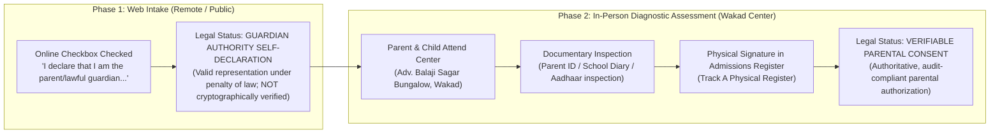
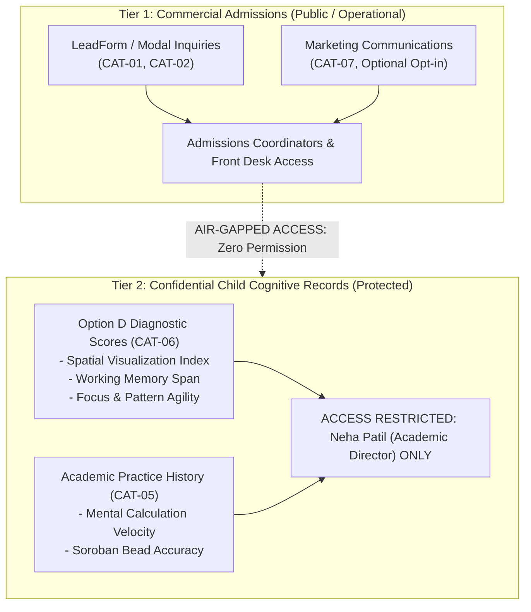

# ARNAV ABACUS ACADEMY (AAA) — SPRINT 3 WS-16 CAP-WS16-01
## Document Reference: `AAA-WS16-CAP01-PRIV-CHILD-01`
### Deliverable F3: Children's Data Protection, Statutory Data Inventory & Privacy Governance

**Document Version:** 1.0.0  
**Assessment Date:** 05-November-2026  
**Governing Authority:** `MGT-DET-S4-S3-AUTH-02`  
**Governing Workstream:** Additional Workstream F (Cost, Security, Legal & Compliance)  
**Statutory Foundation:** Digital Personal Data Protection Act, 2023 (Section 9 — Processing of Personal Data of Children)  
**Inspection Baseline Snapshot:** Commit `51b7322` on branch `feat/sprint3-integration`  
**Production Status:** 🔒 **STRICTLY LOCKED** (`a21a3d1129cc17fc6650bfd04648eb91199e6fa8`)  
**Accountable Leaders:** Nitin Patil (Operations, Tech & Compliance) & Neha Patil (Founder & Academic Director)

---

## 1. Executive Summary & Statutory Principles

Under Section 9 of the **Digital Personal Data Protection Act, 2023 (DPDP Act)**:
1. A Data Fiduciary shall, before processing any personal data of a child, obtain **verifiable consent of the parent of such child or lawful guardian**.
2. A Data Fiduciary shall not undertake such processing of personal data of a child that is **likely to cause any detrimental effect on the well-being of a child**.
3. A Data Fiduciary shall not undertake **tracking or behavioral monitoring of children or targeted advertising directed at children**.

This privacy assessment audits the complete lifecycle of all 10 categories of personal data processed across the AAA admissions web portal and internal AcademyOS learning systems.

---

## 2. Definitive Classification: Guardian Authority vs. Verifiable Parental Consent

A foundational audit determination is codifying the strict legal distinction between digital self-declarations and physical verifiable consent:

> **Statutory Rule of AAA:**  
> The website form checkbox represents strictly a **`Guardian Authority Self-Declaration`**. It enables initial scheduling contact. **Full enrollment, persistent learning platform access, and photographic publication require `Verifiable Parental Consent`**, executed in-person via signed documentary verification at the AAA Wakad Center.

---

## 3. Comprehensive 10-Category Data Inventory

| Category ID | Data Category Name | Minimum Necessary Fields | Statutory Purpose | Authorized Roles | Legal Basis & Consent Status | Retention & Deletion Protocol | Storage Location | Vendor / Subprocessor Access | Export & Deletion Procedures |
| :---: | :--- | :--- | :--- | :--- | :--- | :--- | :--- | :--- | :--- |
| **CAT-01** | **Parent Enquiry Records** | Parent Full Name, 10-Digit Mobile, Preferred Course, Timing. | Contacting parent to schedule free diagnostic assessment. | Admissions Coordinator, Academic Director (Neha Patil). | Mandatory Service Consent (`CONSENT_SERVICE_V1`). | **90-Day Prospect Retention:** Purged 90 days after last contact if not enrolled. | Supabase PostgreSQL in AWS Mumbai (`ap-south-1`). | Cloudflare (Edge Ingress), Supabase (Database). | Cryptographic shredder (`privacyRetentionEngine.ts`); HMAC purge cert. |
| **CAT-02** | **Guardian Authority Information** | Guardian Confirmation Flag (`parentGuardianConfirmed`), Salutation. | Legal assurance of parental authority under Section 9 DPDP. | Admissions Coordinator, Compliance Lead (Nitin Patil). | `GUARDIAN_AUTHORITY_SELF_DECLARATION_V1`. | Retained along with Lead Record (90 days prospect / active enrollment duration). | Supabase PostgreSQL in AWS Mumbai (`ap-south-1`). | Supabase. | Purged synchronously with lead record. |
| **CAT-03** | **Student Identity Records** | Student First Name, Completed Years + Months, School Grade. | Curating developmentally appropriate diagnostic test instruments. | Academic Director (Neha Patil), Lead Instructors. | Guardian Authority Self-Declaration; Parental Consent at enrollment. | Active enrollment duration + 1 year post-departure for academic transcripts. | Supabase PostgreSQL Mumbai + AcademyOS offline roster. | Supabase. Encrypted at rest (AES-256 via AWS KMS). | Exportable to parent via PDF transcript; deleted on right-to-erasure request. |
| **CAT-04** | **Programme Enrolments** | Program Code (`abacus`, `vedic`, etc.), Batch ID, Start Date. | Batch scheduling, micro-batch capping (max 5 students), faculty allocation. | Academic Director, Center Operations Lead (Nitin Patil). | Educational Service Agreement. | Duration of enrollment + 3 years for tax/accounting records. | AcademyOS Database in AWS Mumbai. | Supabase, Local secure backup. | CSV/PDF export with formula escaping; anonymized after statutory window. |
| **CAT-05** | **Attendance & Assessment Scores** | Session Date, Attendance Status, Speed Test Times, Accuracy %. | Tracking weekly computational velocity, bead visualization, and Vedic fluency. | Academic Director (Neha Patil), Assigned Faculty. | Educational Performance & Curricular Evaluation. | Duration of enrollment. Historical aggregates preserved anonymously. | AcademyOS Practice Engine (`/practice/*`). | Zero third-party access. Strictly internal AcademyOS storage. | Available to parent via Term Progress Report card. |
| **CAT-06** | **Educational Development Observations** | Cognitive Pillar Scores (Spatial, Memory, Focus), Observation Notes. | Curricular diagnostic assessment under Option D matrix; individual developmental tracking. | **RESTRICTED:** Neha Patil (Academic Director) ONLY. | Express Parental Assessment Consent. Strictly separated from marketing. | Duration of enrollment. Never commercialized or disclosed to advertisers. | AcademyOS Sovereign Data Store (Role-based access). | **ZERO external processor access.** Encrypted storage. | Transferred strictly to parents during private observation consultations. |
| **CAT-07** | **Parent Communications** | WhatsApp message history, SMS delivery logs, Email dispatches. | Coordinating assessment slots, holiday notices, fee payment receipts. | Admissions Staff, Center Operations Lead. | Service Consent; Optional Marketing Consent. | 180 days for transactional message logs; marketing suppressed immediately upon opt-out. | Meta WhatsApp Cloud API, AWS SES Mumbai logs. | Meta Platforms Ireland, Amazon Web Services Mumbai. | Marketing opt-out via `STOP` suppresses number <24h across all queues. |
| **CAT-08** | **Statutory Consent Records** | Consent Version (`V1`), Timestamp (IST), IP Hash, Checkbox States. | Evidencing statutory compliance with Section 6 & 9 DPDP Act. | Compliance Lead (Nitin Patil). | Legal Compliance & Regulatory Evidence. | Retained for 3 years following consent expiration for regulatory audit defense. | Supabase PostgreSQL Audit Table. | Supabase (Database). | Cryptographically sealed; immutable audit log. |
| **CAT-09** | **Competition Results & Photographs** | Student Name, Award Title (e.g. International Champion), Trophy Photo. | Celebrating genuine student mathematical achievement; parent-authorized showcase. | Academic Director (Neha Patil), Marketing Lead. | **EXPLICIT WRITTEN PHOTO RELEASE** signed on-site by parent (Track A Register). | Until withdrawn by parent. Immediate removal from web upon withdrawal. | Public Web Assets (`/images/*`), Cloudflare CDN. | Cloudflare Global CDN. | Public removal within 24 hours of parental withdrawal notice. |
| **CAT-10** | **System & Security Logs** | Client IP Hash, Timestamp (IST), Route Accessed, User Agent Hash. | Cybersecurity defense, intrusion detection, CERT-In Directions 2022 compliance. | Tech Lead (Nitin Patil), Systems Security Officer. | Section 7(b) DPDP Act (State/Legal function & Cyber Defense). | **Strictly 180 Days** as mandated by CERT-In Directions dated 28-Apr-2022. | Encrypted Log Bucket in AWS Mumbai (`ap-south-1`). | Cloudflare Analytics, AWS CloudWatch. | Automated rollover purge after 180 days. Zero PII contained in logs. |

---

## 4. Separation of Ordinary Enquiry Data from Restricted Educational Observations

A core pedagogical and ethical safeguard is the architectural isolation between **Commercial Admissions Inquiries** and **Confidential Child Cognitive Observations**:

### Protection Standards for Category 06 (Child Educational Observations):
1. **Access Lockout:** Front-desk staff, admissions coordinators, and marketing contractors have **zero read or write permissions** to child cognitive observation scores.
2. **Prohibition of Commercial Exploitation:** In accordance with Section 9(2) DPDP Act, cognitive profiles and learning observation data are **never shared with third-party advertising platforms** (Google Ads, Meta Ads) for lookalike modeling or behavioral profiling.
3. **Parent Transparency:** Diagnostic reports are shared exclusively with the child's lawful guardians during private, one-on-one pedagogical consultations with Neha Patil.

---

## 5. Right-to-Erasure & Consent Withdrawal Workflow

Under DPDP Act Section 12, parents possess the statutory right to withdraw consent and demand erasure of their child's personal data:
1. **Request Intake:** Parent submits erasure request via WhatsApp (`+91 90219 24968`) or email to `support@arnavabacus.com`.
2. **Identity Verification:** Staff verifies requesting mobile number matches the parent record.
3. **Automated Shredder Execution (<24 Hours):**
   - The cryptographic erasure engine (`privacyRetentionEngine.ts`) shreds direct personal identifiers into permanent anonymized tokens (`ANON-PURGED-XXXXXXXX`).
   - If marketing consent was previously granted, the phone number is added to `public.marketing_suppression_list`.
4. **Audit Certificate Generation:**
   - A cryptographically signed **Purge Certificate** containing HMAC-SHA256 hash, purge timestamp, and record count is generated and archived for regulatory proof.
   - Confirmation is delivered to the parent within 48 hours.

---

## 6. Gating Categorization for Privacy Controls

| Privacy Finding / Control | Action Description | Gating Stage |
| :--- | :--- | :---: |
| **PRIV-01: Guardian Self-Declaration Copy** | Ensure web form text matches exact approved phrasing. | **Must resolve before implementation** |
| **PRIV-02: Zero-PII Log Sanitizer** | Verify no child name or raw mobile is written to server logs. | **Must resolve before staging** |
| **PRIV-03: Tier 2 Cognitive Isolation** | Enforce database RLS locking observation records to Academic Director. | **Must resolve before production** |
| **PRIV-04: On-Site Physical Consent Register** | Maintain Track A paper consent forms with physical signatures at Wakad center. | **Ongoing operational control** |
| **PRIV-05: 90-Day Retention Clock** | Verify automated prospect purge triggers after 90 days of inactivity. | **Ongoing operational control** |

---

## 7. Sign-Off & Verification Block

| Governance Role | Name | Designation | Signature Status | Date |
| :--- | :--- | :--- | :--- | :--- |
| **Data Protection Officer** | Lead Privacy & Compliance Architect | Regulatory Privacy Audit | Verified & Submitted | 05-Nov-2026 |
| **Operations & Compliance** | Nitin Patil | Operations, Tech & Compliance Director | Pending Formal Privacy Approval | [Pending] |
| **Academic & Admissions** | Neha Patil | Founder & Academic Director | Pending Formal Privacy Approval | [Pending] |
