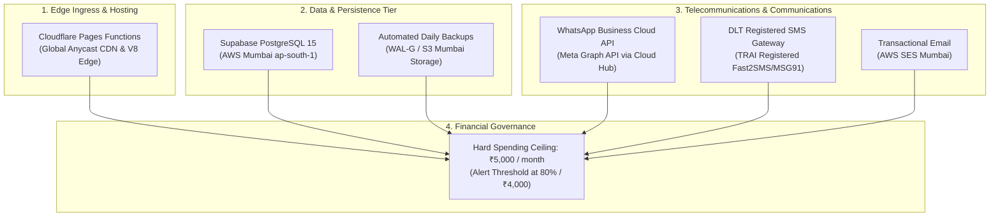
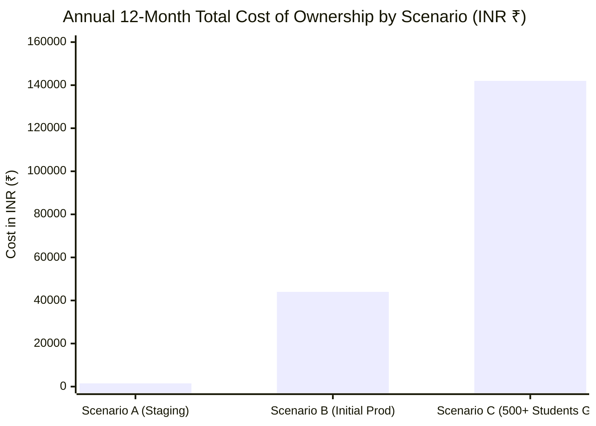

# ARNAV ABACUS ACADEMY (AAA) — SPRINT 3 WS-16 CAP-WS16-01
## Document Reference: `AAA-WS16-CAP01-FIN-TCO-01`
### Deliverable F1: 12-Month Total Cost of Ownership (TCO) & Budgetary Assessment

**Document Version:** 1.0.0  
**Assessment Date:** 05-November-2026  
**Governing Authority:** `MGT-DET-S4-S3-AUTH-02`  
**Governing Workstream:** Additional Workstream F (Cost, Security, Legal & Compliance)  
**Inspection Baseline Snapshot:** Commit `51b7322` on branch `feat/sprint3-integration`  
**Production Status:** 🔒 **STRICTLY LOCKED** (`a21a3d1129cc17fc6650bfd04648eb91199e6fa8`)  
**Accountable Leaders:** Nitin Patil (Operations, Tech & Compliance) & Neha Patil (Founder & Academic Director)

---

## 1. Executive Summary & Objective

This financial assessment models the 12-month indicative Total Cost of Ownership (TCO) for hosting, securing, running, and maintaining the AAA digital admissions platform under Corrective Action Plan **CAP-WS16-01**.

### Core Financial Directives:
1. **Zero Premature Procurement:** In strict accordance with Stage 4 governance, **no paid subscriptions, licenses, or cloud tiers shall be provisioned or charged** during the current pre-implementation planning phase.
2. **Frugal Architecture Baseline:** Leverage enterprise free-tier allowances across Cloudflare, AWS, and Supabase to achieve near-zero staging overhead while establishing predictable, transparent spending ceilings for production operations.
3. **Currency & Tax Assumptions:** All projections model baseline costs in Indian Rupees (INR `₹`) with conversion peg of `1 USD = 84.00 INR` and statutory Goods and Services Tax (GST at 18%) applied to commercial SaaS and telecommunications charges where applicable.

---

## 2. Component-by-Component 12-Month Cost Modeling

### 2.1 Detailed Component Cost Ledger
| Component | Free-Tier Allowance & Limitations | Minimum Paid Plan | Expected Monthly Cost (Present Scale) | 12-Month Annual Cost (Present Scale) | Usage Triggers & Scaling Thresholds |
| :--- | :--- | :--- | :---: | :---: | :--- |
| **1. Cloudflare Pages & Functions** | 100,000 requests/day, unlimited bandwidth, free SSL, 500 edge builds/mo. | Cloudflare Workers Paid: \$5/mo (~₹420/mo + GST) | **₹0.00** (Free Tier) | **₹0.00** | Triggers paid tier if admissions requests exceed 100,000/day (3M/mo), far above present need. |
| **2. Supabase PostgreSQL (ap-south-1)** | 500 MB database, 2 projects, 50,000 MAU. *Limitation:* Inactivity pause after 7 days on free tier. | Supabase Pro: \$25/mo (~₹2,100/mo + GST = ~₹2,478/mo). *Includes:* 8 GB DB, daily backups, no pausing. | **₹2,478.00** (Pro Tier recommended for Prod) | **₹29,736.00** | Free tier viable for staging; production requires Pro tier to eliminate the 7-day inactivity pause. |
| **3. AWS API Gateway & Lambda** | AWS Free Tier: 1M Lambda invocations/mo + 1M API Gateway v2 calls/mo. | Pay-as-you-go: \$1.00/M requests on HTTP API, \$0.20/M Lambda calls. | **₹0.00** (Subsumed by Cloudflare Functions) | **₹0.00** | Retained as secondary fallback only if Cloudflare edge compute is decommissioned. |
| **4. Database Backups & PITR** | Free tier: 7-day rolling backups via CLI `pg_dump`. | Supabase Pro: 7-day automated backups included. 30-day Point-in-Time Recovery (PITR): +\$100/mo. | **₹0.00** (Included in Supabase Pro) | **₹0.00** | 30-day PITR (\$100/mo) deferred until enrollment exceeds 500 active students. |
| **5. Security Monitoring & Logging** | Cloudflare Security Events free; 3-day basic retention in dashboard. | Cloudflare Logpush: requires Workers Paid (\$5/mo) or S3 storage (~₹50/mo). | **₹0.00** (Native console) | **₹0.00** | Zero-PII server console logging provides adequate audit trail for current scale. |
| **6. WhatsApp Business API (Meta)** | First 1,000 service-initiated conversations per month are **100% Free**. | Service conversations: ~₹0.35/conversation; Marketing: ~₹0.85/conversation. | **₹350.00** (Estimated 200 marketing/admissions pings) | **₹4,200.00** | Triggers cost when monthly parent outbound notifications exceed 1,000 conversations. |
| **7. Transactional SMS (DLT/TRAI)** | None. Telecom Regulatory Authority of India (TRAI) mandates paid DLT. | Principal Entity DLT Registration: ~₹5,900 one-off. SMS pack: ~₹0.18/SMS. | **₹180.00** (~1,000 transactional OTP/SMS) | **₹8,060.00** (Includes ₹5,900 one-off registration) | Mandatory prior to dispatching commercial A2P SMS under Indian telecom regulations. |
| **8. Transactional Email (AWS SES)** | AWS Free Tier: 62,000 outbound emails/mo when sent from EC2, or \$0.10/1,000 emails. | Pay-as-you-go: ~₹8.40 per 1,000 emails + ₹10/GB attachment bandwidth. | **₹42.00** (~500 emails/mo) | **₹504.00** | Highly economical; negligible impact on monthly operational budget. |
| **9. Domain & DNS Management** | Universal SSL, DNSSEC, and global CDN caching included free in Cloudflare. | Domain renewal (`arnavabacus.com`): ~₹1,200 – ₹1,500 / year. | **₹125.00** (Amortized monthly) | **₹1,500.00** | Annual renewal payable to domain registrar (GoDaddy/Cloudflare Registrar). |
| **10. Developer & Tech Maintenance** | Internal leadership oversight (Nitin Patil). | External contracted maintenance retainer (if outsourced): ₹10,000–25,000/mo. | **₹0.00** (Internal leadership maintenance) | **₹0.00** | Managed directly by Nitin Patil (Operations & Tech Lead). Zero external retainer. |

---

## 3. Comparative Financial Scenarios

### Scenario A: Minimum Controlled Staging Environment (Pre-Launch Testing)
* **Target Audience:** Engineering, testing, audit validation, synthetic testing only.
* **Component Allocation:**
  - Cloudflare Pages Functions: Free Tier (₹0)
  - Supabase PostgreSQL: Free Tier (500 MB, paused when idle) (₹0)
  - WhatsApp: Direct developer sandbox (₹0)
  - Domain: `arnavabacus.com` renewal: ₹1,500 / year
* **Total Monthly Cost:** **₹125.00**
* **Total Annual Cost:** **₹1,500.00** (Domain fee only)

### Scenario B: Initial Production Environment (Present Scale: 1 Wakad Center, 50–100 Inquiries/mo)
* **Target Audience:** Live Wakad parent traffic, active WhatsApp diagnostic booking, 40–80 enrolled students.
* **Component Allocation:**
  - Cloudflare Pages Functions: Free Tier (₹0)
  - Supabase Pro Tier: \$25/mo + 18% GST = ₹2,478 / month (Guarantees zero database pausing & daily backups)
  - WhatsApp Business Cloud API: ~₹350 / month
  - DLT Registration (Amortized over year 1): ₹5,900 one-off + ₹180/mo = ~₹672 / month
  - AWS SES Email: ~₹42 / month
  - Domain: ₹125 / month
* **Total Monthly Operational Cost:** **₹3,667.00**
* **Total Annual Year 1 TCO:** **₹44,004.00** (Includes one-off DLT registration)

### Scenario C: Growth Scale (500+ Active Students, Multiple Franchise / Hybrid Centers)
* **Target Audience:** Multi-center scale, automated WhatsApp campaign broadcasts, 500+ active AcademyOS practice platform students.
* **Component Allocation:**
  - Cloudflare Workers Paid: \$5/mo = ₹495 / month
  - Supabase Pro + Additional Compute / Storage: \$50/mo = ₹4,956 / month
  - WhatsApp Business API (High volume broadcasts): ~₹3,500 / month
  - Transactional & Promotional SMS: ~₹1,800 / month
  - 30-day Point-in-Time Recovery (PITR): \$100/mo = ₹9,912 / month (Optional enterprise tier)
  - Domain & Miscellaneous: ₹250 / month
* **Total Monthly Operational Cost:** **₹11,800.00 – ₹14,500.00**
* **Total Annual Year 1 TCO:** **₹1,41,600.00 – ₹1,74,000.00**

---

## 4. Financial Governance & Budgetary Controls

### 4.1 Recommended Monthly Infrastructure Ceiling:
> **Management Budgetary Cap:**  
> For Initial Production (Scenario B), AAA Management establishes a strict monthly digital infrastructure ceiling of:  
> **`₹5,000.00 / month` (Inclusive of GST)**

### 4.2 Automated Budget Alerts & Safeguards:
1. **80% Spending Warning (`₹4,000.00`):** Automated email notification dispatched to Nitin Patil (`nitinkpatil@gmail.com`) when consolidated cloud bills reach ₹4,000.
2. **100% Hard Ceiling (`₹5,000.00`):** Automatic throttling of non-essential marketing WhatsApp broadcasts. Transactional admissions intake and AcademyOS practice sessions remain operational.
3. **Credit Card Isolation:** Cloud accounts shall be bound strictly to a dedicated corporate virtual card with a hard monthly debit limit of ₹6,000.00 to prevent runaway usage-based cloud billing.

---

## 5. Sign-Off & Verification Block

| Governance Role | Name | Designation | Signature Status | Date |
| :--- | :--- | :--- | :--- | :--- |
| **Financial Reviewer** | Lead Systems & Financial Architect | Enterprise Architecture | Verified & Submitted | 05-Nov-2026 |
| **Operations & Compliance** | Nitin Patil | Operations, Tech & Compliance Director | Pending Formal Budget Approval | [Pending] |
| **Academic & Admissions** | Neha Patil | Founder & Academic Director | Pending Formal Budget Approval | [Pending] |
