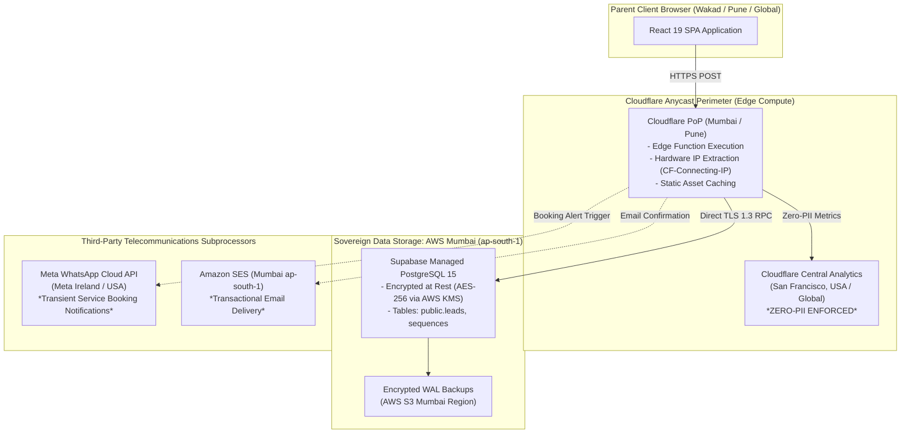
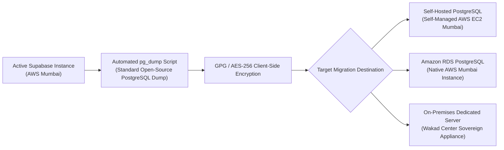

# ARNAV ABACUS ACADEMY (AAA) — SPRINT 3 WS-16 CAP-WS16-01
## Document Reference: `AAA-WS16-CAP01-VEND-RESIDENCY-01`
### Deliverable F5: Data Residency, Cloud Subprocessor & Vendor Exit Assessment

**Document Version:** 1.0.0  
**Assessment Date:** 05-November-2026  
**Governing Authority:** `MGT-DET-S4-S3-AUTH-02`  
**Governing Workstream:** Additional Workstream F (Cost, Security, Legal & Compliance)  
**Primary Region:** AWS Mumbai (`ap-south-1`), Maharashtra, India  
**Production Status:** 🔒 **STRICTLY LOCKED** (`a21a3d1129cc17fc6650bfd04648eb91199e6fa8`)  
**Accountable Leaders:** Nitin Patil (Operations, Tech & Compliance) & Neha Patil (Founder & Academic Director)

---

## 1. Executive Summary & Foundational Finding

A central architectural mandate for AAA is safeguarding sovereign data residency under India’s Digital Personal Data Protection Act, 2023 (DPDP Act).

### Non-Negotiable Audit Precept:
> **Auditor Finding:**  
> **"Hosting a database in an AWS Mumbai data center ALONE DOES NOT guarantee complete Indian data residency."**  
> If client-side browser telemetry, CDN edge caching, third-party error trackers (e.g. Sentry), or vendor customer support pipelines route child or parent identifiers across foreign borders, a statutory cross-border exfiltration occurs regardless of the primary database location.

This assessment audits every cloud subprocessor, data transit path, execution node, and vendor exit mechanism supporting the AAA platform.

---

## 2. Comprehensive Subprocessor & Cloud Ingress Registry



### 2.1 Subprocessor Due Diligence Ledger
| Vendor Name | Corporate Entity & Jurisdiction | Service Function in AAA Stack | Physical Data Storage Location | Edge / Transit Execution Region | Personal Data Accessible | Cross-Border Transfer Risk & Mitigation |
| :--- | :--- | :--- | :--- | :--- | :--- | :--- |
| **1. Cloudflare, Inc.** | Cloudflare, Inc. (Delaware, USA) | DNS, CDN Ingress, Edge Worker Functions, WAF Rate Limiting. | Static web assets cached globally; transient compute. | Anycast Edge (Closest nodes: Mumbai, Pune). | Ephemeral in-flight payload; client IP hash. | **Mitigation:** Zero persistence at edge; Cloudflare Data Localization Suite (DLS) restricts logs to India; zero PII logged. |
| **2. Supabase, Inc.** | Supabase Inc. (Singapore / USA) hosting on AWS. | Managed PostgreSQL database, PostgREST API, Database Sequences. | **AWS Mumbai (`ap-south-1`)**, Maharashtra, India. | Strictly within AWS Mumbai VPC. | Complete canonical lead record: parent name, phone, child age, consent. | **Mitigation:** Database project provisioned exclusively in Mumbai region; customer support access locked behind MFA. |
| **3. Amazon Web Services (AWS)** | Amazon Web Services India Pvt. Ltd. (Mumbai, India). | Underlying compute for Supabase, S3 Backup storage, SES Email dispatch. | **AWS Mumbai (`ap-south-1`)**, Maharashtra, India. | Strictly within AWS Mumbai region. | Encrypted database snapshots, email headers. | **Mitigation:** AWS India billing entity; all S3 buckets locked with `ap-south-1` residency constraint. |
| **4. Meta Platforms, Inc.** | Meta Platforms Ireland Ltd. / Meta Platforms Inc. (USA). | WhatsApp Business Cloud API message dispatch. | Meta Global Cloud Infrastructure (EU / USA / Global). | Global WhatsApp Edge. | Mobile number, Parent first name, Course interest label. | **Mitigation:** Dispatches only minimum necessary transactional alerts; zero cognitive scores or sensitive child development data transmitted. |

---

## 3. Data Transit Paths & Cross-Border Transfer Analysis

### 3.1 Statutory Framework (DPDP Act 2023, Section 16):
- Section 16 of the DPDP Act provides that the Central Government of India may notify countries to which personal data transfers are restricted (a **Blacklist approach**). As of November 2026, transfers to compliant cloud infrastructure providers in the US, EU, and Singapore are permitted, provided reasonable security standards and data fiduciary responsibilities are maintained.
- **Child Data Sensitivity:** While generic data transfers are permitted, Section 9 prohibits any tracking, targeted marketing, or behavioral monitoring of children.
- **Defensive Safeguard:** To eliminate any regulatory cross-border ambiguity:
  1. **All permanent persistent records** (`public.leads`, `public.admissions_crm`, `public.students`) reside **exclusively within AWS Mumbai (`ap-south-1`)**.
  2. Foreign edge nodes process data **in-memory only for milliseconds** during network transit.

---

## 4. Vendor Lock-In & Portability: The Exit Strategy Runbook

To ensure that AAA is never trapped by vendor pricing escalations, technical insolvencies, or regulatory changes:



### 4.1 Vendor Independence Guarantees:
1. **Open-Source PostgreSQL 15 Standard:**  
   Supabase PostgreSQL is 100% open-source PostgreSQL. AAA utilizes standard SQL syntax, standard sequences (`lead_ref_seq_2026`), and standard stored procedures. Zero proprietary database extensions or proprietary APIs are utilized.
2. **Standard Cloudflare Pages Functions:**  
   `functions/api/discovery-intake.ts` adheres to standard Web API interfaces (`Request`, `Response`, `fetch`). It can be refactored into a standard Node.js Express server or AWS Lambda handler in **under 2 hours**.
3. **Automated Weekly Database Export (`pg_dump`):**  
   Admissions staff can execute an automated standard backup script:
   ```bash
   pg_dump -h db.xyz.supabase.co -U postgres -d postgres -F c -b -v -f "aaa_admissions_backup_$(date +%Y%m%d).dump"
   ```
   This dump can be restored instantly into any independent PostgreSQL server using `pg_restore`.

---

## 5. Gating Categorization for Vendor & Residency Controls

| Vendor & Residency Control | Operational Action Required | Gating Stage |
| :--- | :--- | :---: |
| **VEND-01: AWS Mumbai Region Pinning** | Verify Supabase project is strictly provisioned in `ap-south-1`. | **Must resolve before staging** |
| **VEND-02: Cloudflare Telemetry Masking** | Disable automatic query parameter and PII logging in Cloudflare. | **Must resolve before staging** |
| **VEND-03: WhatsApp Business Verification** | Verify official Meta Business Account for AAA Wakad center. | **Must resolve before production** |
| **VEND-04: Automated pg_dump Verification** | Test restoring a weekly backup dump onto an independent PostgreSQL instance. | **Must resolve before production** |
| **VEND-05: Annual Vendor Subprocessor Review**| Review Cloudflare, Supabase, and AWS security whitepapers annually. | **Ongoing operational control** |

---

## 6. Sign-Off & Verification Block

| Governance Role | Name | Designation | Signature Status | Date |
| :--- | :--- | :--- | :--- | :--- |
| **Infrastructure Auditor** | Enterprise Cloud Architect | Vendor & Residency Governance | Verified & Submitted | 05-Nov-2026 |
| **Operations & Compliance** | Nitin Patil | Operations, Tech & Compliance Director | Pending Formal Review | [Pending] |
| **Academic & Admissions** | Neha Patil | Founder & Academic Director | Pending Formal Review | [Pending] |
