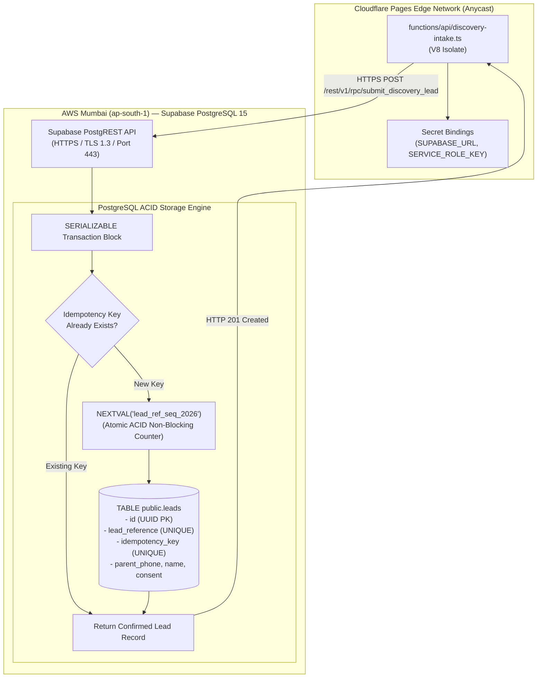

# ARNAV ABACUS ACADEMY (AAA) — SPRINT 3 WS-16
## Document Reference: `AAA-WS16-CAP01-DES-DB-01`
### Deliverable 3: CAP-WS16-01 Database Schema, Atomic Identity & Persistence Design

**Document Version:** 1.0.0  
**Planning Date:** 05-November-2026  
**Governing Authority:** `MGT-DET-S4-S3-AUTH-02`  
**Governing Audit Reference:** `AAA-S3-REG-WS16-AUDIT-FINAL-01` & `AAA-WS16-REC-FINAL-01`  
**Target Infrastructure:** Supabase PostgreSQL in AWS Mumbai (`ap-south-1`)  
**Production Status:** 🔒 **STRICTLY LOCKED** (`a21a3d1129cc17fc6650bfd04648eb91199e6fa8`)  
**Accountable Leaders:** Nitin Patil (Operations, Tech & Compliance) & Neha Patil (Founder & Academic Director)

---

## 1. Executive Summary & Design Scope

The verification audit (`AAA-WS16-VERIF-PERSIST-01`) established that the current Cloudflare Pages Function operates on an ephemeral in-memory state (`leadSequenceCounter = 1`), causing sequence collisions across distributed edge isolates and losing all records upon isolate restarts.

This design specification provides the complete, production-ready PostgreSQL database architecture, atomic sequence generator, and secure REST ingestion contract to establish **durable, tamper-proof persistence** in AWS Mumbai (`ap-south-1`).

---

## 2. Supabase PostgreSQL Mumbai Architecture



---

## 3. Database Schema Specification (DDL)

The following schema defines the sovereign data store to be provisioned in Supabase PostgreSQL Mumbai upon implementation authorization:

```sql
-- ============================================================================
-- ARNAV ABACUS ACADEMY (AAA) — ADMISSIONS DATA SCHEMA
-- Environment: Supabase PostgreSQL 15 (AWS Mumbai ap-south-1)
-- Specification Reference: AAA-WS16-CAP01-DES-DB-01
-- ============================================================================

-- 1. Enable required cryptographic extensions
CREATE EXTENSION IF NOT EXISTS "uuid-ossp";
CREATE EXTENSION IF NOT EXISTS "pgcrypto";

-- 2. Create annual atomic sequence for lead references
-- Non-blocking, thread-safe, guaranteed collision-free
CREATE SEQUENCE IF NOT EXISTS public.lead_ref_seq_2026
    START WITH 1
    INCREMENT BY 1
    NO MINVALUE
    MAXVALUE 99999
    CACHE 1;

-- 3. Core Admissions Leads Table
CREATE TABLE IF NOT EXISTS public.leads (
    -- Tier 1: System Immutable Primary Key
    id UUID PRIMARY KEY DEFAULT gen_random_uuid(),
    
    -- Tier 2: Human-Readable Authoritative Lead Reference
    lead_reference VARCHAR(24) NOT NULL,
    
    -- Tier 3: Client Idempotency Key (24-hour duplicate protection)
    idempotency_key UUID NOT NULL,
    
    -- Ingress Metadata & Zero-PII Audit Hashes
    source_channel VARCHAR(32) NOT NULL DEFAULT 'WEB_DISCOVERY',
    client_ip_hash VARCHAR(64) NOT NULL,
    user_agent_hash VARCHAR(64),
    
    -- Parent & Student Inquiry Attributes (Canonical / Verbatim)
    parent_name VARCHAR(120) NOT NULL,
    mobile_number VARCHAR(15) NOT NULL,
    email VARCHAR(120),
    child_age_bracket VARCHAR(20) NOT NULL,
    course_interest VARCHAR(40) NOT NULL,
    notes TEXT,
    
    -- DPDP Act 2023 Statutory Consent & Guardian Authority
    consent_service_version VARCHAR(24) NOT NULL DEFAULT 'CONSENT_SERVICE_V1',
    consent_service_granted_at TIMESTAMPTZ NOT NULL DEFAULT TIMEZONE('Asia/Kolkata', NOW()),
    consent_marketing_version VARCHAR(24),
    consent_marketing_granted_at TIMESTAMPTZ,
    guardian_authority_type VARCHAR(40) NOT NULL DEFAULT 'GUARDIAN_AUTHORITY_SELF_DECLARATION_V1',
    
    -- Admissions Lifecycle State Machine
    lifecycle_status VARCHAR(40) NOT NULL DEFAULT 'ENQUIRY_RECEIVED',
    
    -- Record Timestamps & 90-Day Prospect Retention Purge Clock
    created_at TIMESTAMPTZ NOT NULL DEFAULT TIMEZONE('Asia/Kolkata', NOW()),
    updated_at TIMESTAMPTZ NOT NULL DEFAULT TIMEZONE('Asia/Kolkata', NOW()),
    retention_purge_due_at TIMESTAMPTZ NOT NULL DEFAULT (TIMEZONE('Asia/Kolkata', NOW()) + INTERVAL '90 days'),
    
    -- Hard Constraints
    CONSTRAINT uq_leads_lead_reference UNIQUE (lead_reference),
    CONSTRAINT uq_leads_idempotency_key UNIQUE (idempotency_key)
);

-- Indexing for rapid staff lookups and deduplication queries
CREATE INDEX IF NOT EXISTS idx_leads_mobile_created ON public.leads (mobile_number, created_at DESC);
CREATE INDEX IF NOT EXISTS idx_leads_idempotency ON public.leads (idempotency_key);
CREATE INDEX IF NOT EXISTS idx_leads_retention_purge ON public.leads (retention_purge_due_at) WHERE lifecycle_status = 'ENQUIRY_RECEIVED';
```

---

## 4. Atomic Sequence Allocation & Stored Procedure (ACID Engine)

To guarantee that concurrent requests processed by different Cloudflare edge nodes receive unique, strictly sequential references without race conditions:

```sql
CREATE OR REPLACE FUNCTION public.fn_submit_discovery_lead(
    p_idempotency_key UUID,
    p_parent_name VARCHAR,
    p_mobile_number VARCHAR,
    p_email VARCHAR,
    p_child_age_bracket VARCHAR,
    p_course_interest VARCHAR,
    p_service_consent BOOLEAN,
    p_marketing_consent BOOLEAN,
    p_guardian_confirmed BOOLEAN,
    p_client_ip_hash VARCHAR
)
RETURNS JSONB
LANGUAGE plpgsql
SECURITY DEFINER
AS $$
DECLARE
    v_existing_lead RECORD;
    v_next_seq BIGINT;
    v_current_year VARCHAR(4);
    v_new_lead_ref VARCHAR(24);
    v_new_id UUID;
    v_created_at TIMESTAMPTZ;
BEGIN
    -- 1. Idempotency Check (24-Hour Re-submission Window)
    SELECT id, lead_reference, created_at
    INTO v_existing_lead
    FROM public.leads
    WHERE idempotency_key = p_idempotency_key;
    
    IF FOUND THEN
        -- Return existing lead record without creating duplicate or advancing sequence
        RETURN jsonb_build_object(
            'success', true,
            'isDuplicate', true,
            'id', v_existing_lead.id,
            'leadReference', v_existing_lead.lead_reference,
            'createdAt', v_existing_lead.created_at,
            'message', 'Duplicate submission detected. Existing booking retained.'
        );
    END IF;

    -- 2. Validate Mandatory Statutory Conditions
    IF NOT p_guardian_confirmed THEN
        RAISE EXCEPTION 'Guardian Authority Self-Declaration is mandatory under Section 9 DPDP Act 2023.';
    END IF;

    IF NOT p_service_consent THEN
        RAISE EXCEPTION 'Service communication consent is required to coordinate diagnostic assessment.';
    END IF;

    -- 3. Atomic Sequence Allocation
    v_current_year := TO_CHAR(TIMEZONE('Asia/Kolkata', NOW()), 'YYYY');
    v_next_seq := NEXTVAL('public.lead_ref_seq_2026');
    v_new_lead_ref := 'AAA-LEAD-' || v_current_year || '-' || LPAD(v_next_seq::TEXT, 5, '0');
    v_created_at := TIMEZONE('Asia/Kolkata', NOW());

    -- 4. Insert Authoritative Lead Record
    INSERT INTO public.leads (
        idempotency_key,
        lead_reference,
        parent_name,
        mobile_number,
        email,
        child_age_bracket,
        course_interest,
        consent_service_version,
        consent_service_granted_at,
        consent_marketing_version,
        consent_marketing_granted_at,
        guardian_authority_type,
        client_ip_hash,
        created_at,
        updated_at
    ) VALUES (
        p_idempotency_key,
        v_new_lead_ref,
        p_parent_name,
        p_mobile_number,
        p_email,
        p_child_age_bracket,
        p_course_interest,
        'CONSENT_SERVICE_V1',
        v_created_at,
        CASE WHEN p_marketing_consent THEN 'CONSENT_MARKETING_V1' ELSE NULL END,
        CASE WHEN p_marketing_consent THEN v_created_at ELSE NULL END,
        'GUARDIAN_AUTHORITY_SELF_DECLARATION_V1',
        p_client_ip_hash,
        v_created_at,
        v_created_at
    )
    RETURNING id INTO v_new_id;

    -- 5. Return Successful Persistence Payload
    RETURN jsonb_build_object(
        'success', true,
        'isDuplicate', false,
        'id', v_new_id,
        'leadReference', v_new_lead_ref,
        'createdAt', v_created_at,
        'message', 'Discovery session inquiry registered and permanently persisted.'
    );
END;
$$;
```

---

## 5. Cloudflare Pages Function Integration Contract

`functions/api/discovery-intake.ts` will connect to Supabase via standard HTTPS REST fetch (PostgREST RPC endpoint) requiring zero external npm libraries:

```typescript
// Contract inside handleDiscoveryIntakeRequest:
const supabaseUrl = env.SUPABASE_URL; // e.g., https://xyz.supabase.co
const serviceRoleKey = env.SUPABASE_SERVICE_ROLE_KEY;

const rpcResponse = await fetch(`${supabaseUrl}/rest/v1/rpc/fn_submit_discovery_lead`, {
  method: 'POST',
  headers: {
    'Content-Type': 'application/json',
    'apikey': serviceRoleKey,
    'Authorization': `Bearer ${serviceRoleKey}`,
    'Prefer': 'return=representation',
  },
  body: JSON.stringify({
    p_idempotency_key: idempotencyKey,
    p_parent_name: payload.parentName,
    p_mobile_number: phoneValidation.normalized,
    p_email: payload.parentEmail || null,
    p_child_age_bracket: payload.childAgeBracket,
    p_course_interest: payload.courseInterest,
    p_service_consent: payload.serviceConsent,
    p_marketing_consent: payload.marketingConsent || false,
    p_guardian_confirmed: payload.parentGuardianConfirmed,
    p_client_ip_hash: clientIpHashed,
  }),
});

if (!rpcResponse.ok) {
  const errData = await rpcResponse.json();
  return new Response(JSON.stringify({
    statusCode: 500,
    success: false,
    error: 'Database persistence failed. Ingestion aborted.',
    details: errData.message
  }), { status: 500, headers });
}

const persistenceResult = await rpcResponse.json();
// HTTP 201 is returned ONLY after confirmed database commit:
return new Response(JSON.stringify({
  statusCode: 201,
  success: true,
  id: persistenceResult.id,
  leadReference: persistenceResult.leadReference,
  createdAt: persistenceResult.createdAt,
  message: persistenceResult.message
}), { status: 201, headers });
```

---

## 6. Security, Permissions & Least-Privilege Isolation

1. **Row Level Security (RLS):**
   ```sql
   ALTER TABLE public.leads ENABLE ROW LEVEL SECURITY;
   -- Anonymous public internet users have ZERO read or write access
   REVOKE ALL ON public.leads FROM anon;
   -- Only the service_role key (used exclusively by the Edge Worker) has access
   GRANT ALL ON public.leads TO service_role;
   GRANT EXECUTE ON FUNCTION public.fn_submit_discovery_lead TO service_role;
   ```
2. **Credential Secrecy:**
   - The `service_role` key is **never** embedded in frontend JavaScript or checked into Git.
   - It is injected as an encrypted secret in the Cloudflare Pages deployment dashboard.

---

## 7. Sign-Off & Verification Block

| Governance Role | Name | Designation | Signature Status | Date |
| :--- | :--- | :--- | :--- | :--- |
| **Principal Architect** | Lead Governance & Systems Architect | AAA Engineering | Verified & Submitted | 05-Nov-2026 |
| **Operations & Compliance** | Nitin Patil | Operations, Tech & Compliance Director | Pending Formal Review | [Pending] |
| **Academic & Admissions** | Neha Patil | Founder & Academic Director | Pending Formal Review | [Pending] |
