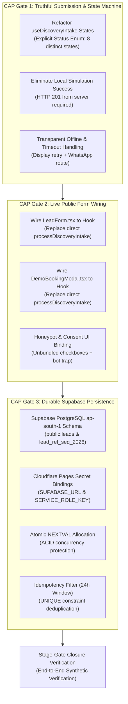

# ARNAV ABACUS ACADEMY (AAA) — SPRINT 3 WS-16
## Document Reference: `AAA-WS16-CAP01-PLAN-01`
### Deliverable 1: CAP-WS16-01 Corrective Action Execution Master Plan

**Document Version:** 1.0.0  
**Planning Date:** 05-November-2026  
**Governing Authority:** `MGT-DET-S4-S3-AUTH-02`  
**Governing Audit Reference:** `AAA-S3-REG-WS16-AUDIT-FINAL-01` & `AAA-WS16-REC-FINAL-01`  
**Inspection Baseline Snapshot:** Commit `51b7322` on branch `feat/sprint3-integration`  
**Production Status:** 🔒 **STRICTLY LOCKED** (`a21a3d1129cc17fc6650bfd04648eb91199e6fa8`)  
**Accountable Leaders:** Nitin Patil (Operations, Tech & Compliance) & Neha Patil (Founder & Academic Director)

---

## 1. Executive Mission & Problem Definition

Following the independent verification audit (`AAA-WS16-REC-FINAL-01`), Management formally resolved to:
1. Accept the verification findings regarding absence of durable persistence, isolate sequence concurrency failure, false offline success states, and component bypass.
2. Maintain the production `main` lock and implementation blocks on WS-17 and WS-18.
3. Preserve commit `51b7322` as the immutable inspection baseline.
4. Formulate **Corrective Action Plan CAP-WS16-01** covering three non-negotiable implementation gates:
   - **Gate 1:** Truthful Submission & Elimination of False Offline Success.
   - **Gate 2:** Full Integration of Live Public Forms (`LeadForm.tsx` & `DemoBookingModal.tsx`) to `useDiscoveryIntake`.
   - **Gate 3:** Durable Supabase PostgreSQL Persistence & Atomic Sequence Allocation.

---

## 2. Strict Execution Boundary & Compliance Rules

This document represents an **authoritative planning, specification, and inspection exercise only**:
- **Zero Code Modification:** Exactly zero application source files (`.ts`, `.tsx`, `.js`, `.css`) shall be modified during this exercise.
- **Zero Schema Migrations:** No SQL statements shall be executed against live or staging databases.
- **Zero Secret Ingestion:** No live API keys, tokens, or environment variables shall be provisioned or exposed in documentation.
- **Zero Package Installations:** No new npm packages shall be added to `package.json`.
- **Zero Remote Operations:** No commits, pushes, merges, resets, or deployments shall occur.
- **Preserved Snapshot:** Commit `51b7322` remains the untouched inspection snapshot on `feat/sprint3-integration`.
- **AcademyOS Boundary:** All practice platform routes (`/login`, `/practice/*`) remain strictly untouched.
- **Synthetic Data Standard:** No real parent, child, or staff personal identifiers shall be used in test specifications.

---

## 3. Work Breakdown Structure: Three Core Implementation Gates



---

## 4. Detailed Specification of Implementation Gates

### 4.1 CAP Gate 1: Truthful Submission & Offline State Machine

#### Defect in Baseline Commit `51b7322`:
In `src/hooks/useDiscoveryIntake.ts` lines 256–265, when `fetch('/api/discovery-intake')` fails (due to network failure, airplane mode, or 404 in static dev preview), the hook falls back to `processDiscoveryIntake(payload)`, generates a synthetic 200 OK, and transitions to `SUCCESS`. The parent is presented with a "Booking Confirmed" card and a fake Lead Reference, despite zero data being transmitted or stored.

#### Corrective Action Specification:
1. **Explicit Submission State Machine:** Replace the current loose status strings with an authoritative enum:
   ```typescript
   export type DiscoverySubmissionStatus =
     | 'IDLE'                   // Pristine form state
     | 'VALIDATING'             // Client-side schema, phone & consent checks
     | 'SUBMITTING'             // Active network fetch in transit
     | 'SERVER_CONFIRMED'       // Server returned HTTP 201 with confirmed persistence
     | 'NETWORK_OFFLINE_ERROR'  // Browser offline or network fetch failed
     | 'SERVER_REJECTED'        // Server returned HTTP 400 or 422
     | 'RATE_LIMITED'           // Server returned HTTP 429
     | 'UNCERTAIN_TIMEOUT';     // Request timed out (>10s) with unknown server state
   ```
2. **Server-Confirmed Success Requirement:**
   `status = 'SERVER_CONFIRMED'` shall be set **strictly and exclusively** when:
   - `response.status === 201` (or 200 with verified persistence flag).
   - `response.leadReference` matches regex `^AAA-LEAD-\d{4}-\d{5}$`.
   - `response.id` (database UUID) is present.
3. **Network Offline & HTTP 404 Handling:**
   - If `fetch` throws a `TypeError` (network drop) or returns `status === 404` (server gateway unavailable):
   - **ZERO local simulation shall occur.**
   - Hook transitions to `status = 'NETWORK_OFFLINE_ERROR'`.
   - UI renders:
     > *"Unable to connect to admissions gateway. Your inquiry was NOT submitted online. Please retry or connect directly via verified WhatsApp."*
4. **Idempotency Preservation During Retries:**
   - The client-generated `idempotencyKey` (UUIDv4) is generated when the user clicks Submit and retained in state.
   - If the user clicks "Retry Submission" following a timeout or network failure, the **exact same `idempotencyKey`** is transmitted.
   - If the previous request actually reached the server before the connection broke, the server safely returns the original lead record without creating a duplicate.
5. **WhatsApp Fallback Routing:**
   - When offline or upon user request, the UI surfaces a prominent button: **"Connect via Official WhatsApp"**.
   - URL: `https://wa.me/919021924968?text=...` (Neha Patil, Academic Director).
   - Visual Disclosure: *"Note: WhatsApp opens a direct chat with Neha Patil. It does not automatically create an online portal record until confirmed by academy staff."*

---

### 4.2 CAP Gate 2: Live Public Form Integration

#### Defect in Baseline Commit `51b7322`:
`LeadForm.tsx` and `DemoBookingModal.tsx` completely bypass `useDiscoveryIntake.ts`. Both files directly import and execute `processDiscoveryIntake` from `../lib/intakeGatewayEngine`, meaning live user submissions never trigger the server-side gateway endpoint.

#### Corrective Action Specification:
1. **Target Components for Refactoring:**
   - `src/components/LeadForm.tsx` (Homepage & Contact inquiries).
   - `src/components/DemoBookingModal.tsx` (Program pages & parent guide popups).
   - `src/components/GuestSampleGatewayModal.tsx` (Worksheet vault sample lead gate).
2. **Standardized Data Flow Architecture:**
   ```mermaid
   flowchart LR
       User["Parent Form Input<br/>(Name, Mobile, Age, Program)"] --> Component["LeadForm.tsx / DemoBookingModal.tsx<br/>(Presentation & UI Controls)"]
       Component --> Hook["useDiscoveryIntake Hook<br/>(State, Validation & Idempotency)"]
       Hook -->|POST /api/discovery-intake| Endpoint["Cloudflare Pages Function<br/>(Hardware IP, WAF, Rate Limiting)"]
       Endpoint -->|PostgreSQL Transaction| Database["Supabase PostgreSQL ap-south-1<br/>(public.leads & lead_ref_seq_2026)"]
   ```
3. **Form-to-Hook Contract:**
   - Both forms shall bind their local inputs to `useDiscoveryIntake`:
     ```typescript
     const {
       parentName, setParentName,
       parentPhone, setParentPhone,
       childAgeBracket, setChildAgeBracket,
       courseInterest, setCourseInterest,
       serviceConsent, setServiceConsent,
       marketingConsent, setMarketingConsent,
       parentGuardianConfirmed, setParentGuardianConfirmed,
       honeypotField, setHoneypotField,
       status, isSubmitting, isSuccess, errorMessage, leadUID,
       handleSubmit, resetForm, whatsappFallbackUrl
     } = useDiscoveryIntake({
       defaultCourse: program,
       defaultAgeBracket: childAge,
       sourceCampaign: sourceCampaign || 'WEBSITE_ORGANIC'
     });
     ```
4. **Elimination of Bypasses:**
   - Remove `import { processDiscoveryIntake } from '../lib/intakeGatewayEngine'` from all form components.
   - Form `<form onSubmit={handleSubmit}>` directly delegates execution to the hook.

---

### 4.3 CAP Gate 3: Durable Supabase PostgreSQL Persistence & Atomic Sequence

#### Defect in Baseline Commit `51b7322`:
`functions/api/discovery-intake.ts` handles request validation, but generates responses entirely in RAM. Global variables `leadSequenceCounter = 1` and `rateLimitCache` reset upon worker isolate recycling and fail across multi-node Cloudflare edge PoPs.

#### Corrective Action Specification:
1. **Target Cloud Region:**
   - AWS Mumbai (`ap-south-1`), Maharashtra, India (Strict domestic data sovereignty).
2. **Cloudflare Pages Secret Bindings:**
   - `SUPABASE_URL`: Sovereign project endpoint (`https://<project-ref>.supabase.co`).
   - `SUPABASE_SERVICE_ROLE_KEY`: Privileged server-side key (Never exposed to browser bundles).
3. **Database Schema Deployment (`public.leads` & `lead_ref_seq_2026`):**
   - Atomic sequence `lead_ref_seq_2026` starting at 1 with `INCREMENT BY 1`.
   - `lead_reference` column formatted as `AAA-LEAD-2026-XXXXX` populated via atomic trigger `fn_allocate_lead_reference()` executing `NEXTVAL`.
   - Constraints: `CONSTRAINT uq_leads_reference UNIQUE (lead_reference)` and `CONSTRAINT uq_leads_idempotency UNIQUE (idempotency_key)`.
4. **Distributed Concurrency & Idempotency Guarantee:**
   - Multiple simultaneous submissions across different Cloudflare PoPs execute independent `INSERT` statements. PostgreSQL row-level locks and atomic sequences guarantee zero sequence collisions.
   - If an identical `idempotency_key` is submitted within 24 hours, PostgreSQL intercepts via `ON CONFLICT (idempotency_key) DO NOTHING` or pre-query, returning the established lead reference.

---

## 5. Residual Audit Findings Register

The following items are formally registered as active governance items to be addressed following Gates 1–3:

| Residual Finding ID | Scope | Root Cause & Current State | Planned Resolution |
| :---: | :--- | :--- | :--- |
| **RES-01** | **Distributed Rate Limiting** | In-memory `Map` lacks cross-PoP sync; client can forge `CF-Connecting-IP` if unproxied. | Configure Cloudflare WAF Zone Rate Limiting Rule (5 req / 15 min) at DNS edge; integrate Upstash Redis for multi-PoP state. |
| **RES-02** | **Orphaned CSV Transformer** | `formatCellForCsvExport` exists in engine but no CSV export UI exists in website. | Wire transformer into internal AcademyOS admissions lead export utility in Sprint 4. |
| **RES-03** | **Architecture Deviation Ratification** | Shift from AWS Lambda to Cloudflare Pages Functions lacks formal Master Plan addendum. | Issue `AAA-S3-ADDENDUM-ARCH-01` formally ratifying Cloudflare Edge compute with Supabase Mumbai data residency. |
| **RES-04** | **Workstream Naming Reconciliation** | Informal logs colloquially named WS-17 and WS-18. | Enforce authoritative Master Plan definitions: WS-17 (Post-Submission Discovery UX) & WS-18 (AcademyOS Ingestion Sync). |
| **RES-05** | **Test Suite WS Labelling** | Test runner output grouped WS-15/WS-16 under legacy headers. | Update test banner strings to reflect official Sprint 3 taxonomy without modifying test assertions. |
| **RES-06** | **AcademyOS Hash Lockdown** | Mandatory ongoing protection of `/login` and `/practice/*`. | Enforce continuous SHA-256 Git blob comparison against `main` on every pull request. |

---

## 6. Execution Milestones & Target Deliverables

```
docs/04_implementation/
├── AAA_WS16_CAP01_Implementation_Plan.md                 (AAA-WS16-CAP01-PLAN-01) - Deliverable 1
├── AAA_WS16_CAP01_File_Change_and_Dependency_Register.md (AAA-WS16-CAP01-REG-FILE-01) - Deliverable 2
├── AAA_WS16_CAP01_Database_and_Identity_Design.md        (AAA-WS16-CAP01-DES-DB-01) - Deliverable 3
├── AAA_WS16_CAP01_Test_and_Acceptance_Matrix.md          (AAA-WS16-CAP01-MAT-TEST-01) - Deliverable 4
├── AAA_WS16_CAP01_Risk_and_Rollback_Plan.md              (AAA-WS16-CAP01-PLAN-RISK-01) - Deliverable 5
└── AAA_WS16_CAP01_Management_Approval_Request.md         (AAA-WS16-CAP01-REQ-MGT-01) - Deliverable 6
```

---

## 7. Sign-Off & Verification Block

| Governance Role | Name | Designation | Signature Status | Date |
| :--- | :--- | :--- | :--- | :--- |
| **Principal Architect** | Lead Governance & Systems Architect | AAA Engineering | Verified & Submitted | 05-Nov-2026 |
| **Operations & Compliance** | Nitin Patil | Operations, Tech & Compliance Director | Awaiting Implementation Authorization | [Pending] |
| **Academic & Admissions** | Neha Patil | Founder & Academic Director | Awaiting Implementation Authorization | [Pending] |
