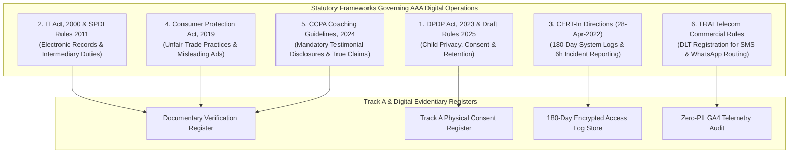
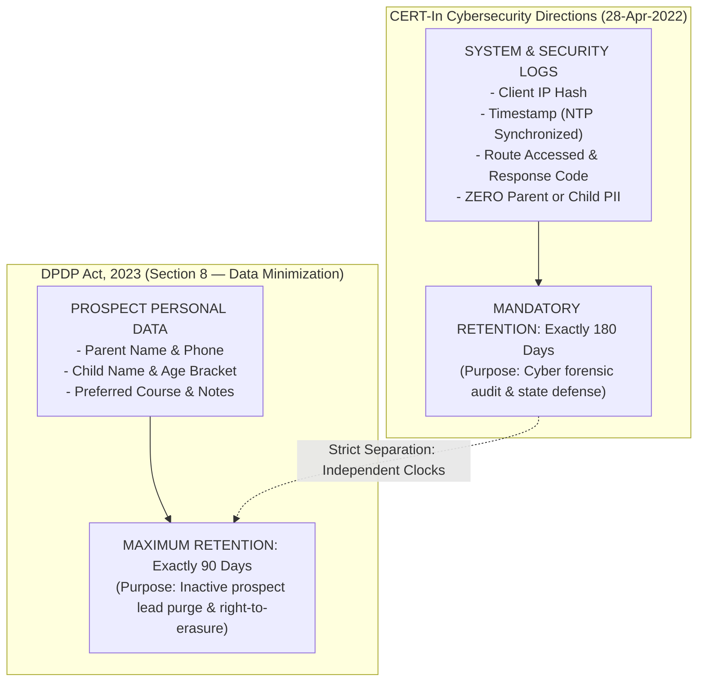

# ARNAV ABACUS ACADEMY (AAA) — SPRINT 3 WS-16 CAP-WS16-01
## Document Reference: `AAA-WS16-CAP01-LEG-INDIA-01`
### Deliverable F4: Indian Statutory, Regulatory & Legal Compliance Matrix

**Document Version:** 1.0.0  
**Assessment Date:** 05-November-2026  
**Governing Authority:** `MGT-DET-S4-S3-AUTH-02`  
**Governing Workstream:** Additional Workstream F (Cost, Security, Legal & Compliance)  
**Jurisdiction:** Republic of India / State of Maharashtra / Pune District  
**Production Status:** 🔒 **STRICTLY LOCKED** (`a21a3d1129cc17fc6650bfd04648eb91199e6fa8`)  
**Accountable Leaders:** Nitin Patil (Operations, Tech & Compliance) & Neha Patil (Founder & Academic Director)

---

## 1. Executive Summary & Legal Disclaimers

This matrix audits the applicability, commencement status, evidentiary requirements, and operational exposure of the AAA digital platform under prevailing Indian federal and state statutes.

### Mandatory Legal Disclaimer:
> **Regulatory Disclaimer:**  
> This assessment constitutes an internal technical and operational compliance review. It **does not constitute formal legal counsel**. Certain determinations—specifically regarding enterprise entity structuring, DPDP parental age verification thresholds, and CCPA coaching guideline coverage—require independent formal sign-off by AAA’s designated legal advocate.

---

## 2. Indian Statutory Frameworks & Regulatory Applicability Matrix

| Regulatory Instrument | Relevant Provisions | Commencement & Notification Status | Applicability to AAA | Current Operational Implications | Evidentiary Records AAA Must Retain | Matters Requiring Independent Legal Advice |
| :--- | :--- | :--- | :--- | :--- | :--- | :--- |
| **1. Digital Personal Data Protection Act, 2023 (DPDP Act)** | Sections 4, 5, 6, 7, 8, 9, 11, 12, 13 | **Enacted 11-Aug-2023.** Substantive provisions take effect upon Gazette Notification; statutory enforcement phased through 2025–2026. | **Directly Applicable.** AAA operates as a "Data Fiduciary" processing personal data of parents and children in India. | - Mandatory unbundled consent (`CONSENT_SERVICE_V1`). - Section 9 prohibition against behavioral profiling of children. - 90-day prospect retention and cryptographic shredding. | - Cryptographic Purge Certificates (`HMAC-SHA256`). - Consent grant audit logs (Timestamp, IP hash, Version). - In-person signed physical consent registers. | Formal opinion on whether online web self-declaration constitutes adequate threshold for pre-enrollment contact prior to in-person diagnostic sessions. |
| **2. Digital Personal Data Protection Rules, 2025 (Draft)** | Procedural rules on parental consent verification & DPO designation. | **Pending final gazetted notification** following public consultation. | **Future Readiness.** Will govern procedural compliance once notified. | - Architecture prepared for digital verifiable consent tokens. - Privacy Notice wording aligned to statutory templates. | - Documented Privacy Notice versioning log. - Evidence of grievance redressal turnaround within statutory SLA. | Legal confirmation of specific digital identity verification methods prescribed for coaching academies once rules are finalized. |
| **3. Information Technology Act, 2000 & SPDI Rules 2011** | Sections 43A, 72A; Reasonable Security Practices (SPDI Rules). | **In force.** Section 43A remains effective until superseded by DPDP operationalization. | **Directly Applicable.** Governs sensitive personal data protection and civil liability for negligence in data handling. | - Implementation of reasonable security practices. - AES-256 encryption at rest; TLS 1.3 in transit. - Published Privacy Policy with designated Grievance Officer. | - Information Security Policy document. - Git repository commit logs and architectural reviews. - SSL/TLS certificate validation records. | Review of commercial Terms of Service and Website Terms of Use. |
| **4. CERT-In Directions (28 April 2022)** | Direction No. 20(3)/2022-CERT-In (Ref: Log Retention & Reporting). | **In force since 27-June-2022.** | **Directly Applicable.** Applies to all entities, corporations, and intermediaries handling digital systems in India. | - **Mandatory 180-Day System Log Retention:** System and security logs (IP hashes, timestamps, routes) must be preserved for 180 days within Indian jurisdiction. - **6-Hour Incident Reporting:** Obligation to report cybersecurity incidents to CERT-In within 6 hours of detection. - **NTP Time Sync:** System clocks must synchronize with National Physical Laboratory (NPL) or NIC NTP servers. | - 180-day rolling security event logs in AWS Mumbai. - NTP synchronization configuration records. - Designated Point of Contact (PoC) communication log with CERT-In. | Formal determination of whether small proprietary educational coaching centers fall under mandatory CERT-In reporting scrutiny. |
| **5. Consumer Protection Act, 2019** | Section 2(28) (Misleading Ads), Section 89 (Punitive Penalties). | **In force since 20-July-2020.** | **Directly Applicable.** Prohibits false claims, deceptive descriptions, and unsubstantiated academic guarantees. | - Absolute prohibition of the word `"Guaranteed"` in headings or marketing copy. - Removal of unverified terms like `"Government Recognized"` or `"Master Trainer"`. - Factual alignment to certificate: *"Certified Trainer of Abacus & Vedic Mathematics"*. | - Documentary Verification Register (`AAA-S4-EVID-01`). - Physical inspection records of teacher training certificates. - Center Authorised Skill Centre certificate (`CI2023/100000455`). | None. Factual alignment is strictly maintained. |
| **6. CCPA Coaching Sector Guidelines, 2024** | Guidelines for Prevention of Misleading Advertisements in Coaching Sector (Nov 2024). | **In force (Issued November 2024).** | **Directly Applicable.** Specifically targets all educational coaching institutions, tutoring centers, and competitive exam training academies. | - Mandatory disclosure on all student testimonials: Student Name, Exact Course Enrolled, Course Duration, and Paid/Free status. - Prohibition of cherry-picked competitive exam claims. - Truthful representation of small batch size: *"Personalised learning in small batches, with a maximum of five students per batch"*. | - 23-item Testimonial Compliance Register (`AAA-S4-TESTIM-01`). - Signed student/parent testimonial release forms in Track A Register. - Batch attendance sheets proving $\le 5$ students/batch. | Legal review of franchise student attribution wording where students participated across collaborative workshops. |
| **7. TRAI Telecom Commercial Communications Regulations (TCCCPR 2018)** | DLT (Distributed Ledger Technology) Entity & Header Registration. | **In force.** | **Directly Applicable** for automated SMS / commercial communications. | - Mandatory Principal Entity Registration with Indian Telecom Operator (Jio / Airtel / Vodafone). - Pre-registration of SMS headers (e.g. `ARNAVA`) and standardized message templates for OTP and booking reminders. - WhatsApp Business Cloud API requires verified Meta business profile. | - DLT Principal Entity Registration Certificate. - Approved SMS Header & Template Approval Register. - Meta Business Verification documentation. | None. Operational telecom compliance managed directly via registered telecom portal. |

---

## 3. Critical Legal Distinction: CERT-In 180-Day Logs vs. DPDP 90-Day Retention

A critical operational requirement is avoiding confusion between **Cybersecurity Audit Logs** and **Parent/Student Prospect Data**:

> **Statutory Rule of AAA:**  
> CERT-In’s 180-day retention mandate applies **exclusively to system, traffic, and security firewall logs** (containing zero PII). It shall **NEVER be used as a legal pretext to retain prospective parent phone numbers or children’s names beyond the 90-day DPDP Act retention clock**.

---

## 4. Entity Structure Impact on Statutory Compliance

AAA operates as an educational proprietorship skill development academy founded and managed by **Neha Patil** with operations overseen by **Nitin Patil**:
1. **MSME Registration:** AAA holds MSME Udyam Registration (`UDYAM-MH-26-0428987`) as a micro-enterprise.
2. **Statutory Reliefs:** Certain draft provisions of DPDP Act permit the Central Government to exempt specific classes of micro, small, and medium enterprises (MSMEs) from strict data protection officer appointment requirements.
3. **Non-Exempt Provisions:** MSME status **does NOT exempt AAA from Section 9 child privacy mandates**, zero-PII obligations, consumer protection truthfulness, or CERT-In 6-hour breach reporting.

---

## 5. Gating Categorization for Legal & Regulatory Controls

| Legal Control Domain | Operational Action | Gating Stage |
| :--- | :--- | :---: |
| **LEG-01: True Claim Standards** | Zero occurrences of "Guaranteed" or "Government Recognized" in all code. | **Must resolve before implementation** |
| **LEG-02: CCPA Testimonial Disclosures** | Include student name, course, duration, and paid disclosure on all quotes. | **Must resolve before implementation** |
| **LEG-03: DPDP Dual Consent Checks** | Service consent required; marketing consent unbundled and default unticked. | **Must resolve before implementation** |
| **LEG-04: CERT-In 180-Day System Logs** | Configure automated 180-day security log bucket in AWS Mumbai with NTP sync. | **Must resolve before staging** |
| **LEG-05: DLT Telecommunications Setup** | Complete Principal Entity DLT registration before dispatching transactional SMS. | **Must resolve before production** |
| **LEG-06: Formal Advocate Opinion** | Obtain written opinion on web guardian authority self-declaration validity. | **Must resolve before production** |
| **LEG-07: Track A Physical Registers** | Daily physical log maintenance at Adv. Balaji Sagar Bungalow, Wakad. | **Ongoing operational control** |

---

## 6. Sign-Off & Verification Block

| Governance Role | Name | Designation | Signature Status | Date |
| :--- | :--- | :--- | :--- | :--- |
| **Compliance Officer** | Regulatory Compliance Architect | Statutory Governance | Verified & Submitted | 05-Nov-2026 |
| **Operations & Compliance** | Nitin Patil | Operations, Tech & Compliance Director | Pending Formal Legal Endorsement | [Pending] |
| **Academic & Admissions** | Neha Patil | Founder & Academic Director | Pending Formal Legal Endorsement | [Pending] |
