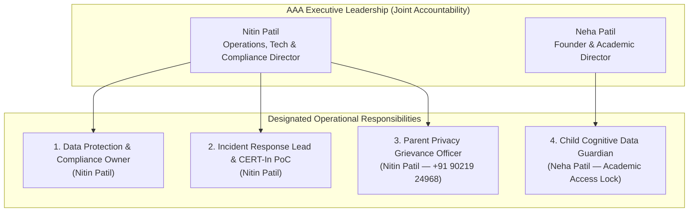
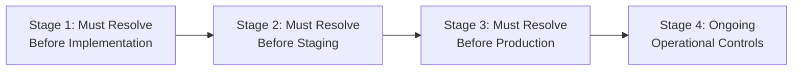

# ARNAV ABACUS ACADEMY (AAA) — SPRINT 3 WS-16 CAP-WS16-01
## Document Reference: `AAA-WS16-CAP01-REG-OPS-01`
### Deliverable F6: Operational Risk, Internal Control Register & Executive Sign-Off Briefing

**Document Version:** 1.0.0  
**Assessment Date:** 05-November-2026  
**Governing Authority:** `MGT-DET-S4-S3-AUTH-02`  
**Governing Workstream:** Additional Workstream F (Cost, Security, Legal & Compliance)  
**Inspection Baseline Snapshot:** Commit `51b7322` on branch `feat/sprint3-integration`  
**Production Status:** 🔒 **STRICTLY LOCKED** (`a21a3d1129cc17fc6650bfd04648eb91199e6fa8`)  
**Accountable Leaders:** Nitin Patil (Operations, Tech & Compliance) & Neha Patil (Founder & Academic Director)

---

## 1. Executive Summary & Purpose

This operational control register establishes the human governance structure, statutory responsibilities, audit cadences, and stage-gate approval requirements necessary to operationalize **CAP-WS16-01** within legal and security boundaries.

It synthesizes the findings from Deliverables F1 through F5, defines the master classification of all findings across the four delivery stages, and presents distinct executive decisions for Management consideration.

---

## 2. Institutional Human Governance Roles

To satisfy statutory mandates under the DPDP Act 2023, CERT-In Directions 2022, and Consumer Protection Act 2019, AAA designates the following official roles:

| Statutory Governance Role | Designated Individual | Official Contact Details | Core Operational Responsibilities |
| :--- | :--- | :--- | :--- |
| **1. Internal Privacy & Security Owner** | **Nitin Patil** | `nitinkpatil@gmail.com` `+91 90219 24968` | Direct architectural oversight of cloud infrastructure, database security, access control reviews, and encryption standards. |
| **2. Incident Response Lead & CERT-In PoC** | **Nitin Patil** | `nitinkpatil@gmail.com` Wakad Center Office | Responsible for managing the 6-hour CERT-In incident notification procedure and coordinating containment/mitigation protocols. |
| **3. Parent & Customer Grievance Officer** | **Nitin Patil** | `+91 90219 24968` Mon–Sat, 9:30 AM – 7:30 PM | Designated public contact under CPA 2019 and DPDP Act for receiving and resolving parent privacy inquiries, erasure requests, and service complaints within 48 hours. |
| **4. Child Cognitive Data Guardian** | **Neha Patil** | `neha.patil@arnavabacus.com` Wakad Center | Exclusive access controller for Option D diagnostic observation scores and child developmental profiles. Prohibits commercialization or external disclosure. |

---

## 3. Operational Review & Audit Cadence

| Operational Cadence | Activity & Procedure | Mandatory Documentation Produced | Responsible Owner |
| :--- | :--- | :--- | :--- |
| **Bi-Monthly (Every 2 Months)** | **Cloud Access & Privilege Review:** Inspect all active user accounts on Cloudflare, Supabase, GitHub, and Google Analytics. Revoke stale sessions; enforce MFA. | Access Review Sign-Off Log | Nitin Patil |
| **Monthly (Every 30 Days)** | **90-Day Prospect Purge Audit:** Execute automated query checking for prospect inquiries reaching 90 days. Verify cryptographic shredder outputs. | Cryptographic Purge Certificate (`HMAC-SHA256`) | Nitin Patil |
| **Quarterly (Every 90 Days)** | **Disaster Recovery & Backup Restoration Drill:** Restore a production `pg_dump` backup onto an isolated local/staging test database. Verify schema, row counts, and data integrity. | DR Restoration Verification Report (RTO < 5 mins) | Nitin Patil |
| **Quarterly (Every 90 Days)** | **Track A Physical Register Audit:** Inspect physical, on-site paper registers at Adv. Balaji Sagar Bungalow (fire safety, first aid log, admissions consent forms). | Physical Log Certification Sheet | Neha Patil |
| **Semi-Annually (Every 6 Months)** | **Subprocessor & Security Audit:** Review compliance certifications (SOC 2 / ISO 27001) for Cloudflare, Supabase, AWS, and Meta. Inspect dependency vulnerabilities (`npm audit`). | Subprocessor Security Review Register | Nitin Patil |
| **Annually (Every 12 Months)** | **Legal & Statutory Health-Check:** Formal legal consultation with AAA's designated advocate to review DPDP Rules gazettal, CCPA coaching guidelines, and consumer terms. | Written Legal Compliance Opinion | Nitin Patil & Neha Patil |

---

## 4. Master Finding Classification Across Delivery Stages

Every finding and control identified in Workstream F is mapped to a strict implementation gate:

### 4.1 Stage 1: Must Resolve Before Implementation
- **CTL-01 (Gate 1):** Refactor `useDiscoveryIntake.ts` state machine to 8 explicit states; completely purge local simulated success so network drops show transparent retry UI.
- **CTL-02 (Gate 2):** Wire `LeadForm.tsx` and `DemoBookingModal.tsx` to consume `useDiscoveryIntake`, eliminating direct calls to in-memory simulators.
- **CTL-03 (Gate 3 Design):** Finalize Supabase PostgreSQL DDL (`public.leads` & `lead_ref_seq_2026`) and stored procedure `fn_submit_discovery_lead()`.
- **CTL-04 (Zero-PII Logger):** Ensure server console logs emit only SHA-256 hashes of client IP and lead reference; zero raw names or phones.
- **CTL-05 (AcademyOS Lock):** Verify 100% bit-for-bit Git blob parity against `main` for all `/login` and `/practice/*` files.

### 4.2 Stage 2: Must Resolve Before Staging
- **CTL-06 (Secret Bindings):** Inject `SUPABASE_URL` and `SUPABASE_SERVICE_ROLE_KEY` exclusively into Cloudflare Pages environment secrets.
- **CTL-07 (Database RLS):** Deploy Row Level Security on `public.leads` locking all permissions from anonymous access and granting execution exclusively to `service_role`.
- **CTL-08 (Data Residency Pinning):** Verify Supabase PostgreSQL project is physically provisioned in AWS Mumbai (`ap-south-1`).
- **CTL-09 (Cognitive Data Isolation):** Enforce strict database role separation preventing admissions staff from accessing child cognitive observation records.
- **CTL-10 (CERT-In 180-Day System Logs):** Configure separate, encrypted 180-day access log bucket in AWS Mumbai with NTP time synchronization.

### 4.3 Stage 3: Must Resolve Before Production
- **CTL-11 (WAF Rate Limiting):** Deploy Cloudflare DNS/Zone rate limiting rule (5 requests per 15 minutes per IP) to disarm automated DDoS scrapers at the edge.
- **CTL-12 (Distributed Rate State):** Integrate Upstash Redis REST or Cloudflare KV for multi-PoP sliding-window rate tracking.
- **CTL-13 (DLT Commercial SMS):** Complete TRAI DLT Principal Entity Registration and template approvals before activating commercial A2P SMS notifications.
- **CTL-14 (Meta Business Profile):** Complete official Meta Business Verification for WhatsApp Cloud API integration.
- **CTL-15 (Legal Advocate Review):** Obtain formal written opinion confirming that web guardian authority self-declaration satisfies pre-enrollment discovery scheduling thresholds.
- **CTL-16 (Backup Restoration Test):** Successfully execute and document a live restoration test using `pg_dump` and `pg_restore`.

### 4.4 Stage 4: Ongoing Operational Controls
- **CTL-17 (Monthly 90-Day Purge):** Continuous execution of prospect retention shredder with cryptographic purge certificates.
- **CTL-18 (Bi-Monthly Access Audit):** Review active sessions across Cloudflare, Supabase, and GitHub; enforce hardware/TOTP MFA.
- **CTL-19 (Track A Physical Register Maintenance):** Daily physical logging at Adv. Balaji Sagar Bungalow, Wakad.
- **CTL-20 (Annual Subprocessor Review):** Annual review of cloud subprocessor security certifications.

---

## 5. Executive Management Decision Pack (Six Discrete Approvals)

To ensure unambiguous governance, AAA Management is presented with six discrete decisions:

### Decision 1: Architecture Approval
* **Scope:** Ratify the Cloudflare Pages Function edge compute layer connected to Supabase PostgreSQL in AWS Mumbai (`ap-south-1`) via HTTPS PostgREST.
* **Authority:** Nitin Patil (Operations & Tech Lead).
* **Status:** **PENDING FORMAL RATIFICATION**.

### Decision 2: Budget & Spending Ceiling Approval
* **Scope:** Approve the 12-month TCO baseline: ₹0/month staging budget, ₹3,667/month initial production baseline, and a hard monthly spending ceiling of **`₹5,000.00 / month`** with an automated 80% alert threshold at ₹4,000.00.
* **Authority:** Nitin Patil & Neha Patil (Joint Management).
* **Status:** **PENDING FORMAL BUDGET APPROVAL**.

### Decision 3: Security & Threat Model Approval
* **Scope:** Approve the defensive controls specification covering three-tier lead identity, WAF rate limiting, export formula neutralization (CWE-1236), least-privilege RLS, and 6-hour CERT-In incident notification runbook.
* **Authority:** Nitin Patil (Operations, Tech & Compliance Director).
* **Status:** **PENDING FORMAL SECURITY APPROVAL**.

### Decision 4: Privacy & Data Governance Approval
* **Scope:** Approve the 10-category data inventory, strict segregation of child cognitive observations (accessible to Neha Patil exclusively), 90-day prospect retention purge, and the legal distinction between `Guardian Authority Self-Declaration` and `Verifiable Parental Consent`.
* **Authority:** Neha Patil (Founder & Academic Director) & Nitin Patil (Compliance Lead).
* **Status:** **PENDING FORMAL PRIVACY APPROVAL**.

### Decision 5: Legal Review Mandate
* **Scope:** Formally instruct AAA’s designated legal advocate to issue written validation on the web guardian authority self-declaration and CCPA coaching guideline compliance prior to live production release.
* **Authority:** Nitin Patil & Neha Patil (Joint Management).
* **Status:** **PENDING ADVOCATE INSTRUCTION**.

### Decision 6: Implementation Authorization Status
* **Scope:** Authorization to transition from Planning to Implementation for CAP-WS16-01 on branch `feat/sprint3-integration`.
* **Current Status:** **WITHHELD / PENDING STAGE-GATE CLOSURE**.
* **Statutory Lock Affirmation:**  
  - WS-16: **NOT ACCEPTED** (Corrective action pending).  
  - WS-17: **STRICTLY BLOCKED**.  
  - WS-18: **STRICTLY BLOCKED**.  
  - Production `main`: **STRICTLY LOCKED** at `a21a3d1129cc17fc6650bfd04648eb91199e6fa8`.  
  - **NO IMPLEMENTATION, PROCUREMENT, PAID-SERVICE ACTIVATION, MIGRATION OR DEPLOYMENT AUTHORITY IS GRANTED BY THIS ASSESSMENT.**

---

## 6. Sign-Off & Verification Block

| Governance Role | Name | Designation | Signature Status | Date |
| :--- | :--- | :--- | :--- | :--- |
| **Principal Compliance Architect** | Lead Governance & Operational Auditor | Workstream F Governance | Verified & Submitted | 05-Nov-2026 |
| **Operations & Compliance** | Nitin Patil | Operations, Tech & Compliance Director | Pending Management Determination | [Pending] |
| **Academic & Admissions** | Neha Patil | Founder & Academic Director | Pending Management Determination | [Pending] |
