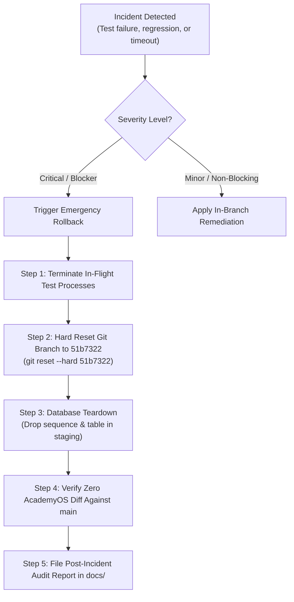

# ARNAV ABACUS ACADEMY (AAA) — SPRINT 3 WS-16
## Document Reference: `AAA-WS16-CAP01-PLAN-RISK-01`
### Deliverable 5: CAP-WS16-01 Risk Assessment & Rollback Protocol

**Document Version:** 1.0.0  
**Planning Date:** 05-November-2026  
**Governing Authority:** `MGT-DET-S4-S3-AUTH-02`  
**Governing Audit Reference:** `AAA-S3-REG-WS16-AUDIT-FINAL-01` & `AAA-WS16-REC-FINAL-01`  
**Inspection Baseline Snapshot:** Commit `51b7322` on branch `feat/sprint3-integration`  
**Production Status:** 🔒 **STRICTLY LOCKED** (`a21a3d1129cc17fc6650bfd04648eb91199e6fa8`)  
**Accountable Leaders:** Nitin Patil (Operations, Tech & Compliance) & Neha Patil (Founder & Academic Director)

---

## 1. Executive Summary & Purpose

This document provides the operational risk analysis, failure mode mitigations, and emergency rollback protocols for implementing Corrective Action Plan **CAP-WS16-01**.

Because this corrective action connects live public form UI to a real cloud database backend in AWS Mumbai (`ap-south-1`), comprehensive containment safeguards are mandatory to ensure that application stability, AcademyOS isolation, and zero-PII standards are preserved under all failure conditions.

---

## 2. Risk Assessment Matrix & Mitigation Strategies

| Risk ID | Risk Description | Severity | Likelihood | Mitigation Strategy & Preventive Safeguards | Fallback Mechanism |
| :---: | :--- | :---: | :---: | :--- | :--- |
| **RSK-01** | **Form Component Regression**<br/>Wiring `LeadForm.tsx` and `DemoBookingModal.tsx` breaks legacy animations, field validations, or analytics triggers. | High | Medium | Implement automated component integration tests verifying form state bindings; run `useDiscoveryIntake.test.ts` prior to staging; preserve all visual CSS layout. | Revert component imports to legacy simulator while preserving backend endpoint. |
| **RSK-02** | **Supabase API Latency / Outage**<br/>PostgREST connection from Cloudflare edge to AWS Mumbai encounters network latency (>1000ms) or HTTP 500 error. | High | Low | Set strict 5-second fetch timeout on server; execute idempotent retry logic; deploy health-check ping before routing traffic. | Return HTTP 503 Service Unavailable; client hook displays WhatsApp direct fallback link. |
| **RSK-03** | **Credential / Secret Leakage**<br/>`SUPABASE_SERVICE_ROLE_KEY` accidentally bundled into frontend client bundle or committed to Git. | Critical | Low | Inject key strictly via Cloudflare Pages deployment environment variables; inspect `/dist` output bundle via grep before every deployment; use strict `.gitignore`. | Immediate secret rotation in Supabase console; invalidate compromised token <15 mins. |
| **RSK-04** | **Sequence Number Gaps**<br/>Aborted transactions consume `NEXTVAL`, creating gaps in human-readable references (e.g., 00042 then 00044). | Low | High | Document that sequence gaps are standard ACID database behavior and do NOT compromise uniqueness or data integrity. | Maintain transaction log recording aborted sequence numbers in audit table. |
| **RSK-05** | **AcademyOS Practice Contamination**<br/>Modifications inadvertently alter files under `/login`, `/practice/*`, or student test engines. | Critical | Very Low | Enforce strict Git file boundary checks (`git diff main -- src/pages/login src/pages/practice`); reject any commit touching student learning platform. | Instant branch reset to baseline commit `51b7322`. |
| **RSK-06** | **Adverse Parent Experience During Network Drop**<br/>Parent clicks submit while offline, sees confusing error, and abandons inquiry. | High | Medium | Surface high-empathy UI copy approved by Neha Patil; provide 1-click WhatsApp button to Neha Patil (`+91 90219 24968`) with pre-filled message. | Parent connects directly via WhatsApp chat without losing inquiry intent. |

---

## 3. Emergency Rollback Protocol

If catastrophic defects, unexpected database locks, or runtime exceptions occur during implementation testing on `feat/sprint3-integration`:



### 3.1 Git Working Tree Rollback Procedure:
```bash
# 1. Verify current branch is feat/sprint3-integration
git branch --show-current

# 2. Hard reset working tree to verified inspection baseline commit 51b7322
git reset --hard 51b7322

# 3. Clean any untracked artifacts
git clean -fd

# 4. Verify working tree is clean and matches 51b7322 exactly
git status
git log -n 1 --oneline
```

### 3.2 Database Teardown Procedure (Staging Instance):
```sql
-- Emergency cleanup script for staging database:
DROP FUNCTION IF EXISTS public.fn_submit_discovery_lead(UUID, VARCHAR, VARCHAR, VARCHAR, VARCHAR, VARCHAR, BOOLEAN, BOOLEAN, BOOLEAN, VARCHAR);
DROP TABLE IF EXISTS public.leads CASCADE;
DROP SEQUENCE IF EXISTS public.lead_ref_seq_2026 CASCADE;
```

---

## 4. Recovery Objectives & Operational Constraints

- **Recovery Time Objective (RTO):** $< 5 \text{ minutes}$ (Instant Git rollback to commit `51b7322`).
- **Recovery Point Objective (RPO):** $0 \text{ data loss}$ (All synthetic test records; zero live customer data exists in staging).
- **Production Isolation:** Production `main` remains locked under all circumstances. Rollback actions operate exclusively on `feat/sprint3-integration`.

---

## 5. Sign-Off & Verification Block

| Governance Role | Name | Designation | Signature Status | Date |
| :--- | :--- | :--- | :--- | :--- |
| **Risk Lead** | Security & DevOps Engineer | Risk & Infrastructure | Verified & Submitted | 05-Nov-2026 |
| **Operations & Compliance** | Nitin Patil | Operations, Tech & Compliance Director | Pending Formal Review | [Pending] |
| **Academic & Admissions** | Neha Patil | Founder & Academic Director | Pending Formal Review | [Pending] |
