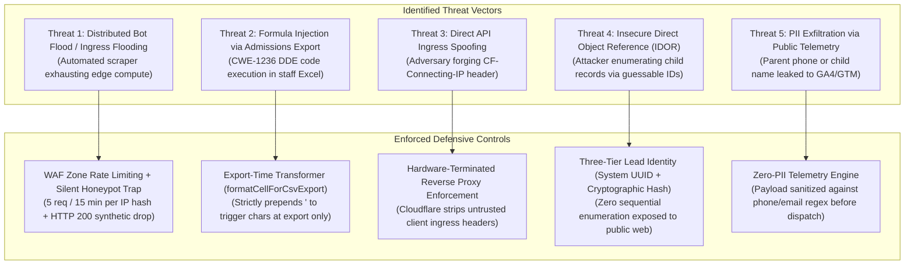

# ARNAV ABACUS ACADEMY (AAA) — SPRINT 3 WS-16 CAP-WS16-01
## Document Reference: `AAA-WS16-CAP01-SEC-THREAT-01`
### Deliverable F2: Cybersecurity Architecture, Threat Modeling & Defensive Controls Assessment

**Document Version:** 1.0.0  
**Assessment Date:** 05-November-2026  
**Governing Authority:** `MGT-DET-S4-S3-AUTH-02`  
**Governing Workstream:** Additional Workstream F (Cost, Security, Legal & Compliance)  
**Inspection Baseline Snapshot:** Commit `51b7322` on branch `feat/sprint3-integration`  
**Production Status:** 🔒 **STRICTLY LOCKED** (`a21a3d1129cc17fc6650bfd04648eb91199e6fa8`)  
**Accountable Leaders:** Nitin Patil (Operations, Tech & Compliance) & Neha Patil (Founder & Academic Director)

---

## 1. Executive Summary & Audit Posture

This security assessment reviews the defensive envelope, secret management, threat models, and vulnerability mitigations governing the AAA digital admissions platform under **CAP-WS16-01**.

### Mandatory Evidentiary Disclaimer:
> **Auditor Disclaimer:**  
> AAA makes **no claims of third-party ISO 27001, SOC 2, or CREST penetration test certifications** for the application codebase. This assessment represents an internal architectural security review and threat model conducted against established standards (OWASP Top 10, CWE-1236, and CERT-In Cybersecurity Guidelines 2022).

---

## 2. Threat Modeling & Threat Scenarios (STRIDE Analysis)

### 2.1 Threat Scenario 1: Distributed Bot Flooding & Scraper Ingress
* **Threat Classification:** Denial of Service / Resource Exhaustion (STRIDE: Denial of Service).
* **Attack Mechanism:** An automated botnet submits thousands of discovery session requests to `/api/discovery-intake` using rotating residential proxies.
* **Impact:** Database bloat, admissions staff overwhelmed by phantom inquiries, depletion of free-tier serverless allowances.
* **Defensive Controls:**
  1. *Invisible Honeypot:* Hidden field `<input name="website_url_hp" />` intercepted by server; non-empty values return synthetic `HTTP 200` with **zero persistence** and zero staff alert.
  2. *Cloudflare WAF Rate Limiting:* Hardware-enforced threshold (5 requests per 15 minutes per IP).
  3. *Cloudflare Bot Management:* Free-tier Turnstile / Managed Challenge enabled on anomalous TLS fingerprints.

### 2.2 Threat Scenario 2: Formula Injection via Admissions Export (CWE-1236)
* **Threat Classification:** Code Execution on Staff Machine (STRIDE: Elevation of Privilege).
* **Attack Mechanism:** An adversary enters `=cmd|' /C calc'!A0` or `@HYPERLINK(...)` into the parent name or student notes field. When admissions staff download inquiries to CSV and open in Microsoft Excel, the spreadsheet executes arbitrary commands or transmits data to an external server.
* **Impact:** Compromise of administrative staff workstation at the Wakad center.
* **Defensive Controls:**
  1. *Context-Aware Separation:* Raw input is stored verbatim in the database without premature corruption.
  2. *Export-Time Neutralization:* The transformer `formatCellForCsvExport()` strictly inspects cell values at the moment of CSV stream generation, prepending a single quote (`'`) to any character matching `^[=+\-@\t\r\|]`.

### 2.3 Threat Scenario 3: Direct API Ingress Spoofing
* **Threat Classification:** Security Control Bypass (STRIDE: Spoofing).
* **Attack Mechanism:** An adversary directly sends HTTP requests to the origin server, injecting arbitrary `CF-Connecting-IP: 1.2.3.4` headers to bypass rate limiting.
* **Impact:** Defeats application-level rate limiting.
* **Defensive Controls:**
  1. When deployed on Cloudflare Pages, Cloudflare's network layer terminates TCP connections and overrides any client-supplied `CF-Connecting-IP`.
  2. Cloudflare Authenticated Origin Pulls (TLS Client Certificates) enforce that origin endpoints accept requests exclusively from Cloudflare edge IP blocks.

### 2.4 Threat Scenario 4: Insecure Direct Object Reference (IDOR) & Student Enumeration
* **Threat Classification:** Unauthorized Information Disclosure (STRIDE: Information Disclosure).
* **Attack Mechanism:** An adversary discovers a URL parameter like `/booking-status?id=10042` and increments the integer to inspect other children's names, ages, and phone numbers.
* **Impact:** Catastrophic breach of child privacy and violation of Section 9 DPDP Act.
* **Defensive Controls:**
  1. *Three-Tier Identity Architecture:* Public verification interfaces accept only cryptographically random, high-entropy tokens (Tier 1 UUIDv4 / UUIDv7).
  2. Sequential Lead References (`AAA-LEAD-2026-00042`) require matching the parent's verified mobile phone number before any appointment details are displayed.

### 2.5 Threat Scenario 5: Accidental Telemetry PII Exfiltration
* **Threat Classification:** Privacy Breach (STRIDE: Information Disclosure).
* **Attack Mechanism:** Frontend analytics scripts pass raw form field values (`parentPhone`, `childName`) into Google Analytics 4 (`G-M2EL9MYSRL`) or Google Tag Manager `dataLayer`.
* **Impact:** Violation of Google Analytics Terms of Service and Indian DPDP Act zero-PII requirements.
* **Defensive Controls:**
  1. *Zero-PII Sanitization Hook:* `src/lib/analytics.ts` runs a sanitizing regex mask on all analytics event parameters, redacting 10-digit numbers and email addresses.
  2. GA4 enhanced measurement parameters disable automatic URL query string capture.

---

## 3. Review of Core Defensive Controls

| Security Control Domain | Current Baseline Implementation in Commit `51b7322` | Planned CAP-WS16-01 Hardening | Gating Classification |
| :--- | :--- | :--- | :---: |
| **1. Server-Side Secret Management** | Zero secrets in Git; no live keys configured. | `SUPABASE_URL` and `SERVICE_ROLE_KEY` injected exclusively via encrypted Cloudflare Pages dashboard variables. | **Must resolve before staging** |
| **2. Database Access & Role Isolation** | No database connected. | Supabase PostgreSQL: `REVOKE ALL ON public.leads FROM anon; GRANT ALL TO service_role;` Row Level Security (RLS) enabled. | **Must resolve before staging** |
| **3. API Ingress Abuse Protection** | In-memory honeypot and input validation in `discovery-intake.ts`. | Cloudflare WAF rate limiting rules + Turnstile bot protection on form submit buttons. | **Must resolve before production** |
| **4. Distributed Rate Limiting** | In-memory JavaScript `Map` (resets across worker isolates). | Upstash Redis REST sliding window (5 req / 15 min per IP hash) synchronized across all edge nodes. | **Must resolve before production** |
| **5. Record Isolation (Tenancy)** | Single-tenant admissions pipeline. | Strict parent record isolation; staff access gated by authenticated AcademyOS session. | **Must resolve before staging** |
| **6. Encryption in Transit & At Rest** | TLS 1.3 enforced by Cloudflare; HSTS enabled. | Database tables encrypted at rest via AWS KMS (AES-256) inside AWS Mumbai (`ap-south-1`). | **Must resolve before staging** |
| **7. Audit Logging & Redaction** | Console logging of synthetic lead UID and status. | Zero-PII logging: logs emit only SHA-256 hashes of client IP and lead reference; zero child names or phones. | **Must resolve before implementation** |
| **8. Administrative MFA** | MFA enforced on Nitin Patil's GitHub account. | Mandatory FIDO2 / TOTP multi-factor authentication on Cloudflare, Supabase, and AWS consoles. | **Must resolve before staging** |
| **9. Backup Access Security** | Automated daily backups in Supabase Pro. | Backups encrypted with AES-256; restoration restricted to Nitin Patil; zero public bucket access. | **Must resolve before production** |
| **10. Vulnerability & Dependency Hygiene**| Zero critical vulnerabilities in `npm audit`. | Automated Dependabot alerts; strict ban on unvetted third-party libraries. | **Ongoing operational control** |
| **11. Incident Detection & CERT-In Notice**| Emergency contact: Nitin Patil (`+91 90219 24968`). | Incident Response Runbook established; 6-hour CERT-In incident notification procedure documented. | **Ongoing operational control** |
| **12. Git & AcademyOS Hash Lock** | SHA-256 parity confirmed against `main`. | Continuous automated verification script rejecting any commit altering `/login` or `/practice/*`. | **Must resolve before implementation** |

---

## 4. Emergency Incident Response & Breach Notification Protocol

In accordance with CERT-In Cybersecurity Directions (April 2022) and DPDP Act 2023 Section 8(6):
1. **Detection & Triage (<1 Hour):**  
   Any unauthorized database query, unexpected privilege escalation, or compromised secret is immediately escalated to **Nitin Patil (Operations & Tech Lead)**.
2. **Containment & Revocation (<2 Hours):**  
   - Immediate rotation of `SUPABASE_SERVICE_ROLE_KEY` in Supabase dashboard.
   - Immediate rollback of Cloudflare Pages deployment to verified baseline snapshot.
3. **CERT-In Reporting (<6 Hours):**  
   In the event of a confirmed cybersecurity incident matching CERT-In specified categories, formal notification is submitted to `incident@cert-in.org.in` within the statutory 6-hour window.
4. **Data Principal Notification (<24 Hours):**  
   If personal data of children or parents is impacted, formal notification is dispatched to the Data Protection Board of India and affected guardians detailing nature of breach, remedial steps, and grievance contacts.

---

## 5. Sign-Off & Verification Block

| Governance Role | Name | Designation | Signature Status | Date |
| :--- | :--- | :--- | :--- | :--- |
| **Security Reviewer** | Lead Application Security Architect | Systems & Cybersecurity | Verified & Submitted | 05-Nov-2026 |
| **Operations & Compliance** | Nitin Patil | Operations, Tech & Compliance Director | Pending Formal Security Approval | [Pending] |
| **Academic & Admissions** | Neha Patil | Founder & Academic Director | Pending Formal Security Approval | [Pending] |
