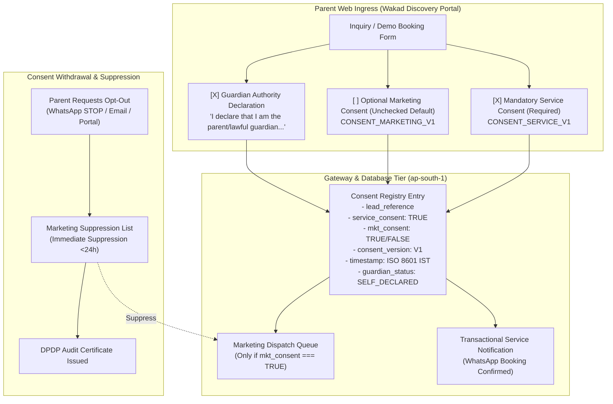

# ARNAV ABACUS ACADEMY (AAA) — SPRINT 3 WS-16
## Document Reference: `AAA-WS16-LIFECYCLE-CONSENT-01`
### Deliverable 5: Consent Lifecycle, Guardian Authority Declaration & DPDP Act Governance

**Document Version:** 1.0.0  
**Effective Date:** 05-November-2026  
**Governing Audit Reference:** `AAA-S3-REG-WS16-AUDIT-FINAL-01` (Findings `AUD-07` and `AUD-08`)  
**Security Classification:** Confidential — Legal & Regulatory Compliance Specification  
**Accountable Leaders:** Nitin Patil (Operations, Tech & Compliance) & Neha Patil (Founder & Academic Director)  
**Baseline Git Snapshot:** Commit `89c4323` on branch `feat/sprint3-integration`  
**Production Status:** STRICTLY LOCKED (`a21a3d1129cc17fc6650bfd04648eb91199e6fa8`)

---

## 1. Statutory Alignment & Purpose

Under India's Digital Personal Data Protection Act, 2023 (DPDP Act 2023, Sections 6, 7, and 9) governing personal data processing and special protections for children's data:
1. Consent must be **free, specific, informed, unconditional, and unambiguous** with a clear affirmative action.
2. The processing of personal data of a child requires **verifiable parental or lawful guardian consent**.
3. Bundled or pre-ticked consent checkboxes are strictly prohibited.

Audit findings `AUD-07` (PASS) and `AUD-08` (CLARIFIED) confirmed that AAA's frontend UI implements unbundled checkboxes and an explicit declaration of guardian authority. This document codifies the end-to-end lifecycle, suppression mechanism, and physical verification protocols.

---

## 2. Unbundled Consent Architecture

Consent is segregated into two independent legal instruments:



---

## 3. Consent Instrument Specifications

### 3.1 Required Service Consent (`CONSENT_SERVICE_V1`)
* **Legal Basis:** Section 6(1) & 7(a) DPDP Act (Performance of contract / requested educational service).
* **Mandatory Status:** Required to process inquiry and schedule free diagnostic session.
* **Exact Wording:**
  > *"I consent to Arnav Abacus Academy contacting me via phone, WhatsApp, or email strictly regarding this inquiry, diagnostic assessment scheduling, and academic progress updates."*
* **Scope:** Transactional service communications only (booking confirmation, schedule reminders, assessment results, faculty communications).
* **Retention Period:** 90 days from last activity (unless converted to enrolled student).

### 3.2 Optional Marketing Consent (`CONSENT_MARKETING_V1`)
* **Legal Basis:** Section 6(1) DPDP Act (Explicit affirmative opt-in).
* **Mandatory Status:** Optional. Checkbox **must remain unticked by default**. Form submission cannot be blocked if parent leaves this unchecked.
* **Exact Wording:**
  > *"Keep me updated on upcoming math workshops, holiday camps, Olympiad seminars, and educational tips from Neha Patil."*
* **Scope:** Promotional broadcasts, seasonal bootcamps, and newsletter dispatches.
* **Retention Period:** Until explicitly withdrawn by the parent.

---

## 4. Formal Classification of Guardian Authority (`AUD-08`)

### 4.1 Strict Legal Classification
In accordance with Management Determination and Legal Clarification `AUD-08`:
> **Formal Terminology:**  
> The web form check shall be strictly designated and recorded as:  
> **`Guardian Authority Self-Declaration`**  
> *(System Code: `GUARDIAN_AUTHORITY_SELF_DECLARATION_V1`)*

### 4.2 Legal Disclaimers & Operational Reality
1. A web form checkbox over the public internet **cannot legally constitute cryptographically verifiable parental identity** without integration with digital identity infrastructure (such as DigiLocker or Aadhaar OTP).
2. The web checkbox represents a **formal legal representation and warranty** made by the applicant under penalty of law.
3. AAA explicitly documents that initial discovery intake operates under this self-declaration.

### 4.3 On-Site Documentary Verification Procedure
Physical and authoritative verification of parental/guardian identity occurs in-person at the AAA Wakad Center:
1. **Timing:** At the commencement of the scheduled in-person Diagnostic Assessment.
2. **Location:** Flat No. 3, 1st Floor, Adv. Balaji Sagar Bungalow, Wakad, Pune 411057.
3. **Verification Process:**
   - Staff confirms the accompanying adult is the parent/guardian matching the lead name and mobile number.
   - For formal enrollment, the parent signs the physical **Student Admission & Consent Register** (Track A Physical Register).
   - The verified status is updated in AcademyOS CRM to `GUARDIAN_VERIFIED_ON_SITE`.

---

## 5. Consent Withdrawal & Marketing Suppression Protocol

### 5.1 Withdrawal Channels
Parents may withdraw marketing consent or exercise their DPDP rights through any of the following channels:
1. **WhatsApp Opt-Out:** Replying `STOP` or `UNSUBSCRIBE` to any official AAA WhatsApp business message.
2. **Email Opt-Out:** Clicking the one-click unsubscribe link in marketing emails or emailing `support@arnavabacus.com`.
3. **Verbal Opt-Out:** Requesting suppression directly during any telephone conversation with admissions staff.

### 5.2 Technical Suppression Execution (<24 Hours)
```sql
-- Immediate Marketing Suppression Entry
INSERT INTO public.marketing_suppression_list (
    mobile_hash,
    email_hash,
    suppressed_at,
    reason,
    channel
) VALUES (
    encode(sha256('9876543210'::bytea), 'hex'),
    encode(sha256('parent@example.com'::bytea), 'hex'),
    NOW(),
    'PARENT_REQUEST_WHATSAPP_STOP',
    'WHATSAPP'
) ON CONFLICT (mobile_hash) DO NOTHING;

-- Revoke active marketing consent flag on lead
UPDATE public.leads
SET consent_marketing_granted_at = NULL,
    updated_at = NOW()
WHERE mobile_number = '9876543210';
```

### 5.3 Suppression Guarantee
Before any marketing campaign or broadcast is dispatched, the automated messaging system runs a mandatory exclusion query against `marketing_suppression_list`. Any suppressed number is filtered out before API payload creation.

---

## 6. Sign-Off & Verification Block

| Governance Role | Name | Designation | Signature Status | Date |
| :--- | :--- | :--- | :--- | :--- |
| **DPDP Compliance Lead** | Data Protection Officer | Regulatory Governance | Verified & Submitted | 05-Nov-2026 |
| **Operations & Compliance** | Nitin Patil | Operations, Tech & Compliance Director | Pending Formal Approval | [Stage-Gate] |
| **Academic & Admissions** | Neha Patil | Founder & Academic Director | Pending Formal Approval | [Stage-Gate] |
