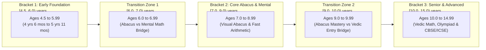

# ARNAV ABACUS ACADEMY (AAA) — SPRINT 3 WS-16
## Document Reference: `AAA-WS16-PROP-AGE-01`
### Deliverable 6: Continuous Age Mapping, Developmental Transition Rules & Option D Governance

**Document Version:** 1.0.0  
**Effective Date:** 05-November-2026  
**Governing Audit Reference:** `AAA-S3-REG-WS16-AUDIT-FINAL-01` (Finding `AUD-10`)  
**Pedagogical Authority:** Neha Patil (Founder & Academic Director)  
**Security Classification:** Confidential — Pedagogical Architecture & Policy Proposal  
**Baseline Git Snapshot:** Commit `89c4323` on branch `feat/sprint3-integration`  
**Production Status:** STRICTLY LOCKED (`a21a3d1129cc17fc6650bfd04648eb91199e6fa8`)

---

## 1. Executive Summary & Pedagogical Context

Under the AAA Learning Model™, mathematical mastery is developmental, tactile, and cognitive. 

Audit Finding `AUD-10` identified an ambiguity in the web form taxonomy:
- Dropdown selections present coarse brackets (e.g., `"4.5–6"`, `"6–9"`, `"9–12"`, `"12–15"`).
- In mathematical logic, boundary values such as exactly 6 years or 9 years appear in two adjacent brackets if defined with inclusive bounds.
- Furthermore, a child aged **6 years 8 months (6.67 continuous years)** possesses substantially different developmental readiness compared to a child who turned **6 years 0 months (6.00 continuous years)** yesterday.

This proposal provides an unambiguous, continuous age classification model (combining completed chronological age with developmental cognitive readiness), formally reaffirming **Placement Option D** as mandated by Neha Patil.

---

## 2. Option D Core Pedagogical Principle

> **The Sovereign Rule of Option D:**  
> *"Chronological age defines the entry corridor; Diagnostic Assessment and Cognitive Intelligence Pillars dictate the final curricular placement. Age alone shall NEVER mechanically dictate student course enrollment."*

Under Option D:
1. Web forms capture the initial age corridor solely to curate the diagnostic assessment instruments.
2. The final placement into Abacus, Vedic Math, Mental Math, or Olympiad is confirmed exclusively by Neha Patil and senior faculty following the in-person diagnostic evaluation.

---

## 3. Continuous Age vs. Completed Years Mathematical Taxonomy

To eliminate boundary overlap in system code, age is defined as continuous chronological age $A \in \mathbb{R}^+$ where:
$$A = \text{Years} + \frac{\text{Months}}{12}$$

### 3.1 Unambiguous Half-Open Age Brackets
Brackets are mathematically defined as half-open intervals $[A_{\min}, A_{\max})$:

---

## 4. Transition Zone Diagnostic Rules

### 4.1 Transition Zone 1: Children Aged 6.0 to 6.99 (Grade 1 / 2)
* **Default Diagnostic Stream:** Tactile Abacus Beads & Visual Number Sense.
* **Pedagogical Evaluation Criteria:**
  - *Finger Dexterity & Tactile Feedback:* Can the child coordinate thumb and index finger on the abacus lower/upper beads?
  - *Symbolic vs Sensory Processing:* Does the child count on fingers, or are they ready to visualize bead movements?
* **Course Trajectory Options:**
  - **Option 1A (Sensory Readiness):** Abacus Foundation Level 1 (Focus on Spatial Visualization & Base-10 complements).
  - **Option 1B (High Mental Arithmetic):** Dual Abacus + Mental Math Bridge (if child easily manipulates numbers $1-20$ mentally).

### 4.2 Transition Zone 2: Children Aged 9.0 to 9.99 (Grade 4 / 5)
* **Default Diagnostic Stream:** Dual Assessment (Abacus Visual Evaluation + Vedic Sutra Readiness).
* **Pedagogical Evaluation Criteria:**
  - *Previous Abacus Exposure:* If the child has completed Abacus Levels 1–3 previously, advance to Abacus Master / Mental Speed.
  - *Zero Prior Abacus:* For a 9-year-old starting fresh, direct entry into **Vedic Mathematics Foundation** is strongly evaluated to prevent frustration with junior bead mechanics and to immediately accelerate school performance (multiplication tables up to 99, squaring, fast subtraction).
* **Course Trajectory Options:**
  - **Option 2A:** Vedic Mathematics Accelerated (Fast sutras, mental cross-multiplication, school exam speed).
  - **Option 2B:** Abacus Intensive (if parent's primary objective is ADHD/focus improvement and working memory stimulation).

---

## 5. Web Intake UI Implementation Specification

To maintain a frictionless parent experience without requiring exact birthdate calculation during initial inquiry:
1. **Frontend Dropdown Wording:**
   - `"Ages 4.5 – 6 (Kindergarten / Grade 1)"` $\rightarrow$ Mapped to code `BRACKET_EARLY_FOUNDATION` ($[4.5, 6.0)$)
   - `"Ages 6 – 9 (Grades 1 – 4)"` $\rightarrow$ Mapped to code `BRACKET_PRIMARY_CORE` ($[6.0, 9.0)$)
   - `"Ages 9 – 12 (Grades 5 – 7)"` $\rightarrow$ Mapped to code `BRACKET_MIDDLE_ACCELERATED` ($[9.0, 12.0)$)
   - `"Ages 12 – 15 (Grades 8 – 10)"` $\rightarrow$ Mapped to code `BRACKET_SENIOR_OLYMPIAD` ($[12.0, 15.0)$)
2. **Admissions Staff Diagnostic Note:**
   If the parent selects a child age of 6 or 9, the internal intake notification automatically displays:
   `[TRANSITION ZONE DETECTED: Apply Dual Diagnostic Assessment Protocol under Option D]`.

---

## 6. Formal Sign-Off & Recommendation Block

This proposal is submitted to Neha Patil for authoritative pedagogical approval.

| Governance Role | Name | Designation | Signature Status | Date |
| :--- | :--- | :--- | :--- | :--- |
| **Academic Author** | Child Cognitive Development Specialist | AAA Academic Curriculum Team | Submitted | 05-Nov-2026 |
| **Operations Reviewer** | Nitin Patil | Operations, Tech & Compliance Director | Endorsed | 05-Nov-2026 |
| **Academic Authority** | Neha Patil | Founder & Academic Director | Pending Formal Approval | [Stage-Gate] |
