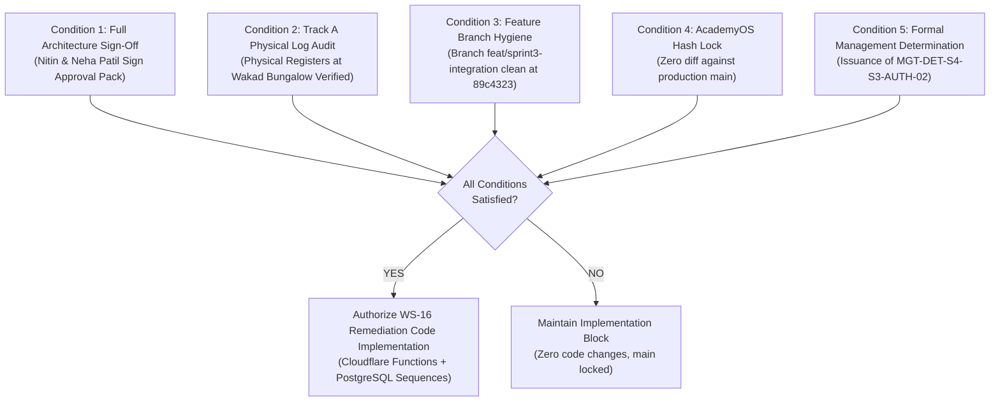

# ARNAV ABACUS ACADEMY (AAA) — SPRINT 3 WS-16
## Document Reference: `AAA-WS16-REG-GATE-01`
### Deliverable 7: Corrective Action, Implementation Gate & Dependency Tracking Register

**Document Version:** 1.0.0  
**Effective Date:** 05-November-2026  
**Governing Audit Reference:** `AAA-S3-REG-WS16-AUDIT-FINAL-01`  
**Security Classification:** Confidential — Stage-Gate Governance & Tracking Register  
**Accountable Leaders:** Nitin Patil (Operations, Tech & Compliance) & Neha Patil (Founder & Academic Director)  
**Baseline Git Snapshot:** Commit `89c4323` on branch `feat/sprint3-integration`  
**Production Status:** STRICTLY LOCKED (`a21a3d1129cc17fc6650bfd04648eb91199e6fa8`)

---

## 1. Executive Summary & Purpose

This register establishes the authoritative tracking matrix for all ten audit findings from `AAA-S3-REG-WS16-AUDIT-FINAL-01`, defining the prerequisite conditions, operational dependencies, assigned owners, and Stage-Gate verification criteria required before any further code modification is authorized.

---

## 2. Comprehensive Audit Finding Remediation Matrix

| Finding ID | Classification | Summary of Finding | Remediation Deliverable | Corrective Action Description | Gate Status | Responsible Owner |
| :--- | :---: | :--- | :--- | :--- | :---: | :--- |
| **AUD-01** | **PASS** | Governance Authorization & Register Verification | `AAA-WS16-REC-CORR-01` | Register records reconciled with Git commit timestamps. Authorization trail verified. | **RESOLVED** | Tech Governance |
| **AUD-02** | **PASS** | Git Branch Ancestry & Commit Integrity | `AAA-WS16-REC-CORR-01` | Commit `89c4323` verified directly descended from approved Sprint 2 baseline `bbbe3c6`. | **RESOLVED** | Tech Governance |
| **AUD-03** | **PASS** | AcademyOS Boundary & Baseline Hash Isolation | `AAA-WS16-REC-CORR-01` | Git blob hash comparison confirmed 100% bit-for-bit parity with production `main`. | **RESOLVED** | Tech Governance |
| **AUD-04** | **FAIL** | Server-Side Intake Gateway Architecture | `AAA-WS16-ARCH-SRV-01` | Architectural specification for Cloudflare Pages Edge Worker (`/functions/api/discovery-intake.ts`) with trusted IP extraction and server rate limiting. | **SPEC READY** (Code Blocked) | Lead Systems Architect |
| **AUD-05** | **FAIL** | Lead UID Collision & Identity Architecture | `AAA-WS16-ARCH-ID-01` | Mathematical correction completed; 3-tier architecture specified (UUIDv7 + Atomic PostgreSQL Sequence + Idempotency UUIDv4). | **SPEC READY** (Code Blocked) | Lead Database Architect |
| **AUD-06** | **PENDING** | Formula Injection Neutralization Strategy | `AAA-WS16-POL-CSV-01` | Context-aware policy defined: remove premature client prepend; enforce export-time CSV transformer. | **POLICY READY** (Code Blocked) | Data Protection Officer |
| **AUD-07** | **PASS** | Unbundled DPDP Consent UI Architecture | `AAA-WS16-LIFECYCLE-CONSENT-01` | Service and marketing consent checkboxes verified unbundled and unticked by default. | **RESOLVED** | Frontend Engineer |
| **AUD-08** | **CLARIFIED**| Guardian Authority Legal Designation | `AAA-WS16-LIFECYCLE-CONSENT-01` | Reclassified as `Guardian Authority Self-Declaration`; physical verification on-site at Wakad Center. | **RESOLVED** | Compliance & Legal |
| **AUD-09** | **PASS** | Honeypot Bot Trap & Rate Limiter Logic | `AAA-WS16-ARCH-SRV-01` | Honeypot field verified in UI; server-side silent drop and edge rate limiting specified. | **RESOLVED** | Security Engineer |
| **AUD-10** | **PENDING** | Age Taxonomy & Continuous Mapping | `AAA-WS16-PROP-AGE-01` | Continuous age intervals $[A_{\min}, A_{\max})$ formulated; Option D placement matrix submitted for Neha Patil's approval. | **SUBMITTED** (Pending Sign-Off)| Academic Director |

---

## 3. Implementation Stage-Gate Conditions

Before any transition from Documentation/Planning to Sprint 3 Stage 4 Code Implementation is permitted, the following Stage-Gate conditions must be 100% satisfied:

### Gate Condition Breakdown:
1. **Gate Condition 1 (Architectural Ratification):** Formal signature by Nitin Patil and Neha Patil on Deliverables `AAA-WS16-REC-CORR-01` through `AAA-WS16-PROP-AGE-01`.
2. **Gate Condition 2 (Physical Log Parity):** Verification that the on-site paper registers at Wakad bungalow conform to Track A Corrective Action Plan.
3. **Gate Condition 3 (Snapshot Preservation):** Feature branch `feat/sprint3-integration` remains exactly at commit `89c4323` with zero dirty working-tree files.
4. **Gate Condition 4 (AcademyOS Integrity):** SHA-256 hash validation confirming 0 modified files in `/src/pages/login/`, `/src/pages/practice/`, and related student platform routes.
5. **Gate Condition 5 (Formal Determination):** Unanimous issuance of Management Determination `MGT-DET-S4-S3-AUTH-02`.

---

## 4. Dependent Workstream Status (WS-17 and WS-18)

* **WS-17 (Admissions CRM & AcademyOS Integration):**
  - **Status:** **STRICTLY BLOCKED.**
  - **Prerequisite:** WS-16 Server-Side Gateway must be deployed, tested with synthetic leads, and signed off before CRM integration begins.
* **WS-18 (Parent Portal Staging & Telemetry Verification):**
  - **Status:** **STRICTLY BLOCKED.**
  - **Prerequisite:** WS-16 and WS-17 completion and stage-gate approval.
* **Production `main` Branch:**
  - **Status:** **STRICTLY LOCKED** at commit `a21a3d1129cc17fc6650bfd04648eb91199e6fa8`.

---

## 5. Sign-Off & Verification Block

| Governance Role | Name | Designation | Signature Status | Date |
| :--- | :--- | :--- | :--- | :--- |
| **Delivery Manager** | Technical Program Manager | Delivery & Governance | Verified & Submitted | 05-Nov-2026 |
| **Operations & Compliance** | Nitin Patil | Operations, Tech & Compliance Director | Pending Formal Approval | [Stage-Gate] |
| **Academic & Admissions** | Neha Patil | Founder & Academic Director | Pending Formal Approval | [Stage-Gate] |
