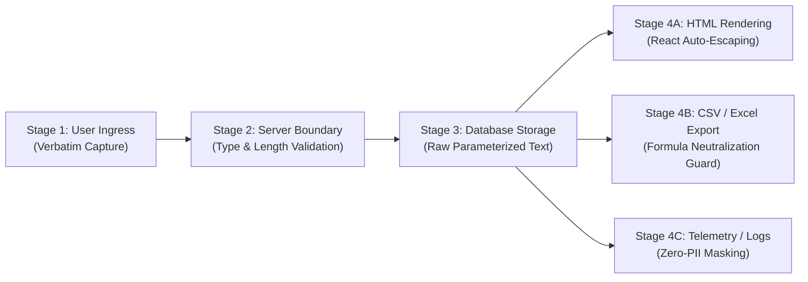

# ARNAV ABACUS ACADEMY (AAA) — SPRINT 3 WS-16
## Document Reference: `AAA-WS16-POL-CSV-01`
### Deliverable 4: Context-Aware Data Handling & Formula Injection Neutralization Policy

**Document Version:** 1.0.0  
**Effective Date:** 05-November-2026  
**Governing Audit Reference:** `AAA-S3-REG-WS16-AUDIT-FINAL-01` (Finding `AUD-06`)  
**Security Classification:** Confidential — Data Governance & Security Standard  
**Accountable Leaders:** Nitin Patil (Operations, Tech & Compliance) & Neha Patil (Founder & Academic Director)  
**Baseline Git Snapshot:** Commit `89c4323` on branch `feat/sprint3-integration`  
**Production Status:** STRICTLY LOCKED (`a21a3d1129cc17fc6650bfd04648eb91199e6fa8`)

---

## 1. Executive Summary & Defect Remediation

In Sprint 2 (WS-15) and Sprint 3 (WS-16), input sanitization in `intakeGatewayEngine.ts` implemented formula neutralization directly on raw input during browser-side ingress:
```typescript
// Legacy implementation (FLAWED):
let sanitized = input;
if (/^[=+\-@\t\r]/.test(sanitized)) {
  sanitized = "'" + sanitized; // Prematurely mutates user's legal name in client memory
}
```

Audit Finding `AUD-06` classified this behavior as **PENDING APPROVAL / DEFECTIVE** because:
1. **Canonical Data Corruption:** If a parent legitimate surname or note begins with a hyphen or plus sign (e.g., phone prefix `+91-9876543210` or hyphenated compound name `-Devi`), prepending a single quote alters their legal identity in database storage.
2. **Context Confusion:** Formula injection (CWE-1236: Improper Neutralization of Formula Elements in a CSV File) is an **export-time vulnerability**, not a database-storage or HTML-rendering vulnerability.
3. **Database Parameterization Neglect:** SQL injection is prevented by prepared statements / parameterized queries, not by prepending single quotes.

This policy mandates a **Context-Aware Data Handling Architecture** across five distinct operational lifecycle stages.

---

## 2. Five-Stage Context-Aware Lifecycle Matrix



| Lifecycle Stage | Context | Threat / Vulnerability | Mandatory Handling Standard | Mutation Allowed? |
| :--- | :--- | :--- | :--- | :---: |
| **Stage 1: User Ingress** | Browser Form Inputs (`LeadForm`, `DemoBookingModal`) | Accidental whitespace, control characters, user typos | Trim leading/trailing whitespace; strip non-printable ASCII control characters (`\x00-\x1F\x7F`). | **NO** (Preserve raw text) |
| **Stage 2: Server Ingress** | HTTP API Ingress (`/api/discovery-intake`) | Malformed types, buffer overflows, payload tampering | Strict Zod schema validation (type, length, character regex). Reject invalid payloads with HTTP 400. | **NO** (Pass-through or Reject) |
| **Stage 3: Database Storage** | Supabase PostgreSQL (`public.leads`) | SQL Injection (CWE-89) | Parameterized SQL queries (prepared statements via Supabase/PostgreSQL client). Store clean, unmutated UTF-8 text. | **NO** (Store canonical verbatim) |
| **Stage 4A: Web Display** | Staff Admin UI & Parent Portals | Cross-Site Scripting (XSS, CWE-79) | Native React JSX auto-escaping; explicit `DOMPurify` sanitizer if rendering sanitized rich HTML. | **NO** (Render safely via DOM) |
| **Stage 4B: Spreadsheet Export** | CSV / XLSX Download for Admissions Staff | Formula Injection (CWE-1236) / DDE Command Execution | **Output-Specific Neutralization:** Prepend `'` strictly in the export generator pipeline before writing CSV rows. | **YES (In Export Stream ONLY)** |
| **Stage 4C: Audit & Telemetry** | Google Analytics 4, Server Logs | PII Leakage (DPDP Act, Zero-PII Protocol) | Redact or SHA-256 hash all PII fields (mobile, parent name, child name). Log only Lead Reference & Event Metadata. | **YES (Redacted / Hashed)** |

---

## 3. Spreadsheet / CSV Export Neutralization Engine (Specification)

When admissions coordinators export leads from AcademyOS or CRM for offline reporting in Microsoft Excel, LibreOffice Calc, or Google Sheets:

### 3.1 Trigger Characters (CWE-1236)
Any cell value starting with any of the following characters triggers formula execution in spreadsheet software:
- Equals sign: `=`
- Plus sign: `+`
- Minus / Hyphen sign: `-`
- At sign: `@`
- Tab: `\t` (ASCII `0x09`)
- Carriage return: `\r` (ASCII `0x0D`)
- Pipe character: `\|` (DDE command prefix in older engines)

### 3.2 Formal Export Transformer Specification
```typescript
/**
 * Authoritative CSV / Excel Cell Sanitizer
 * Applied STRICTLY during export generation.
 * NEVER applied to database records or in-memory React state.
 */
export function formatCellForCsvExport(value: unknown): string {
  if (value === null || value === undefined) {
    return '""';
  }

  const stringVal = String(value);

  // Check if string begins with dangerous spreadsheet formula prefix
  const isFormulaTrigger = /^[=+\-@\t\r|]/.test(stringVal);

  let safeString = stringVal;
  if (isFormulaTrigger) {
    // Prepend single quote to force spreadsheet programs to treat cell as literal text
    safeString = `'${stringVal}`;
  }

  // Standard RFC 4180 CSV escaping: Escape double quotes by doubling them
  const escaped = safeString.replace(/"/g, '""');

  // Wrap in double quotes
  return `"${escaped}"`;
}
```

---

## 4. Verification & Validation Rules

1. **Database Integrity Audit:**
   A continuous database check must confirm that no record in `public.leads` begins with an artificially injected single quote `'` unless the parent literally typed that quote as their opening character.
2. **Export Test Suite:**
   The automated export test harness must verify:
   - Malicious input: `=cmd|'/C calc'!A0` $\rightarrow$ Exported CSV: `"'=cmd|'/C calc'!A0"`
   - Legitimate phone: `+919876543210` $\rightarrow$ Stored DB: `+919876543210` $\rightarrow$ Exported CSV: ` "'+919876543210"`
   - Hyphenated name: `-Devi` $\rightarrow$ Stored DB: `-Devi` $\rightarrow$ Exported CSV: `"'-Devi"`
3. **Client-Side Refactoring Requirement:**
   In Sprint 3 remediation implementation, `intakeGatewayEngine.ts` line 34 formula prepending logic shall be removed from the ingress validator and relocated exclusively to the export utility.

---

## 5. Sign-Off & Verification Block

| Governance Role | Name | Designation | Signature Status | Date |
| :--- | :--- | :--- | :--- | :--- |
| **Security Officer** | Lead Data Protection Architect | Security Governance | Verified & Submitted | 05-Nov-2026 |
| **Operations & Compliance** | Nitin Patil | Operations, Tech & Compliance Director | Pending Formal Approval | [Stage-Gate] |
| **Academic & Admissions** | Neha Patil | Founder & Academic Director | Pending Formal Approval | [Stage-Gate] |
