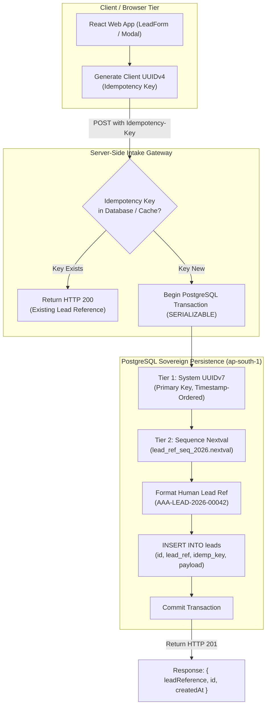

# ARNAV ABACUS ACADEMY (AAA) — SPRINT 3 WS-16
## Document Reference: `AAA-WS16-ARCH-ID-01`
### Deliverable 3: Lead Identity, Reference Sequence & Idempotency Architecture Specification

**Document Version:** 1.0.0  
**Effective Date:** 05-November-2026  
**Governing Audit Reference:** `AAA-S3-REG-WS16-AUDIT-FINAL-01` (Finding `AUD-05`)  
**Security Classification:** Confidential — Architecture & Engineering Specification  
**Accountable Leaders:** Nitin Patil (Operations, Tech & Compliance) & Neha Patil (Founder & Academic Director)  
**Baseline Git Snapshot:** Commit `89c4323` on branch `feat/sprint3-integration`  
**Production Status:** STRICTLY LOCKED (`a21a3d1129cc17fc6650bfd04648eb91199e6fa8`)

---

## 1. Executive Summary & Defect Remediation

Under Sprint 2 (WS-15) and Sprint 3 (WS-16), lead identification was generated client-side via:
```typescript
// Legacy provisional generator (DEPRECATED):
const leadId = `AAA-LEAD-${currentYear}-${Math.floor(1000 + Math.random() * 9000)}`;
```

As demonstrated in Audit Finding `AUD-05` and mathematical reconciliation `AAA-WS16-REC-CORR-01`:
1. Across a 9,000-value identifier space ($[1000, 9999]$), the collision probability reaches **50% after only 112 submissions** ($k_{0.5} \approx 112$). At 200 submissions, the probability of collision is **89.0%**.
2. Client-side generation creates race conditions, identifier collisions, and untrusted state.
3. The provisional identifier conflated three fundamentally distinct architectural requirements:
   - System database record identity
   - Human-facing organizational reference
   - Network duplicate/idempotency protection

This deliverable establishes the authoritative, three-tier identity and idempotency architecture to be implemented strictly on the server tier.

---

## 2. Three-Tier Identity Architecture



### 2.1 Tier 1: Immutable Internal Primary Key (`lead_id`)
* **Type:** UUIDv7 (RFC 9562).
* **Characteristics:** 128-bit globally unique, cryptographically random, monotonically time-ordered.
* **Storage:** PostgreSQL `UUID` primary key with default `gen_random_uuid()` or UUIDv7 extension.
* **Purpose:** Authoritative internal system identity, relational foreign keys, CRM database indexing, and audit log correlation.
* **Visibility:** Internal system only; never exposed directly to parents in URL query parameters or SMS/WhatsApp messages.

### 2.2 Tier 2: Human-Readable Authoritative Lead Reference (`lead_reference`)
* **Format:** `AAA-LEAD-YYYY-[00001]` (e.g., `AAA-LEAD-2026-00001`).
* **Structure:**
  - Prefix: `AAA-LEAD-` (Fixed enterprise namespace)
  - Year: `YYYY` (Calendar year of inquiry receipt in Indian Standard Time, UTC+05:30)
  - Sequence: 5-digit zero-padded monotonic sequence starting at `00001` per calendar year.
* **Characteristics:** Guaranteed 100% collision-free up to 99,999 leads per calendar year. (Expandable to 6 digits if annual admissions exceed 90,000).
* **Storage:** PostgreSQL `VARCHAR(24) NOT NULL UNIQUE`.
* **Purpose:** Staff communication, parent confirmation emails, WhatsApp diagnostic booking references, and physical walk-in verification.
* **Privacy Assurance:** Zero PII leakage. Contains only year and sequence number; no parent phone, child name, or grade is embedded.

### 2.3 Tier 3: Network Idempotency Key (`idempotency_key`)
* **Format:** UUIDv4 generated by client or upstream caller.
* **Transmission:** HTTP Header `Idempotency-Key: <uuidv4>` or JSON body field `idempotency_key`.
* **Storage:** PostgreSQL `UUID UNIQUE` with index and `created_at` timestamp.
* **Retention:** 24-hour retention window. If the exact same idempotency key is submitted within 24 hours (due to double-clicks, network re-transmissions, or mobile reconnects), the gateway returns the cached successful response without executing a new insertion.

---

## 3. Database Schema & Atomic Allocation Specification

### 3.1 PostgreSQL DDL Specification
```sql
-- 1. Create annual lead sequence for 2026
CREATE SEQUENCE IF NOT EXISTS lead_ref_seq_2026
    START WITH 1
    INCREMENT BY 1
    NO MINVALUE
    MAXVALUE 99999
    CACHE 1;

-- 2. Core Admissions Leads Table
CREATE TABLE IF NOT EXISTS public.leads (
    -- Tier 1: System Immutable UUID
    id UUID PRIMARY KEY DEFAULT gen_random_uuid(),
    
    -- Tier 2: Human-Readable Sequential Reference
    lead_reference VARCHAR(24) NOT NULL,
    
    -- Tier 3: Client Idempotency Key
    idempotency_key UUID NOT NULL,
    
    -- Ingress Metadata
    source_channel VARCHAR(32) NOT NULL DEFAULT 'WEB_DISCOVERY',
    client_ip_hash VARCHAR(64) NOT NULL,
    user_agent_hash VARCHAR(64),
    
    -- Student & Parent Data (Context-Neutral / Raw)
    parent_name VARCHAR(120) NOT NULL,
    mobile_number VARCHAR(15) NOT NULL,
    child_name VARCHAR(120) NOT NULL,
    child_age NUMERIC(4, 2) NOT NULL, -- e.g. 6.50
    grade_level VARCHAR(20) NOT NULL,
    program_interest VARCHAR(40) NOT NULL,
    preferred_slot VARCHAR(60),
    notes TEXT,
    
    -- Consent & Privacy Tracking (DPDP Act 2023)
    consent_service_version VARCHAR(24) NOT NULL,
    consent_service_granted_at TIMESTAMPTZ NOT NULL,
    consent_marketing_version VARCHAR(24),
    consent_marketing_granted_at TIMESTAMPTZ,
    guardian_authority_type VARCHAR(40) NOT NULL DEFAULT 'GUARDIAN_SELF_DECLARATION',
    
    -- Lifecycle Timestamps
    created_at TIMESTAMPTZ NOT NULL DEFAULT TIMEZONE('Asia/Kolkata', NOW()),
    updated_at TIMESTAMPTZ NOT NULL DEFAULT TIMEZONE('Asia/Kolkata', NOW()),
    retention_purge_due_at TIMESTAMPTZ NOT NULL DEFAULT (TIMEZONE('Asia/Kolkata', NOW()) + INTERVAL '90 days'),
    
    -- Constraints
    CONSTRAINT uq_leads_lead_reference UNIQUE (lead_reference),
    CONSTRAINT uq_leads_idempotency_key UNIQUE (idempotency_key)
);

-- Indexing for rapid lookup and deduplication
CREATE INDEX IF NOT EXISTS idx_leads_mobile_created ON public.leads (mobile_number, created_at DESC);
CREATE INDEX IF NOT EXISTS idx_leads_retention_purge ON public.leads (retention_purge_due_at) WHERE retention_purge_due_at IS NOT NULL;
```

### 3.2 Atomic Allocation Function (Stored Procedure)
```sql
CREATE OR REPLACE FUNCTION public.fn_allocate_lead_reference()
RETURNS TRIGGER AS $$
DECLARE
    current_year VARCHAR(4);
    next_seq_val BIGINT;
BEGIN
    -- Extract current year in IST
    current_year := TO_CHAR(TIMEZONE('Asia/Kolkata', NOW()), 'YYYY');
    
    -- Fetch next atomic sequence value
    -- PostgreSQL sequences are non-blocking, ACID-safe, and collision-proof
    next_seq_val := NEXTVAL('lead_ref_seq_2026');
    
    -- Format: AAA-LEAD-2026-00042
    NEW.lead_reference := 'AAA-LEAD-' || current_year || '-' || LPAD(next_seq_val::TEXT, 5, '0');
    
    RETURN NEW;
END;
$$ LANGUAGE plpgsql;

-- Trigger firing before insert if lead_reference is not supplied
CREATE OR REPLACE TRIGGER trg_allocate_lead_reference
    BEFORE INSERT ON public.leads
    FOR EACH ROW
    WHEN (NEW.lead_reference IS NULL OR NEW.lead_reference = '')
    EXECUTE FUNCTION public.fn_allocate_lead_reference();
```

---

## 4. Concurrency, Race Condition & Retry Management

| Threat / Edge Case | Engineering Mitigation | Expected Outcome |
| :--- | :--- | :--- |
| **Simultaneous Submissions (<5ms apart)** | PostgreSQL `NEXTVAL()` is intrinsically thread-safe and non-blocking at the storage engine level. | Zero sequence collision. Each transaction receives an atomic, strictly incremented sequence number. |
| **Rapid Double Click on Submit Button** | Frontend disables button on click; server checks `UNIQUE (idempotency_key)`. | Second request encounters unique constraint violation or matches pre-insert query; returns first lead reference with HTTP 200. |
| **Transaction Abort / Rollback** | If an insert fails validation after `NEXTVAL()`, a gap in sequence occurs (e.g., 00042 then 00044). | **Acceptable and standard practice.** Monotonic ordering is preserved; zero collision risk. Audited in transaction logs. |
| **Database Network Timeout** | Client hook catches timeout and retries with the **same** idempotency key up to 2 times with exponential backoff. | Once network recovers, first received insert succeeds; retry safely returns cached lead reference. |

---

## 5. Migration Strategy from Legacy 4-Digit Suffix

During Sprint 2 and the Sprint 3 WS-16 staging phase, synthetic test leads and local browser sessions generated identifiers using the provisional format `AAA-LEAD-2026-XXXX`.

### Migration Protocol:
1. **Historical Records Classification:**
   All records bearing the 4-digit format generated prior to Sprint 3 production deployment are formally classified as `PROVISIONAL_SYNTHETIC_RECORDS`.
2. **Database Isolation:**
   When the production Supabase PostgreSQL instance is initialized, the sequence `lead_ref_seq_2026` will start at `1` (`AAA-LEAD-2026-00001`).
3. **Lookup Backward Compatibility:**
   Staff CRM lookup endpoints will accept regex patterns matching both:
   - Legacy: `^AAA-LEAD-2026-[0-9]{4}$` (Provisional / Staging)
   - Authoritative: `^AAA-LEAD-[0-9]{4}-[0-9]{5}$` (Authoritative Production)
4. **Implementation Prohibition:**
   The new sequence allocator shall remain in specification status and **shall not be deployed to code or database** until Sprint 3 Stage-Gate authorization is formally granted.

---

## 6. Sign-Off & Verification Block

| Governance Role | Name | Designation | Signature Status | Date |
| :--- | :--- | :--- | :--- | :--- |
| **Lead Architect** | Technical Solutions Lead | Enterprise Architecture | Verified & Submitted | 05-Nov-2026 |
| **Operations & Compliance** | Nitin Patil | Operations, Tech & Compliance Director | Pending Formal Approval | [Stage-Gate] |
| **Academic & Admissions** | Neha Patil | Founder & Academic Director | Pending Formal Approval | [Stage-Gate] |
