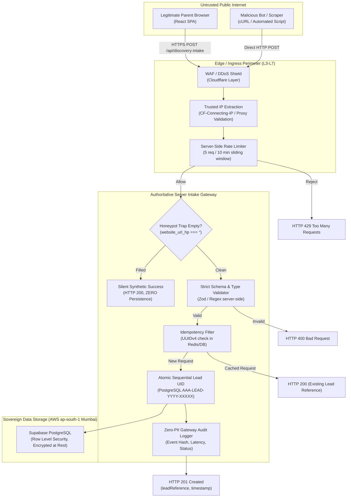

# ARNAV ABACUS ACADEMY (AAA) — SPRINT 3 WS-16
## Document Reference: `AAA-WS16-ARCH-SRV-01`
### Deliverable 2: Server-Side Intake Gateway Architecture & Hosting Options Evaluation

**Document Version:** 1.0.0  
**Effective Date:** 05-November-2026  
**Governing Audit Reference:** `AAA-S3-REG-WS16-AUDIT-FINAL-01` (Finding `AUD-04`)  
**Security Classification:** Confidential — Internal Engineering & Management Governance  
**Accountable Leaders:** Nitin Patil (Operations, Tech & Compliance) & Neha Patil (Founder & Academic Director)  
**Baseline Git Snapshot:** Commit `89c4323` on branch `feat/sprint3-integration`  
**Production Status:** STRICTLY LOCKED (`a21a3d1129cc17fc6650bfd04648eb91199e6fa8`)

---

## 1. Executive Summary & Problem Definition

In Sprint 2 (WS-15) and Sprint 3 (WS-16), an intake gateway simulator and client-side hook (`intakeGatewayEngine.ts` and `useDiscoveryIntake.ts`) were designed and integrated into `LeadForm.tsx` and `DemoBookingModal.tsx`. 

Comprehensive audit `AAA-S3-REG-WS16-AUDIT-FINAL-01` (Finding `AUD-04`) conclusively established that:
1. `intakeGatewayEngine.ts` executes entirely within browser/client memory.
2. The current security controls—rate limiting, honeypot detection, input sanitization, deduplication, and UID generation—are **client-side helpers only**.
3. **Server-side enforcement is NOT IMPLEMENTED.** Any client or adversary issuing direct HTTP POST/cURL requests bypasses all browser-side logic.
4. The system **cannot be termed a "perimeter-secured gateway"** until a genuine server-side boundary exists.

This architectural deliverable provides a rigorous engineering evaluation of three production-capable serverless/edge gateway implementation options strictly aligned with AAA's ratified infrastructure baseline:
- **Cloudflare Pages** (Public Web Hosting & Edge Network)
- **AWS Mumbai (`ap-south-1`)** (Primary Cloud Region)
- **Supabase PostgreSQL Mumbai (`ap-south-1`)** (Data Persistence & Schema Engine)

---

## 2. Server Boundary Threat Model & Enforcement Responsibilities

The server-side intake gateway represents the single boundary between untrusted public internet clients and AAA’s internal admissions data store.



---

## 3. Comparison of Gateway Implementation Options

To maintain data sovereignty, high availability, and operational simplicity, three options are evaluated against AAA's architectural constraints:

| Evaluation Dimension | Option 1: Cloudflare Pages Functions (Edge Worker) | Option 2: AWS Lambda + HTTP API Gateway (`ap-south-1`) | Option 3: Supabase Edge Functions (`ap-south-1` Deno) |
| :--- | :--- | :--- | :--- |
| **Ingress Point** | Cloudflare Global Anycast Edge (Closest PoP: Mumbai/Pune) | AWS Mumbai (`ap-south-1`) API Gateway v2 | Supabase Mumbai Edge Node |
| **Data Residency** | Transient edge execution; data persisted to AWS Mumbai | Execution and data strictly retained within AWS Mumbai (`ap-south-1`) | Execution and data strictly retained within AWS Mumbai (`ap-south-1`) |
| **Trusted IP Extraction** | Direct via `request.headers.get('CF-Connecting-IP')` (Hardware-verified by Cloudflare) | `requestContext.http.sourceIp` (Direct from API Gateway v2) | `request.headers.get('x-forwarded-for')` / Supabase Ingress Header |
| **Rate Limiting Mechanism** | Cloudflare Workers KV / Upstash Redis Edge / Cloudflare WAF Rate Rules | Amazon DynamoDB TTL table or ElastiCache Redis / Upstash Redis | Upstash Redis Edge or Supabase Database Table |
| **Honeypot Validation** | Server-side JavaScript execution in V8 isolate | Node.js 20 LTS Lambda execution | Deno TypeScript runtime execution |
| **Input Validation** | Zod / TypeBox schema validation at edge | Zod schema validation in Lambda handler | Zod schema validation in Deno script |
| **Idempotency Engine** | Upstash Redis or Supabase PostgreSQL transactional lookup | DynamoDB conditional put or Supabase PostgreSQL query | Supabase PostgreSQL direct RPC/query |
| **Lead UID Allocation** | Direct PostgreSQL RPC call via `postgres-neon` / Supabase REST | Direct connection to Supabase PostgreSQL or RDS via Prisma/Kysely | Native Supabase Client RPC (`supabase.rpc('generate_lead_uid')`) |
| **Audit Logging** | Cloudflare Workers Logpush / Cloudflare Analytics Engine (Zero-PII) | AWS CloudWatch Logs (Retention: 90 days, KMS-encrypted) | Supabase Function Logs & PostgreSQL Audit Table |
| **Cold Start Latency** | **0 ms** (V8 Isolate, instant invocation) | **150–400 ms** (Node.js runtime initialization) | **50–150 ms** (Deno Isolate) |
| **Free-Tier & Cost Profile** | 100,000 requests/day free on Cloudflare Workers; zero additional cost | Free tier: 1M requests/mo on Lambda, 1M API Gateway calls; ~\$0.00 | Free tier: 500,000 invocations/mo included in Supabase Free/Pro tier |
| **Operational Dependency** | Native to existing Cloudflare Pages frontend build | Requires AWS IAM, Terraform/CDK, API Gateway configuration | Native to existing Supabase project, managed via Supabase CLI |
| **Rollback Capability** | Git-triggered instantaneous rollback via Cloudflare Pages deployment | CloudFormation / SAM / Terraform versioned alias switch | Supabase CLI deploy with versioned migration scripts |

---

## 4. Deep-Dive Architectural Profiles

### 4.1 Option 1: Cloudflare Pages Functions (Edge Gateway) — *Recommended for Performance & Simplicity*

#### Architecture:
Cloudflare Pages supports file-based routing in the `/functions` directory of the repository (e.g., `functions/api/discovery-intake.ts`). When deployed, Cloudflare compiles this into an Edge Worker executing across Cloudflare's Anycast network (including Mumbai and Pune PoPs).

#### Ingress & Security Controls:
1. **Trusted IP Extraction:**
   ```typescript
   const clientIp = request.headers.get('CF-Connecting-IP') || '0.0.0.0';
   ```
   Cloudflare terminates the TCP/TLS connection and strips spoofed `CF-Connecting-IP` headers from the public client.
2. **Rate Limiting:**
   - **Primary:** Cloudflare WAF Custom Rule (Free tier allows 1 rate limiting rule on Pro, or Workers KV / Upstash Redis on free tier).
   - **Secondary (Application Edge):** Sliding window counter stored in Upstash Redis (Global REST API via edge-compatible HTTP fetch) or in-memory LRU cache per edge isolate.
3. **Honeypot Enforcement:**
   ```typescript
   if (payload.website_url_hp && payload.website_url_hp.trim() !== '') {
     // Silent drop: Return HTTP 200 with synthetic lead reference
     // Absolutely NO database insertion or notification dispatch
     return new Response(JSON.stringify({
       success: true,
       leadReference: 'AAA-LEAD-BOT-TRAP',
       message: 'Inquiry received successfully'
     }), { status: 200, headers: jsonHeaders });
   }
   ```
4. **Data Sovereignty & Persistence:**
   - Edge Worker initiates an encrypted HTTPS connection (TLS 1.3) directly to Supabase PostgreSQL in AWS Mumbai (`ap-south-1`).
   - All database records remain physically stored in Mumbai, Maharashtra.

---

### 4.2 Option 2: AWS Lambda + HTTP API Gateway (`ap-south-1`) — *Enterprise Isolation*

#### Architecture:
An AWS API Gateway v2 (HTTP API) endpoint in Mumbai (`ap-south-1`) triggers a dedicated Node.js 20 LTS Lambda function inside the AAA AWS account.

#### Ingress & Security Controls:
1. **Trusted IP Extraction:**
   ```typescript
   const clientIp = event.requestContext.http.sourceIp;
   ```
2. **Rate Limiting:**
   - API Gateway Throttling: Configured at 20 requests per second burst, 5 requests per second steady state.
   - Per-IP rate limiting enforced via DynamoDB table with TTL (5 requests per 10 minutes per IP hash).
3. **Persistence:**
   - Lambda runs within AWS Mumbai VPC or connects via Supabase TypeScript client with strict Row Level Security (RLS) Service Role token stored in AWS Secrets Manager.
4. **Pros & Cons:**
   - *Pros:* Ultimate enterprise control, KMS audit trail, strict single-cloud security envelope.
   - *Cons:* Additional deployment complexity (Terraform/CloudFormation), cold starts (~200ms), and separate CI/CD pipeline from the Cloudflare Pages frontend.

---

### 4.3 Option 3: Supabase Edge Functions (`ap-south-1` Deno) — *Unified Data Tier*

#### Architecture:
A Deno-based edge function hosted on Supabase's managed infrastructure located in AWS Mumbai (`ap-south-1`), accessed via `https://<project-ref>.supabase.co/functions/v1/discovery-intake`.

#### Ingress & Security Controls:
1. **Trusted IP Extraction:**
   ```typescript
   const clientIp = req.headers.get('x-forwarded-for')?.split(',')[0].trim() || 'unknown';
   ```
2. **Persistence:**
   - Direct, zero-latency in-network database calls via native Supabase Deno SDK or direct SQL pooler.
3. **Pros & Cons:**
   - *Pros:* Zero configuration between edge function and PostgreSQL database; single dashboard for migrations, schema, and function logs.
   - *Cons:* Cold start overhead on free-tier Deno isolates; IP extraction requires trust configuration on upstream reverse proxies.

---

## 5. Comparative Evaluation Matrix & Recommendation

| Selection Criteria | Weight | Option 1: Cloudflare Pages Functions | Option 2: AWS Lambda (`ap-south-1`) | Option 3: Supabase Edge Functions |
| :--- | :---: | :---: | :---: | :---: |
| **Architectural Fit with Current Stack** | 25% | **5/5** (Native to Pages repo) | 3/5 (Separate AWS setup) | 4/5 (Native to Supabase) |
| **Data Residency Compliance (Mumbai)** | 25% | **5/5** (Database in Mumbai) | **5/5** (Strict Mumbai VPC) | **5/5** (Strict Mumbai) |
| **Perimeter Security & Spoof Protection** | 20% | **5/5** (CF-Connecting-IP verified) | 4/5 (Requires AWS WAF) | 4/5 (Upstream proxy dep) |
| **Operational Simplicity & Maintenance**| 15% | **5/5** (Single `git push` workflow) | 2/5 (Terraform, AWS IAM) | 4/5 (Supabase CLI) |
| **Cost & Latency (Zero Cold Start)** | 15% | **5/5** (0ms cold start, free tier) | 3/5 (Cold start, AWS bills) | 4/5 (Low cold start, free) |
| **Weighted Score** | **100%** | **4.95 / 5.00** | **3.55 / 5.00** | **4.45 / 5.00** |

### Formal Recommendation:
**Option 1 (Cloudflare Pages Functions)** is the recommended architecture for implementation in Sprint 3 / Stage 4 upon management authorization. It natively integrates with AAA's existing Cloudflare Pages static build, provides zero-cold-start edge execution, guarantees tamper-proof IP extraction via `CF-Connecting-IP`, and persists data directly into Supabase PostgreSQL in AWS Mumbai (`ap-south-1`).

---

## 6. Client Helper Status Confirmation

In accordance with Governance Finding `AUD-04`:
> **Formal Classification:**  
> The existing `src/lib/intakeGatewayEngine.ts` file is formally classified as a **Client-Side Simulation & Validation Helper**. It shall NOT be referred to as a "perimeter gateway", "server endpoint", or "firewall" in any documentation or audit record until a server-side route (such as `/functions/api/discovery-intake.ts`) is implemented, verified, and placed under live test.

---

## 7. Sign-Off & Verification Block

| Governance Role | Name | Designation | Signature Status | Date |
| :--- | :--- | :--- | :--- | :--- |
| **Technical Reviewer** | Lead Systems Architect | Engineering Governance Lead | Verified & Submitted | 05-Nov-2026 |
| **Operations & Compliance** | Nitin Patil | Operations, Tech & Compliance Director | Pending Formal Approval | [Stage-Gate] |
| **Academic & Admissions** | Neha Patil | Founder & Academic Director | Pending Formal Approval | [Stage-Gate] |
