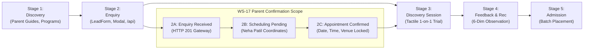

# ARNAV ABACUS ACADEMY (AAA) — SPRINT 3 WS-17 STEP 0
## Document Reference: `AAA-WS17-STEP0-JOURNEY-01`
### Deliverable 2: Parent Journey Lifecycle & Multi-Tier Trigger Design

**Document Version:** 1.0.0  
**Design Date:** 05-November-2026  
**Governing Baseline:** AAA Pedagogical Framework & Admissions CRM Lifecycle  
**Governing Specification:** `AAA-S4-WS-CONF-01`  
**Feature Branch:** `feat/sprint3-integration`  
**Accountable Leaders:** Nitin Patil (Operations, Tech & Compliance) & Neha Patil (Founder & Academic Director)

---

## 1. Executive Summary & Core Pedagogical Principle

A fundamental defect in many educational web platforms is conflating a **parent's initial enquiry submission** with a **confirmed class appointment**.

At Arnav Abacus Academy (AAA), every child is unique. As established in the AAA Learning Model™:
> *"Mathematics is the medium; developing confident, independent and thoughtful learners is the mission."*

Because Neha Patil personally mentors micro-batches capped at a strict maximum of **5 students per batch**, an initial web enquiry cannot magically assign an unverified calendar slot. A child's age, school board, finger-counting habits, and learning pace must be evaluated before batch placement.

Therefore, under WS-17 Step 0, we formally separate the post-submission parent experience into **two distinct, sequential experiences**:
1. **Experience Tier 1: Enquiry Receipt & Coordination Acknowledgment (`EnquiryConfirmationExperience`)**
2. **Experience Tier 2: Confirmed Discovery Session Appointment (`AppointmentConfirmationExperience`)**

---

## 2. The 5-Stage AAA Parent Journey Mapping



---

## 3. Dissecting the 3 Post-Submission States

| Attribute | State A: Successful Enquiry Ingestion | State B: Scheduling Pending Coordination | State C: Appointment Confirmed & Locked |
| :--- | :--- | :--- | :--- |
| **System Event Trigger** | Client receives `HTTP 201 Created` from `/api/discovery-intake`. | Enquiry is persisted in CRM; Neha Patil reviews age/course profile. | Exact trial date, time slot, and delivery mode are agreed upon between parent and academy. |
| **Assigned Identifiers** | Authoritative Lead Reference (`AAA-LEAD-YYYY-[00001]`). | Lead Reference + CRM Lifecycle Status: `ENQUIRY_RECEIVED` / `PARENT_CONTACTED`. | Lead Reference + Confirmed Appointment Record (Scheduled Date/Time, Mode, Venue). |
| **Parent Expectation** | *"The academy has received my details safely."* | *"Neha Patil will reach out to recommend a suitable batch time."* | *"My child's trial class is booked for Saturday 11:00 AM at the Wakad Center."* |
| **Calendar Invite (.ics) Allowed?** | ❌ **STRICTLY PROHIBITED** (No confirmed date/time exists). | ❌ **STRICTLY PROHIBITED** (Avoids creating phantom calendar events). | 🟢 **MANDATORY** (Contains real date, start/end time, venue, and map pin). |
| **Primary Action for Parent** | Review Parent Prep Card; optionally initiate 1-click WhatsApp to accelerate scheduling. | Await phone/WhatsApp message from Neha Patil within 4-hour SLA. | Download `.ics` invite; review center location map; prepare student for diagnostic session. |

---

## 4. Detailed Specification of the Two WS-17 Experiences

### 4.1 Experience Tier 1: The Enquiry Acknowledgment Card (`EnquiryReceiptModal.tsx`)

#### Trigger Condition:
- Fires immediately when `LeadForm` or `DemoBookingModal` receives a successful `HTTP 201 Created` response containing a valid `leadReference`.

#### Core Visual & Informational Elements:
1. **Prominent Lead Reference Badge:**
   - Displays `AAA-LEAD-YYYY-[00001]` in high-contrast mono styling.
   - Text: *"Your Official Enquiry Reference: AAA-LEAD-2026-XXXXX"*.
2. **Truthful Status Banner:**
   - Heading: *"Inquiry Received — Trial Scheduling in Progress"*.
   - Copy: *"Thank you, [Parent Name]! We have safely received your inquiry for [Student Name] ([Program Interest]). To ensure focused personal attention, Neha Patil will review your child's profile and contact you within 4 business hours to finalize an optimal trial time slot."*
3. **One-Click WhatsApp Accelerator:**
   - Button: *"Connect with Neha Patil on WhatsApp (Fast-Track Scheduling)"*.
   - Pre-fills WhatsApp message with the exact `leadReference`, eliminating manual typing for the parent.
4. **Parent Preparation Preview Card:**
   - Provides 3 essential preparatory tips on what the child will experience during the 30-minute tactile discovery trial.
5. **PDF Diagnostic Workbook Download (if initiated from LeadForm):**
   - Keeps the free 3-page diagnostic workbook accessible.

---

### 4.2 Experience Tier 2: The Confirmed Appointment Modal (`AppointmentConfirmedModal.tsx`)

#### Trigger Condition:
- Fires **only** when an explicit date, start time, end time, and delivery mode have been verified and selected (either via future self-scheduling calendar widget or via post-coordination confirmation link sent to parent).

#### Core Visual & Informational Elements:
1. **Appointment Confirmed Banner:**
   - Heading: *"Your Discovery Session is Confirmed!"*.
   - Subheading: *"We look forward to meeting [Student Name] for an exciting hands-on exploration of numbers."*
2. **Session Logistics Block:**
   - **Date & Day:** e.g., *"Saturday, 14 November 2026"*.
   - **Time:** e.g., *"11:00 AM – 11:45 AM IST (45 mins)"*.
   - **Mode:**
     - If **Offline Wakad Center:**  
       Venue: *Flat No. 3, 1st Floor, Adv. Balaji Sagar Bungalow, Opp. Creative Cameo, Near Park Street, Behind Wisdom World School, Wakad, Pune 411057.*  
       Link: *"Open in Google Maps"* (verified GPS link).
     - If **Online Live Class:**  
       Platform: *Zoom / Google Meet (Secure link sent 24 hours prior)*.
3. **Download Calendar Invitation (.ics) Button:**
   - Instant download of zero-dependency `.ics` file compatible with Google Calendar, Apple Calendar, and Outlook.
4. **Reschedule & Cancellation Policy Notice:**
   - Explains that micro-batches allow a maximum of 2 reschedules with 12-hour advance notice to respect educator time.

---

## 5. Architectural Safeguard: Preventing Phantom Appointments

```
┌────────────────────────────────────────────────────────────────────────────────────────┐
│                        CRITICAL ARCHITECTURAL BOUNDARY                                 │
├────────────────────────────────────────────────────────────────────────────────────────┤
│ RULE: Under NO circumstances shall an .ics calendar file be generated or offered to   │
│ a parent upon initial inquiry submission unless an actual confirmed appointment slot   │
│ (ISO timestamp: YYYY-MM-DDTHH:mm:ss+05:30) exists.                                     │
│                                                                                        │
│ Emitting a calendar invite with a "placeholder" or "arbitrary" time violates CCPA 2024 │
│ honesty requirements and causes parental confusion when arrival dates clash.           │
└────────────────────────────────────────────────────────────────────────────────────────┘
```
