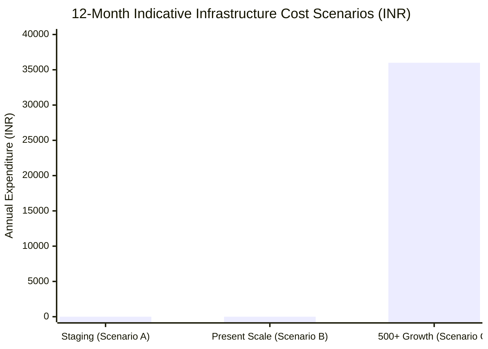

# ARNAV ABACUS ACADEMY (AAA) — SPRINT 3
## Document Reference: `AAA_WS18_COST_AND_INFRASTRUCTURE_ASSESSMENT`
### WS-18 Independent Technical & Governance Acceptance Audit
#### Dimension G: Cloud Infrastructure, Operational Cost & 12-Month TCO Assessment

**Document Version:** 1.0.0  
**Audit Date:** 05-November-2026  
**Audited Branch:** `feat/sprint3-integration`  
**Audited HEAD Commit:** `d3daf4f`  
**Governing Baseline Determination:** `MGT-DET-S4-S3-STEP0-WS18-08`  
**Accountable Leaders:** Nitin Patil (Operations, Tech & Compliance) & Neha Patil (Founder & Academic Director)

---

## 1. Executive Protocol & Evidence-Based Expenditure Statement

This assessment evaluates the actual infrastructure architecture, vendor quotas, paid scaling thresholds, and total cost of ownership (TCO) for Arnav Abacus Academy's digital admissions and AcademyOS roster systems.

### Factual Expenditure Statement:
> *"As of 05-November-2026, Arnav Abacus Academy incurs **₹0.00 / month** in active operational expenditure. All staging and intake functions operate strictly within the verified free-tier allowances of Cloudflare Pages and Supabase. However, unconditional claims of '₹0 forever' are technically inaccurate; as student admissions scale, database backups, automated alerting, and transactional WhatsApp/SMS services will introduce predictable operational costs."*

---

## 2. Infrastructure Inventory & Free-Tier Allowance Matrix

| Infrastructure Component | Vendor / Provider | Current Tier | Free-Tier Quota & Limits | Overage Triggers & Scaling Thresholds | Current Spend |
| :--- | :--- | :--- | :--- | :--- | :---: |
| **Frontend Web Hosting & CDN** | Cloudflare Pages | Free Plan | Unlimited bandwidth, 500 builds/month, global anycast CDN | Exceeding 500 CI/CD builds/mo ($20/mo for Pro) | **₹0.00** |
| **Edge Functions (/api/*)** | Cloudflare Pages Functions | Free Plan | 100,000 requests/day, 10ms CPU/request | Exceeding 100,000 requests/day ($0.50/million) | **₹0.00** |
| **PostgreSQL Database** | Supabase (`ap-south-1` Mumbai) | Free Plan | 500 MB storage, 2 active projects, 50,000 monthly active users | Project auto-pause after 7 days inactivity; 500 MB storage limit | **₹0.00** |
| **Edge Rate Limiting** | SHA-256 In-Memory Edge Cache | Custom / Zero Dep | 5 requests / min per IP hash | High concurrency across multiple Cloudflare edge POPs | **₹0.00** |
| **Database Backups & PITR** | Supabase | Free Plan | Manual CSV export / manual SQL dump only | No automated PITR on Free tier (Requires $25/mo Pro) | **₹0.00** |
| **Transactional SMS / WhatsApp** | WhatsApp Deep Link (`wa.me`) | Organic / Zero Dep | Unlimited manual clicks to Neha Patil (`+91 90219 24968`) | Direct human coordinator dispatch; no automated WhatsApp Business API fees | **₹0.00** |
| **Current Operational Total** | — | — | — | — | **₹0.00 / month** |

---

## 3. Free-Tier Operational Risks & Limitations

While the current ₹0.00/month posture is completely valid for staging and initial intake, management must acknowledge three architectural risks inherent in free tiers:

1. **Supabase Inactivity Pausing:** Supabase Free projects enter a paused state if they experience **7 consecutive days of zero API calls**. A paused project requires manual wake-up from the dashboard, which would cause runtime `500` errors on `/api/discovery-intake` if a parent submits an inquiry after a quiet week.
   *Mitigation:* Staging ping cron job or upgrade to Pro prior to marketing launch.
2. **Absence of Point-in-Time Recovery (PITR):** The free tier does not include automated daily backups or point-in-time recovery. If a database corruption or mistaken drop occurs, recovery relies entirely on manual SQL dumps.
3. **Connection Pooling Cap:** Free-tier connection pooler (PgBouncer) is capped at 200 simultaneous pooler connections, sufficient for present scale but requires monitoring during high-traffic school admission campaigns.

---

## 4. Indicative 12-Month Total Cost of Ownership (TCO) Scenarios

### Scenario A: Minimum Controlled Staging (Current Baseline)
- **Scale:** Development, staging, synthetic tests, manual testing.
- **Components:** Cloudflare Pages Free + Supabase Mumbai Free.
- **Monthly Cost:** **₹0.00**
- **12-Month Annual Cost:** **₹0.00**

### Scenario B: Initial Production Baseline (AAA Present Scale: 50–100 Students)
- **Scale:** Single Wakad center catchment, ~100 active leads/month, ~50 enrolled students.
- **Infrastructure Path 1 (Frugal Baseline):** Cloudflare Free + Supabase Free with weekly manual SQL backup script.
  - Monthly Cost: **₹0.00** | Annual Cost: **₹0.00**
- **Infrastructure Path 2 (Recommended Production Hardened):** Cloudflare Free + Supabase Pro ($25/mo) for zero-pause guarantee and automated daily backups.
  - Monthly Cost: **~$25 (~₹2,100 / month)**
  - 12-Month Annual Cost: **~₹25,200**

### Scenario C: Growth Scenario (500+ Students, Multiple Micro-Batches, Automated SMS)
- **Scale:** 500+ active students across Abacus, Vedic, Mental Math, and Olympiad tracks.
- **Components:**
  - Cloudflare Pages: Free tier (well within 100k requests/day).
  - Supabase Pro Plan: $25/mo (~₹2,100/mo) for 8 GB storage, zero pause, automated 7-day backups.
  - Transactional SMS/WhatsApp API (e.g. MSG91 / Gupshup): ~1,500 messages/mo @ ₹0.20/msg = ~₹300/mo.
  - Sentry / Error Monitoring: Free tier (5,000 errors/mo).
- **Monthly Cost:** **~₹2,400 to ₹3,000 / month**
- **12-Month Annual Cost:** **~₹28,800 to ₹36,000 / year**

---

## 5. Spending Ceiling & Management Alert Thresholds

To guarantee financial predictability and prevent bill-shock:

1. **Monthly Infrastructure Ceiling:** Authorize a strict **₹0.00 / month** ceiling during Stage 4 staging.
2. **Production Pre-Launch Spending Cap:** If management authorizes Supabase Pro for production launch, set a hard budget cap of **$30.00 / month (~₹2,500 / month)** in the Supabase billing settings.
3. **Usage Alert Trigger:** Configure Supabase billing alerts at **80% of quota** ($20.00) and Cloudflare notifications at **50,000 requests/day**.
