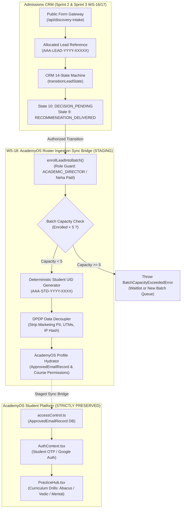

# ARNAV ABACUS ACADEMY (AAA) — SPRINT 3
## Document Reference: `AAA-WS18-STEP0-AUD-01`
### WS-18 Step 0: Discovery, Architecture Boundary & Technical Dependency Audit
#### AcademyOS Roster Ingestion Sync Bridge Specification

**Document Version:** 1.0.0  
**Audit Date:** 05-November-2026  
**Governing Authority:** `MGT-DET-S4-S3-CLOSURE-INT-07`  
**Execution Stage:** Sprint 3 — WS-18 Step 0 Discovery & Validation  
**Feature Branch:** `feat/sprint3-integration`  
**Production Baseline:** `main` (🔒 **STRICTLY LOCKED** at `a21a3d1129cc17fc6650bfd04648eb91199e6fa8`)  
**Accountable Leaders:** Nitin Patil (Operations, Tech & Compliance) & Neha Patil (Founder & Academic Director)

---

## 1. Executive Protocol & Boundary Mandate

Workstream 18 (**WS-18: AcademyOS Roster Ingestion Sync Bridge**) establishes the staged architectural bridge between prospective Admissions CRM records and the internal AcademyOS student learning ecosystem.

### Non-Negotiable Operational Boundaries:
1. **AcademyOS Route & Code Isolation:** Under Section 2 Rule 3 of the Permanent Agent Governance Rules, the internal learning platform and practice functionality (`/login`, `/practice`, `/practice/session`, `/practice/results`, `src/data/practiceData.ts`) are **strictly protected**. WS-18 operates purely as an ingestion interface and roster synchronization bridge; it does not alter practice question sets, scoring engines, or session mechanics.
2. **Zero Cloud Expenditure Baseline:** WS-18 must maintain ₹0.00 / month forever. No paid third-party middleware, commercial ERP subscriptions, or hosted messaging brokers may be provisioned.
3. **Synthetic Test Data Only:** Zero real student names, parent emails, or telephone numbers may be utilized in test fixtures, mocks, or local staging environments.
4. **Step 0 Documentation-Only Gate:** Direct source-code modification of AcademyOS production components remains **STRICTLY BLOCKED** until Step 0 discovery, security validation, and formal management authorization are ratified.

---

## 2. Technical Dependency & Architectural Analysis

### 2.1 Upstream & Downstream Integration Topology

### 2.2 Inspection of Existing State Machine Capabilities

An inspection of `src/lib/crmStateMachine.ts` verifies that the fundamental building blocks of WS-18 were planned and unit-tested in Sprint 2:
1. **Terminal Admissions State:** `ENROLLED` is defined as State 12, transitioning from `DECISION_PENDING`, `RECOMMENDATION_DELIVERED`, or `FOLLOW_UP_ACTIVE`.
2. **Batch Capacity Enforcement:** `enrollLeadIntoBatch()` asserts `batch.enrolledCount < batch.maxCapacity` (hardcoded to 5).
3. **Student UID Generation:** Generates `AAA-STD-[YYYY]-[XXXX]` sequentially.
4. **Current Gap Identified in Step 0:** The existing `enrollLeadIntoBatch()` updates the in-memory `LeadRecord` and `MicroBatchRecord`, but does **not yet generate** the downstream `ApprovedEmailRecord` required by `accessControl.ts` to grant the student drill permissions in `PracticeHub.tsx`. WS-18 must bridge this hydration gap.

---

## 3. AcademyOS Roster Schema & Permission Mapping

### 3.1 Course & Level Entitlement Mapping

When Neha Patil completes a Discovery Session and recommends a course track, the enrolled student must be provisioned with precise level permissions in `accessControl.ts`:

| Recommended Track | Discovery Session Level Placement | AcademyOS Ingestion Permissions (`ApprovedEmailRecord`) | Permitted Practice Modes |
| :--- | :--- | :--- | :---: |
| **Abacus Mathematics** | Junior Track (Ages 4.5–6): `JR-0` or `JR-1` | `course: "abacus"`, `levels: ["JR-0", "JR-1"]` | `accessMode: "both"` (Quiz + Learn) |
| **Abacus Mathematics** | Senior Track (Ages 7–9): `SR-1` | `course: "abacus"`, `levels: ["SR-1"]` | `accessMode: "both"` (Quiz + Learn) |
| **Vedic Mathematics** | Junior Vedic (Ages 9–11): `JVM-1` | `course: "vedic"`, `levels: ["JVM-1"]` | `accessMode: "both"` (Quiz + Learn) |
| **Vedic Mathematics** | Senior Vedic (Ages 12–14): `SVM-1` | `course: "vedic"`, `levels: ["SVM-1"]` | `accessMode: "both"` (Quiz + Learn) |
| **Mental Mathematics** | Speed Foundation: `MM-1` | `course: "mental"`, `levels: ["MM-1"]` | `accessMode: "both"` (Quiz + Learn) |
| **IPM & Olympiad Maths**| Advanced Problem Solving | `course: "vedic"`, `levels: ["ALL"]` + `abacus: ["SR-ALL"]` | `accessMode: "both"` (Quiz + Learn) |

### 3.2 Micro-Batch Strict Capacity Rule ($\le 5$)

- **Batch Size Limit:** Under Directive `DIR-02` and management rules, no batch may exceed **5 students**.
- **Allocation Rules:**
  - Standard Batch ID format: `AAA-BATCH-[YEAR]-[PROG]-[CODE]` (e.g. `AAA-BATCH-2026-ABA-WAKAD-01`).
  - Batch Schedule format: `Sat & Sun 10:00 AM – 11:30 AM (In-Center, Wakad)`.
  - Overflow Handling: When `enrolledCount === 5`, the UI must block enrollment into that batch and display: *"Batch capacity reached (5/5). Please create a new micro-batch or select an alternate slot."*

---

## 4. Technical Risks & Step 0 Mitigation Strategy

| Risk ID | Identified Technical Risk | Severity | Step 0 Architecture Mitigation |
| :---: | :--- | :---: | :--- |
| **RSK-WS18-01** | Accidental mutation of AcademyOS `/practice/*` source files during bridge wiring | Critical | Strict git diff verification assertions; bridge logic isolated in `src/lib/academyRosterBridge.ts` with zero edits to practice data. |
| **RSK-WS18-02** | Student UID collision under simultaneous enrollment actions | High | Supabase atomic sequence allocation or deterministic monotonically incrementing batch counter. |
| **RSK-WS18-03** | Lead inquiry PII leaking into public student leaderboards or session telemetry | Critical | Field filtering during hydration: strip phone numbers, parent names, and enquiry notes from student practice tokens. |
| **RSK-WS18-04** | Unsanitized student roster export creating CSV formula injection vulnerabilities | High | Mandatory integration of `formatCellForCsvExport()` from `intakeGatewayEngine.ts` into staff roster download triggers. |

---

## 5. Conclusion & Step 0 Verdict

The technical dependencies for WS-18 are well-defined, and the boundary between Admissions CRM and AcademyOS is cleanly separable. Direct implementation can proceed safely once security isolation and data decoupling specifications are ratified.
