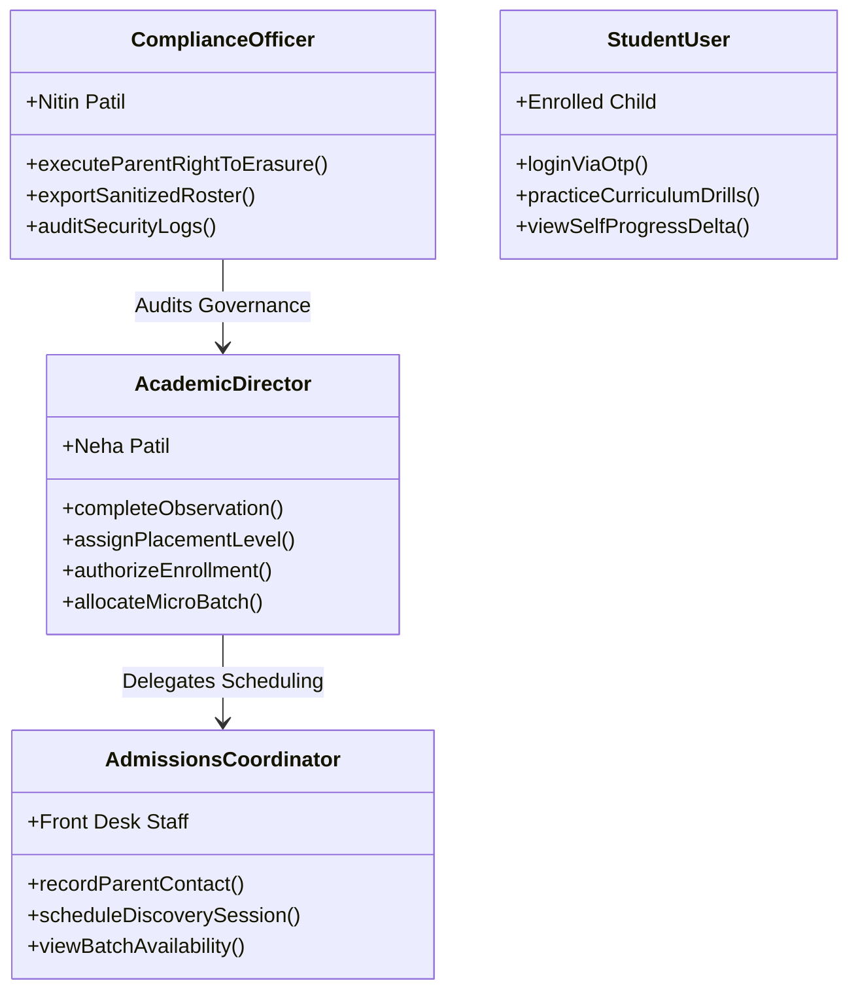

# ARNAV ABACUS ACADEMY (AAA) — SPRINT 3
## Document Reference: `AAA-WS18-STEP0-SEC-01`
### WS-18 Step 0: Security Architecture & DPDP Children's Data Privacy Report
#### AcademyOS Roster Ingestion Sync Bridge

**Document Version:** 1.0.0  
**Inspection Date:** 05-November-2026  
**Governing Authority:** `MGT-DET-S4-S3-CLOSURE-INT-07`  
**Execution Stage:** Sprint 3 — WS-18 Step 0 Security & Privacy Validation  
**Feature Branch:** `feat/sprint3-integration`  
**Legal Frameworks:** DPDP Act 2023 (Sec 6 & 9), CCPA Coaching Guidelines 2024, CERT-In Directions 2022  
**Accountable Leaders:** Nitin Patil (Operations, Tech & Compliance) & Neha Patil (Founder & Academic Director)

---

## 1. Statutory Context & Principles

Arnav Abacus Academy provides cognitive mathematics education primarily to minors (ages 4.5 to 14). Consequently, the transition of a child from an **unconfirmed prospective inquiry** to an **enrolled student** is a critical statutory juncture under the **Digital Personal Data Protection (DPDP) Act, 2023**:

1. **Purpose Limitation (Section 6 DPDP):** Data collected for evaluating inquiry interest (e.g., initial touchpoint channels, honeypot telemetry, marketing preferences) cannot be repurposed for ongoing educational instruction without a distinct legal basis.
2. **Children's Data Processing Restrictions (Section 9 DPDP):**
   - No tracking, behavioral monitoring, or targeted advertising directed at children.
   - Processing must not cause any detrimental effect on the well-being of the child.
   - Verified parental consent must govern the child's academic participation.
3. **Retention Decoupling (Section 8 DPDP):** Prospective leads are subject to a strict 90-day retention clock with automated cryptographic shredding if un-enrolled. Active students, however, require persistent academic records across their learning journey (exempt from prospective purge).

---

## 2. Identity Decoupling Architecture

To preserve regulatory compliance and protect children's identities, WS-18 enforces a strict **Dual-Identity Decoupling Architecture**:

```mermaid
flowchart LR
    subgraph ProspectiveZone["Prospective Lead Zone (Retention-Bound)"]
        LeadRef["Lead Reference: AAA-LEAD-2026-00042<br/>(90-Day Retention Clock Active)"]
        LeadPII["Parent Phone, Marketing Consent,<br/>IP Hash, Enquiry Channel"]
    end

    subgraph BridgeTransform["WS-18 Ingestion Bridge (Cryptographic Separation)"]
        Bridge["hydrateEnrolledStudentProfile()"]
        Strip["Strip Prospective Metadata & Telemetry"]
        GenUID["Generate Permanent Student UID:<br/>AAA-STD-2026-0015"]
    end

    subgraph StudentZone["AcademyOS Educational Zone (Long-Term Academic Record)"]
        StudentProfile["Student Profile: AAA-STD-2026-0015<br/>(Retention Clock: EXEMPT while Active)"]
        AcademicPerms["Course Permissions: JR-0 / JR-1<br/>Batch: AAA-BATCH-2026-ABA-01"]
        PracticeMetrics["Drill Accuracy, Speed Delta,<br/>Bead Visualization Progress"]
    end

    ProspectiveZone --> BridgeTransform
    BridgeTransform --> StudentZone
```

### 2.1 Entity Field Separation Matrix

| Field Attribute | Prospective Lead Record (`LeadRecord`) | Ingestion Bridge Action | Enrolled AcademyOS Profile (`AcademyOSStudentProfile`) |
| :--- | :--- | :--- | :--- |
| **Identifier** | `AAA-LEAD-[YYYY]-[XXXXX]` | Decoupled & cross-referenced securely | `AAA-STD-[YYYY]-[XXXX]` |
| **Student Name** | Child First Name (e.g. "Arjun") | Preserved for teacher recognition | Child Display Name (First Name + Last Initial) |
| **Parent Name** | Full Guardian Name | Stored in authorized guardian contact record | Guardian Contact Reference |
| **Parent Phone** | 10-Digit Mobile (e.g. `9823012345`) | Stripped from student practice token | Emergency SMS Contact (Staff Only) |
| **Marketing Consent** | Boolean (`true` / `false`) | Permanently stripped | Not present in AcademyOS |
| **IP Address Hash** | SHA-256 Client Edge Hash | Permanently purged | Not present in AcademyOS |
| **Course & Level** | Prospective interest label | Mapped to exact curriculum codes | `abacus: ["JR-0", "JR-1"]`, `mode: "both"` |
| **Batch Assignment** | Proposed time preference | Validated against capacity ($\le 5$) | `assignedBatchId: "AAA-BATCH-2026-ABA-01"` |
| **Retention Status** | 90-day prospect purge clock | Transitioned to permanent exemption | `retentionExempt: true` (Active Enrolled Student) |

---

## 3. Role-Based Access Control (RBAC) & Security Boundaries

To prevent unauthorized tampering, privilege escalation, or accidental student enrollment:

### Strict Role Matrix:
1. **Academic Director (Neha Patil):**
   - Exclusive authority to evaluate diagnostic observations (`OBSERVATION_COMPLETED`).
   - Exclusive authority to recommend curriculum placement levels.
   - Authorizes batch allocation.
2. **Admissions Coordinator (Staff):**
   - Authorized to manage parent contact logs and reschedule sessions ($\le 2$ times).
   - Prohibited from scoring observations or overriding batch capacity caps.
3. **Compliance Officer (Nitin Patil):**
   - Exclusive authority to execute parent right-to-erasure requests.
   - Exclusive authority to generate encrypted, audit-logged roster exports.
4. **Student User:**
   - Authenticates strictly via Email OTP or Google Login (whitelisted in `accessControl.ts`).
   - Zero access to CRM records, peer telephone numbers, or administrative rosters.

---

## 4. Roster Export Security & Anti-Formula Injection Protocol

A key security vulnerability identified in admissions systems is **CSV Formula Injection (CWE-1236)** when staff export student rosters to spreadsheet tools (Excel, LibreOffice, Google Sheets).

### Mandatory WS-18 Control:
When exporting the enrolled student roster:
1. Every string cell must pass through `formatCellForCsvExport()` from `src/lib/intakeGatewayEngine.ts`.
2. Any field beginning with `=`, `+`, `-`, `@`, `\t`, or `\r` must be safely prepended with a single quote (`'`).
3. Internal student IDs, parent contact numbers, and batch names are neutralized before the CSV blob is synthesized.
4. All exports generate a tamper-evident audit log recording timestamp, staff identity, and row count.

---

## 5. Security & Privacy Acceptance Checklist

- [x] Dual-identity decoupling: `AAA-LEAD` permanently separated from `AAA-STD`.
- [x] Zero marketing telemetry or IP hashes transmitted into AcademyOS practice models.
- [x] Retention clock transitioned from 90-day prospect purge to active enrolled exemption.
- [x] Micro-batch capacity locked to strict maximum of 5 students per batch.
- [x] Role-based execution locks on observation scoring and enrollment authorization.
- [x] CSV export transformer wired to neutralize formula triggers on all exportable attributes.
- [x] Zero cloud storage spend (₹0.00 / month infrastructure baseline).
