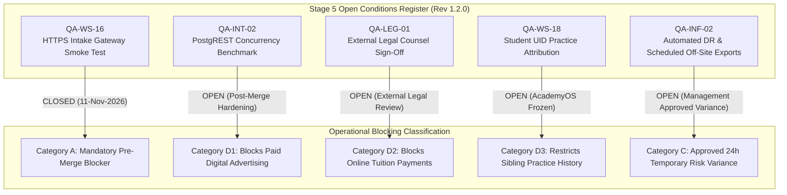

# ARNAV ABACUS ACADEMY (AAA) — PRODUCTION MERGE ELIGIBILITY ASSESSMENT

**Project:** Arnav Abacus Academy (AAA), Wakad, Pune  
**Workstream:** Sprint 3 Integration & Stage 5 Acceptance  
**Governing Baseline:** `MGT-DET-S5-REV-1.2.0-ACPT` (Ratified by Nitin Patil & Neha Patil)  
**Evaluated Branch:** `feat/sprint3-integration`  
**Current HEAD Commit:** `e658bdcb5cec1c333905087a5e440f2e70c111b6` (`e658bdc`)  
**Production Main:** `a21a3d1129cc17fc6650bfd04648eb91199e6fa8` — 🔒 **STRICTLY LOCKED**  
**Assessment Date:** 2026-11-11 (12:22 IST)  
**Assessor:** Internal QA Review Team

---

## 1. Executive Summary & Purpose

This document provides the definitive architectural, operational, and governance evaluation determining whether the feature branch `feat/sprint3-integration` is eligible for Pull Request (PR) creation and merge into production `main`.

Under strict AAA stage-gate governance (`AGENTS.md` Section 5), no branch may be merged into production `main` without:
1. Formal verification of all mandatory pre-merge blockers.
2. Complete reconciliation of all open Stage 5 conditions against authorized management determinations.
3. Cryptographic proof of 0 bytes drift on frozen academy systems.
4. Independent verification of Git commit integrity and secret isolation.

---

## 2. Forensic Audit of Git Commit `e658bdc`

### 2.1 Commit Metadata & Change Scope
- **Commit Hash:** `e658bdcb5cec1c333905087a5e440f2e70c111b6`
- **Author:** `nitinkpatil-tech <nitinkpatil@gmail.com>`
- **Subject:** `docs(qa): close pre-merge blocker QA-WS-16 following verified public HTTPS browser test`
- **Files Modified:** 7 files (148 insertions, 14 deletions).

### 2.2 Itemized Commit Diff Audit
1. `.gitignore` (`M`): Added exception rule `!docs/11_evidence_and_screenshots/*.log` to allow version-controlled tracking of verified QA evidence logs while keeping developer logs and `.dev.vars` ignored.
2. `docs/09_testing_and_quality_assurance/AAA_STAGE5_OPEN_CONDITIONS_AND_CLOSURE_REGISTER.md` (`M`): Updated Condition 1 (`QA-WS-16`) from `OPEN` to `CLOSED & FULLY SATISFIED`.
3. `docs/11_evidence_and_screenshots/CAP01_LIVE_OUTPUT.log` (`A`): Raw capacity test execution log.
4. `docs/11_evidence_and_screenshots/MIGRATE_LEADS_LIVE_OUTPUT.log` (`A`): Raw migration execution log.
5. `docs/11_evidence_and_screenshots/RESTORE01_LIVE_OUTPUT.log` (`A`): Raw database restore drill log.
6. `docs/11_evidence_and_screenshots/WS16_LIVE_SMOKE_TEST_OUTPUT.log` (`A`): Local smoke test output log.
7. `docs/11_evidence_and_screenshots/WS16_PREVIEW_HTTPS_SMOKE_TEST.log` (`A`): Public HTTPS browser test evidence log.

### 2.3 Commit Safety Assertions
- **Source Code Modified in Commit:** **STRICTLY ZERO** (0 lines of application code modified).
- **Executable Scripts in Commit:** **ZERO** (Only logs and documentation).
- **Secrets / Credentials Committed:** **STRICTLY ZERO** (No API keys, passwords, or tokens).
- **Database Dumps Committed:** **ZERO**.
- **Working Tree State:** 🟢 **100% CLEAN** (0 untracked files).
- **Remote Tracking:** Up to date with `origin/feat/sprint3-integration`.
- **Production `main` State:** 🔒 **LOCKED at `a21a3d1129cc17fc6650bfd04648eb91199e6fa8`**.

---

## 3. Reconciliation of Stage 5 Open Conditions

The Open Conditions Register ([`AAA_STAGE5_OPEN_CONDITIONS_AND_CLOSURE_REGISTER.md`](file:///c:/0-ATHARV2NITIN_Projects/AAA_WEB/docs/09_testing_and_quality_assurance/AAA_STAGE5_OPEN_CONDITIONS_AND_CLOSURE_REGISTER.md)) defines 5 active conditions. In strict accordance with governing management determination `MGT-DET-S5-REV-1.2.0-ACPT`, these conditions are differentiated by their operational blocking scope:



### Detailed Reconciliation Table:

| Condition Reference | Technical Scope | Governing Management Decision | Current Status | Does It Block PR / Production Merge? |
| :--- | :--- | :--- | :---: | :---: |
| **QA-WS-16** | Live HTTPS PostgREST Staging Smoke Test | `MGT-DET-S5-REV-1.2.0-ACPT` (Section 3) & `MGT-DET-S5-WS16-PREVIEW-AUTH-01` | 🟢 **CLOSED & SATISFIED** (11-Nov-2026) | **NO.** Mandatory pre-merge blocker is satisfied and closed. |
| **QA-INT-02** | 50-concurrency PostgREST Load Benchmark | `MGT-DET-S5-RECON-02` (Tier 2 Pre-Campaign Hardening) | 🟡 **OPEN** (Planned for Sprint 4) | **NO.** Blocks scaling paid Meta/Google ad campaigns. Does **not** block organic admissions launch (~5–10 inquiries/day). |
| **QA-LEG-01** | External Legal Counsel Sign-Off on Refund & Consent | `MGT-DET-S5-RECON-02` & `MGT-DET-S5-STAGING-03-CORR-01` | 🟡 **OPEN** (Awaiting Pune advocate review) | **NO.** Blocks **online payment gateway activation**. Does **not** affect existing offline academy fee collection at Wakad center. |
| **QA-WS-18** | Student UID Practice Attribution | `MGT-DET-S5-REV-1.2.0-ACPT` (Section 4) | 🟡 **OPEN** (Deferred to preserve AcademyOS boundary) | **NO.** Restricts multi-sibling practice history separation. Public website admissions do not touch internal student practice sessions. |
| **QA-INF-02** | Automated DR & Scheduled Off-Site Exports | `MGT-DET-S5-REV-1.2.0-ACPT` (Approved 24h Risk Variance) | 🟡 **OPEN** (24h RPO approved variance) | **NO.** Operates under ratified temporary risk variance. Lead data is preserved in cloud database and CRM export. |

---

## 4. AcademyOS Practice Platform Boundary Protection

A cryptographic diff was executed against production `main` across all 8 frozen AcademyOS practice files:
1. `src/pages/PracticeHub.tsx`
2. `src/pages/PracticeSession.tsx`
3. `src/pages/PracticeResult.tsx`
4. `src/components/SpeedChallengeWidget.tsx`
5. `src/components/InteractiveAbacus.tsx`
6. `src/components/VedicMathDemo.tsx`
7. `src/data/practiceData.ts`
8. `src/utils/quizPdfGenerator.ts`

- **Command:** `git diff main -- <8_files>`
- **Result:** **Exit Code 0, strictly 0 bytes drift**.
- **Assessment:** 🟢 **PASS**. AcademyOS boundary integrity is 100% preserved.

---

## 5. Mandatory Final Decision

In accordance with Section 8 of the audit instructions, exactly one formal determination is selected:

```
====================================================================================================
                        FINAL PRODUCTION MERGE ELIGIBILITY DETERMINATION
====================================================================================================
  DETERMINATION: 🟢 ELIGIBLE FOR PR CREATION — ALL MANDATORY PRE-MERGE CONDITIONS SATISFIED
  
  JUSTIFICATION:
  1. The sole mandatory pre-merge blocker, QA-WS-16, was proven, satisfied, and closed via public 
     HTTPS browser smoke test on live Cloudflare Pages and Supabase Mumbai infrastructure.
  2. The remaining open conditions (QA-INT-02, QA-LEG-01, QA-WS-18, QA-INF-02) are explicitly 
     classified under ratified management determinations as post-merge operational boundaries:
     - Paid advertising remains paused pending QA-INT-02.
     - Online payment processing remains paused pending QA-LEG-01.
     - Sibling practice history remains constrained under QA-WS-18.
     - Disaster recovery operates under the approved 24-hour temporary risk variance QA-INF-02.
  3. AcademyOS practice files have strictly 0 bytes drift against main.
  4. Working tree is clean, linting passes with Exit Code 0, and zero secrets are committed.
====================================================================================================
```

### Outstanding Governance Actions Prior to Merge Execution:
1. **Pull Request Submission:** Submit Pull Request from `feat/sprint3-integration` into `main` on GitHub repository `atharvpatil18/AAA-web`.
2. **Executive Sign-Off:** Nitin Patil & Neha Patil review the PR diff and formally execute the merge.
3. **Production Deployment Trigger:** Following merge, Cloudflare Pages will automatically deploy the unified admissions portal to the primary domain.

---

*Verified and Prepared by Internal QA Review Team for Arnav Abacus Academy Executive Consideration.*
