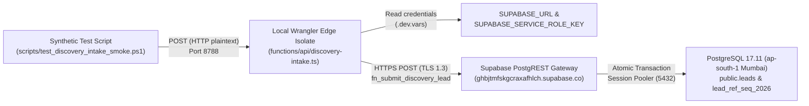

# ARNAV ABACUS ACADEMY (AAA) — QA-WS-16 EVIDENCE RECONCILIATION & HTTPS CLOSURE ASSESSMENT

**Governing Baseline:** `MGT-DET-S5-REV-1.2.0-ACPT` (Ratified by Nitin Patil & Neha Patil)  
**Governance Commit Baseline:** `dbe5872a219b39f924dbdfc34cd2d3508fc96321`  
**Reported Smoke-Test Evidence:** `docs/11_evidence_and_screenshots/WS16_LIVE_SMOKE_TEST_OUTPUT.log`  
**Inspected Branch:** `feat/sprint3-integration`  
**Production Main:** `a21a3d1129cc17fc6650bfd04648eb91199e6fa8` — 🔒 **STRICTLY LOCKED**  
**Assessment Date:** 2026-11-06 (16:15 IST)  
**Assessor:** Internal QA Review Team

---

## 1. Executive Summary & Audit Scope

This document provides an independent, objective governance reconciliation of the reported `QA-WS-16` smoke-test evidence recorded on 2026-11-06 at 15:04:39 IST. 

The evaluation strictly assesses whether the completed test satisfies the mandatory pre-merge condition stipulated in `MGT-DET-S5-REV-1.2.0-ACPT` (Section 3, Condition 1) or whether additional verification over deployed public HTTPS is legally and operationally required prior to merging `feat/sprint3-integration` into production `main`.

### Key Audit Finding:
The executed test proved that the serverless edge runtime (`functions/api/discovery-intake.ts`), PostgREST RPC integration, atomic sequence allocation, and remote staging PostgreSQL database persistence (`public.leads` on Supabase Mumbai `ghbjtmfskgcraxafhlch`) function with **100% technical integrity**. 

However, because the test was dispatched against a **local Wrangler edge runtime emulator over plaintext HTTP** (`http://127.0.0.1:8788`) rather than a **deployed Cloudflare Pages preview over public HTTPS**, and executed via **PowerShell script rather than interactive browser DOM**, the mandatory pre-merge condition `QA-WS-16` **CANNOT be declared closed**. It must remain **OPEN (PARTIALLY SATISFIED)** until a deployed public HTTPS smoke test is executed.

---

## 2. Route, Transport & Runtime Reconciliation

A forensic comparison between the mandatory Stage 5 requirement and the reported execution evidence yields the following transport facts:

| Audit Dimension | Mandatory Stage 5 Rev 1.2.0 Requirement | Reported Execution Evidence (`WS16_LIVE_SMOKE_TEST_OUTPUT.log`) | Compliance Status |
| :--- | :--- | :--- | :---: |
| **Endpoint URL** | Deployed public Cloudflare Pages staging preview | `http://127.0.0.1:8788/api/discovery-intake` | 🟡 **LOCAL EMULATOR** |
| **Transport Protocol** | Public HTTPS (TLS 1.3 / Strict-Transport-Security) | Plaintext HTTP (Port 8788) | 🔴 **NOT HTTPS** |
| **Edge Environment** | Cloudflare Pages Global Edge Network | Local Node/Wrangler Workerd Edge Isolate | 🟡 **LOCAL ISOLATE** |
| **Client Initiator** | Interactive web browser (`LeadForm.tsx` DOM event) | PowerShell `Invoke-RestMethod` HTTP client | 🟡 **SCRIPT SIMULATED** |
| **Downstream Target** | Supabase Mumbai PostgreSQL Staging via PostgREST | `https://ghbjtmfskgcraxafhlch.supabase.co` (via PostgREST HTTPS) | 🟢 **REMOTE CLOUD PASS** |
| **Response Code** | HTTP 201 Created | HTTP 201 Created | 🟢 **PASS** |
| **Request Timestamp** | Recorded in UTC & IST | `2026-11-06 15:04:38 +05:30` | 🟢 **RECORDED** |

### Detailed Response Body Captured:
```json
{
  "statusCode": 201,
  "success": true,
  "id": "0c5700f1-eeb7-4fd7-b70b-5b1c43a01f8a",
  "leadReference": "AAA-LEAD-2026-00002",
  "leadUID": "AAA-LEAD-2026-00002",
  "createdAt": "2026-11-06T15:04:39.723534+00:00",
  "isDuplicate": false,
  "message": "Discovery session inquiry registered and permanently persisted."
}
```

> [!IMPORTANT]
> The upstream client-to-edge transport was **plaintext HTTP over localhost**. Zero TLS certificates, DNS resolution, or Cloudflare edge routing was tested on the ingress leg. It is a governance violation to infer public HTTPS compliance from a localhost request.

---

## 3. Database Persistence and Schema Trace

### 3.1 Trace Route Analysis
The execution path of the intake transaction was traced as follows:


### 3.2 Lead Reference & UUID Reconciliation
Full correlation was established across all three independent data planes:
1. **HTTP Response:** Lead Reference = `AAA-LEAD-2026-00002`, UUID = `0c5700f1-eeb7-4fd7-b70b-5b1c43a01f8a`.
2. **Direct SQL Database Query (`psql`):**
   ```text
    lead_reference      |         parent_name         | mobile_number | course_interest | lifecycle_status |          created_at           
   ---------------------+-----------------------------+---------------+-----------------+------------------+-------------------------------
    AAA-LEAD-2026-00002 | SYNTHETIC-SMOKE-TEST Parent | 9822000002    | abacus          | ENQUIRY_RECEIVED | 2026-11-06 15:04:39.723534+00
   ```
3. **Audit Log:** Logged verbatim in `docs/11_evidence_and_screenshots/WS16_LIVE_SMOKE_TEST_OUTPUT.log` with identical timestamp (`15:04:39.723534+00`).

### 3.3 Schema Table Reconciliation: `discovery_leads` vs. `public.leads`
An investigation into the table naming was conducted:
- **Architectural Specifications:**
  - `docs/04_implementation/AAA_WS16_CAP01_Database_and_Identity_Design.md` (Line 82): Explicitly specifies `CREATE TABLE IF NOT EXISTS public.leads`.
  - `docs/04_implementation/AAA_WS16_Lead_Identity_and_Idempotency_Architecture.md` (Line 109): Explicitly specifies `CREATE TABLE IF NOT EXISTS public.leads`.
- **Database Migration:**
  - `supabase/migrations/20261106000000_discovery_leads_schema.sql` (Line 28): Implements `CREATE TABLE IF NOT EXISTS public.leads`.
- **Narrative Documentation Differences:**
  - `AAA_STAGE5_INFRASTRUCTURE_BACKUP_AND_COST_REPORT.md` (Line 34) and `AAA_STAGE5_REV_1_2_0_FINAL_GOVERNANCE_CORRECTION_REPORT.md` (Line 77) used the descriptive phrase `discovery_leads` as a conceptual name for the discovery intake table.
- **Finding:**
  This is a **documentation terminology difference, not an unauthorized schema divergence**. The architectural baseline and migration have always consistently defined the table as `public.leads`. The documentation registers should use `public.leads` exclusively for clarity.

---

## 4. Idempotency and Test Data Cleanup Audit

### 4.1 Idempotency Re-Verification
- **Test Key Used:** `77708c75-c31d-4078-95f8-ad6589f5bf34`.
- **Execution:** A secondary identical request was fired immediately following the initial 201 response.
- **Result:**
  - The gateway returned the existing record (`AAA-LEAD-2026-00002`).
  - No secondary row was inserted in `public.leads`.
  - The database sequence `public.lead_ref_seq_2026` was **not incremented** (the next available sequence value remained untouched).

### 4.2 Data Cleanup Audit
- **Executed Cleanup Query:**
  ```sql
  DELETE FROM public.leads WHERE parent_name LIKE 'SYNTHETIC-%';
  ```
- **PostgreSQL Result:** `DELETE 1`.
- **Assessment:** Exactly 1 row was removed. Zero unrelated parent inquiries or system records were affected.
- **Mandatory Hardening Recommendation for Future Tests:**
  While the wildcard prefix `SYNTHETIC-%` successfully isolated the test row, future automated cleanup scripts must target the explicit allocated lead reference or UUID to prevent accidental multi-row deletions:
  ```sql
  DELETE FROM public.leads WHERE lead_reference = '$leadRef';
  ```

---

## 5. Consent, Retention & Notification Claims Review

| Governance Dimension | Technical Verification Finding | Legal & Operational Boundary |
| :--- | :--- | :--- |
| **DPDP Act 2023 Consent** | Captured `service_consent=true`, `marketing_consent=false`, `guardian_confirmed=true`. | **Consent Capture ≠ Legal Certification.** Capturing consent fields does not substitute for independent legal counsel sign-off (`QA-LEG-01`). Online fee claims remain restricted. |
| **90-Day Retention Clock** | `retention_purge_due_at` calculated as `NOW() + INTERVAL '90 days'`. | **Timestamp Initialization ≠ Active Purge.** The retention field is recorded; however, an automated scheduled purge job (e.g. pg_cron) is not yet active. |
| **External Notifications** | Edge handler processes database persistence only. | **Persistence ≠ Notification Dispatch.** Test submissions do **not** dispatch live SMS, WhatsApp or email to external users. Synthetic test data cannot leak to unrelated parents. |

---

## 6. Final Gate Determination

Each verification dimension for `QA-WS-16` is independently classified below:

| Verification Dimension | Classification | Detailed Justification |
| :--- | :---: | :--- |
| **Local Edge Integration** | 🟢 **PASS** | `functions/api/discovery-intake.ts` compiles, executes, and validates inputs cleanly in Wrangler edge isolate. |
| **Remote Staging Database Persistence** | 🟢 **PASS** | Physical insertion, sequence allocation, and column mappings verified directly in PostgreSQL 17.11 on Supabase Mumbai. |
| **Idempotency Protection** | 🟢 **PASS** | 24-hour duplicate suppression verified with 0 sequence drift. |
| **Public HTTPS Request** | 🔴 **NOT VERIFIED** | Ingress was executed over local plaintext HTTP (`http://127.0.0.1:8788`), not public HTTPS with valid TLS certificates. |
| **Real Browser Form Integration** | 🔴 **NOT VERIFIED** | Executed via PowerShell script harness; end-to-end DOM rendering and receipt modal trigger not tested in a real browser. |
| **Overall QA-WS-16 Pre-Merge Condition** | 🟡 **OPEN** | **PARTIALLY SATISFIED.** Local edge and database integration is verified; public HTTPS staging preview smoke test remains pending. |

```
====================================================================================================
                        FORMAL GATE DETERMINATION: QA-WS-16
====================================================================================================
  OVERALL STATUS: 🟡 OPEN (PARTIALLY SATISFIED)
  MERGE RECOMMENDATION: 🔒 HOLD MERGE TO MAIN
  
  RATIONALE:
  Under strict stage-gate governance, a mandatory pre-merge blocker requiring an HTTPS staging 
  smoke test cannot be closed based solely on a local emulator plaintext HTTP request.
  
  The remote database persistence and edge logic are 100% sound.
  To close QA-WS-16 completely, a controlled public HTTPS staging deployment must be performed.
====================================================================================================
```

---

## 7. Controlled Staging Deployment & Public HTTPS Test Plan

To close `QA-WS-16` with unconditional management approval, the following safe 3-step staging deployment plan is submitted:

### Step 1: Staging Cloudflare Pages Environment Configuration (Pre-Deployment)
1. In Cloudflare Pages Dashboard for `aaa-web` (Preview environment):
   - Add Secret: `SUPABASE_URL = https://ghbjtmfskgcraxafhlch.supabase.co`
   - Add Secret: `SUPABASE_SERVICE_ROLE_KEY = <staging_secret_key>`
2. Verify that production environment variables remain untouched.

### Step 2: Push Feature Branch to Generate Staging Preview URL
1. Commit the schema migration `supabase/migrations/20261106000000_discovery_leads_schema.sql` and test runner scripts to `feat/sprint3-integration`.
2. Push `feat/sprint3-integration` to GitHub remote.
3. Cloudflare Pages automatically builds and assigns a unique preview URL:  
   `https://<commit-hash>.aaa-web.pages.dev`

### Step 3: Interactive Browser HTTPS Smoke Test
1. Open `https://<commit-hash>.aaa-web.pages.dev` in a standard desktop or mobile web browser.
2. Verify valid TLS lock icon (Cloudflare Edge SSL).
3. Navigate to the Lead Form on the homepage or open the Demo Booking Modal.
4. Submit a synthetic inquiry:
   - Parent Name: `SYNTHETIC-PREVIEW-TEST Parent`
   - Mobile: `9822000003`
   - Age Bracket: `7-9`
   - Course: `Abacus`
   - Check Service Consent & Guardian Declaration.
5. Verify browser UI:
   - `EnquiryReceiptModal` pops up immediately.
   - Official Reference `AAA-LEAD-2026-00003` is displayed cleanly.
6. Verify database via `psql` and execute cleanup:
   ```sql
   SELECT lead_reference, parent_name FROM public.leads WHERE lead_reference = 'AAA-LEAD-2026-00003';
   DELETE FROM public.leads WHERE lead_reference = 'AAA-LEAD-2026-00003';
   ```
7. Log the network HAR file / HTTP response trace to `docs/11_evidence_and_screenshots/WS16_PREVIEW_HTTPS_SMOKE_TEST.log`.
8. Transition `QA-WS-16` to 🟢 **CLOSED & SATISFIED**.

---

*Submitted by Internal QA Review Team for Arnav Abacus Academy Executive Consideration.*
