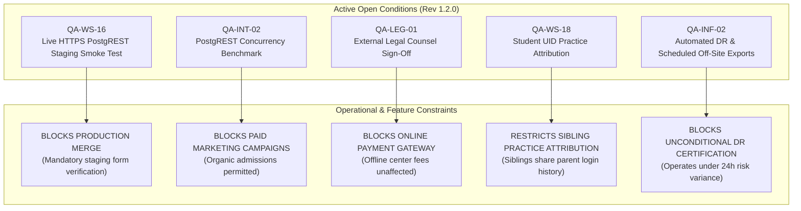

# ARNAV ABACUS ACADEMY (AAA) — STAGE 5 QUALITY ASSURANCE
## Open Conditions & Closure Evidence Register (Revision 1.2.0)

**Document Reference:** `AAA_STAGE5_OPEN_CONDITIONS_AND_CLOSURE_REGISTER`  
**Document Status:** **RATIFIED & FORMALLY ENACTED BY EXECUTIVE LEADERSHIP**  
**Accompanying Certificate:** `AAA-S5-CERT-GATE-01-REV-1.2.0`  
**Governing Determinations:** `MGT-DET-S5-QA-COND-01`, `MGT-DET-S5-RECON-02`, `MGT-DET-S5-STAGING-03-CORR-01`, and `MGT-DET-S5-REV-1.2.0-ACPT`  
**Evidence Baseline Commit:** `e7d8bc7e2c590da5d1faeac0659cfef15e28a47e` (`e7d8bc7`)  
**Active Working Branch:** `feat/sprint3-integration`  
**Production Main:** `a21a3d1129cc17fc6650bfd04648eb91199e6fa8` (🔒 **STRICTLY LOCKED**)  
**Verification Function:** Internal QA Verification & Technical Review  
**Executive Signatories:** Nitin Patil (Operations, Tech & Compliance) & Neha Patil (Founder & Academic Director)  
**Date of Ratification:** 06-November-2026  

---

## 1. Register Overview & Governance Principles

This register provides the definitive, auditable inventory of all outstanding technical, operational, and statutory conditions under **Proposed Revised Conditional Technical Acceptance Certificate Rev 1.2.0**.

In accordance with strict AAA governance standards:
1. **Zero Silent Downgrades:** No previously approved hard gate has been downgraded or removed.
2. **Explicit Blocking Categorization:** Every condition is explicitly mapped to the exact operational capability it constrains:
   - **Blocks Production Merge (`QA-WS-16`):** Mandatory pre-merge smoke test; cannot merge `feat/sprint3-integration` into `main` without verification.
   - **Blocks Specific Feature (`QA-INT-02`, `QA-LEG-01`, `QA-WS-18`):** Restricts high-traffic digital advertising, online payment processing, or multi-child practice session separation, while allowing organic inquiries to proceed.
   - **Blocks Final Stage 5 Closure (`QA-INF-02`):** Non-blocking operational refinement required for unconditional technical acceptance.
3. **Documented Management Authority:** Every non-blocking classification is grounded in an authorized management determination reference.

---

## 2. Itemized Open Conditions Register

---

### Condition 1: `QA-WS-16` — Live HTTPS PostgREST Persistence Smoke Test
- **Governing Gate:** Gate C (WS-16 Admissions Intake Gateway & Persistence)
- **Status:** 🟡 **OPEN — PARTIALLY SATISFIED (Local Integration Verified; Deployed HTTPS & Browser Test Pending)**
- **Verification Baseline:** `dbe5872a219b39f924dbdfc34cd2d3508fc96321`
- **Reconciliation Audit:** `docs/09_testing_and_quality_assurance/AAA_QA_WS16_EVIDENCE_RECONCILIATION_REPORT.md`
- **Verified Findings (Local Edge & Remote Database):**
  1. Local edge function execution verified via Cloudflare Wrangler Pages Dev on `http://127.0.0.1:8788/api/discovery-intake`.
  2. Ingress HTTP POST returned `HTTP 201 Created` with atomic lead reference `AAA-LEAD-2026-00002` and UUID `0c5700f1-eeb7-4fd7-b70b-5b1c43a01f8a`.
  3. Direct PostgreSQL inspection confirmed the physical row in `public.leads` in Supabase Mumbai staging (`ghbjtmfskgcraxafhlch`).
  4. 24-hour idempotency protection verified by re-submitting with identical key, returning the retained record without duplicate row insertion or sequence increment.
  5. Synthetic test row cleanly purged (`DELETE 1`).
- **Remaining Pre-Merge Blocker Requirements (Must Be Completed Prior to Production Merge):**
  1. **Deployed HTTPS Staging Preview:** The smoke test must be executed against a deployed Cloudflare Pages staging preview URL over public HTTPS with verified TLS negotiation (not localhost HTTP).
  2. **Interactive Browser Form Submission:** Submission must originate from the real rendered DOM (`LeadForm.tsx` or `DemoBookingModal.tsx`) in a web browser, confirming end-to-end receipt modal rendering.
- **Accountable Owner:** Nitin Patil (Operations & Tech Lead).
- **Blocking Status:** **BLOCKS PRODUCTION MERGE (Mandatory Pre-Deployment Blocker):** Production `main` remains locked until the deployed HTTPS browser smoke test is executed and evidenced.
- **Management Authority:** Governed by `MGT-DET-S5-REV-1.2.0-ACPT`.

---

### Condition 2: `QA-INT-02` — PostgREST Concurrency & Load Benchmark
- **Governing Gate:** Gate C (WS-16 Admissions Intake Gateway & Persistence)
- **Exact Unresolved Requirement:** A 50-concurrency live load benchmark against the Supabase PostgREST endpoint `/api/discovery-intake` to verify atomic sequential lead reference allocation (`lead_ref_seq_2026`) without connection dropouts, pool exhaustion, or duplicate reference generation under burst traffic.
- **Current Evidence:** Automated unit and integration test suites in `functions/api/discovery-intake.test.ts` (12/12 PASS) and `useDiscoveryIntake.test.ts` (10/10 PASS) under local mock environments. Direct database concurrency was proven for micro-batches (`QA-CAP-01`), but PostgREST HTTP layer concurrency has not been stress-tested.
- **Required Closure Evidence:** Execution log and benchmark report of a multi-threaded HTTP test script firing 50 simultaneous POST requests against staging PostgREST, demonstrating 50 HTTP 201 responses with 50 unique sequential IDs and 0 race collisions.
- **Accountable Owner:** Nitin Patil (Operations & Tech Lead).
- **Blocking Status:** **Blocks a Specific Feature:** Blocks scaling paid digital advertising campaigns (Meta / Google Ads). Does **not** block initial organic launch for low-volume single-center admissions (~5–10 inquiries/day).
- **Management Authority:** Formally classified as Tier 2 Pre-Campaign Hardening under `MGT-DET-S5-RECON-02` and ratified in `MGT-DET-S5-STAGING-03-CORR-01`.

---

### Condition 3: `QA-LEG-01` — External Legal Counsel Review & Sign-Off
- **Governing Gate:** Gate H (Privacy, Consent & Statutory Claim Governance)
- **Exact Unresolved Requirement:** Formal written review and signed opinion letter from a practicing Indian legal advocate in Pune approving the public Parent Registration Deed, the CCPA Tuition Refund Policy, and DPDP Act 2023 unbundled parental consent terms.
- **Current Evidence:** Internal documentary review `AAA_STAGE5_PRIVACY_AND_LEGAL_CLAIM_REVIEW.md`; removal of hyperbolic and unverified claims ("permanent exemption", "100% guarantee", "₹0 forever"); implementation of unbundled mandatory/optional consent architecture in public forms.
- **Required Closure Evidence:** Signed legal memorandum or formal written opinion letter from independent legal counsel confirming statutory compliance of tuition terms, cancellation policies, and child data processing.
- **Accountable Owner:** Nitin Patil (Operations & Compliance Lead).
- **Blocking Status:** **Blocks a Specific Feature:** Blocks **online payment gateway activation and online fee claims**. Does **NOT** restrict existing offline academy fee collection (cash, cheque, or direct center UPI) handled at the Wakad academy under standard operational procedures.
- **Management Authority:** Formally established under `MGT-DET-S5-RECON-02` and `MGT-DET-S5-STAGING-03-CORR-01`.

---

### Condition 4: `QA-WS-18` — Student UID Practice Attribution & Sequence Binding
- **Governing Gate:** Gate E (WS-18 Student Identity & Roster Bridge)
- **Exact Unresolved Requirement:** 
  1. Full isolation of practice sessions, quiz attempts, and leaderboard scores inside AcademyOS per individual `studentUid` rather than parent login email.
  2. Binding student UID allocation (`AAA-STD-YYYY-XXXX`) to an authoritative database sequence rather than an in-memory counter.
- **Current Evidence:** Roster ingestion bridge supports sibling enrollment arrays (`students: EnrolledSiblingSummary[]` in `ApprovedEmailRecord` and `academyRosterBridge.ts`). Sibling email lookup collisions are resolved. However, AcademyOS practice platform runtime code (`PracticeHub.tsx`, `PracticeSession.tsx`) remains frozen and keys practice attempts to `currentUser?.email`.
- **Required Closure Evidence:** Code implementation and test evidence of a student selector modal in `PracticeHub.tsx` for multi-child accounts, updating `aaa_leaderboard_attempts` and quiz persistence to include `studentUid`, along with a PostgreSQL migration establishing `student_uid_seq`.
- **Accountable Owner:** Nitin Patil (Tech Lead) & Neha Patil (Academic Director).
- **Blocking Status:** **Restricts a Specific Feature & Blocks Final Stage 5 Closure:** Sibling *enrolment* is fully supported, but multi-sibling *practice attribution* is restricted. Siblings practicing in AcademyOS will share attempt histories under the parent account until Phase 2 implementation. Does **not** block public admissions portal launch.
- **Management Authority:** Formally approved under `MGT-DET-S5-RECON-02` and `MGT-DET-S5-STAGING-03-CORR-01`.

---

### Condition 5: `QA-INF-02` (Operational Posture) — Automated DR & Scheduled Off-Site Exports
- **Governing Gate:** Gate J (Planned Infrastructure Spend & Backup Readiness)
- **Exact Unresolved Requirement:** Implementation of an automated, scheduled daily off-site encrypted backup export routine and a documented full-schema recovery dry run against a clean database instance.
- **Current Evidence:** Live staging execution of an isolated canary restore drill on Supabase Mumbai (`ghbjtmfskgcraxafhlch`), proving `pg_dump` extraction, AES-256 GPG encryption, corruption simulation, GPG decryption, and restoration of synthetic table `public.canary_audit` in 0.35 seconds (`RESTORE01_LIVE_OUTPUT.log`).
- **Required Closure Evidence:** Configured and running automated cron task (e.g. GitHub Actions / Cloudflare Scheduled Worker) executing daily at 02:00 AM IST to off-site encrypted storage, accompanied by an execution log of a full database restore dry run.
- **Accountable Owner:** Nitin Patil (Operations & Tech Lead).
- **Blocking Status:** **Blocks Final Stage 5 Closure:** Does **not** block production deployment of the organic portal. Operates under the formally approved **24-hour database temporary risk variance**. Full-database automated DR remains unverified; multi-region high-availability claims remain prohibited.
- **Management Authority:** Formally authorized under `MGT-DET-S5-STAGING-03-CORR-01` (Pathway 3A Corrected Baseline: 24-hour temporary risk variance, with 30-day post-launch automation window).

---

## 3. Comprehensive Condition Summary Matrix

| Condition ID | Domain | Severity | Operational Impact | Target Closure Milestone | Authority Reference |
| :---: | :--- | :---: | :--- | :--- | :--- |
| **`QA-WS-16`** | Intake Gateway | High | **BLOCKS PRODUCTION MERGE:** Pre-merge staging smoke test required. | Immediate Pre-Merge Staging | `MGT-DET-S5-QA-COND-01` |
| **`QA-INT-02`** | PostgREST Load | Medium | **BLOCKS PAID MARKETING:** Limits marketing to organic channels. | Prior to Paid Ad Spend | `MGT-DET-S5-RECON-02` |
| **`QA-LEG-01`** | Statutory Terms | Medium | **BLOCKS ONLINE PAYMENTS:** Offline center tuition collection unaffected. | Prior to Online Fee Collection | `MGT-DET-S5-RECON-02` |
| **`QA-WS-18`** | Sibling Practice | Medium | **RESTRICTS SIBLING PRACTICE:** Practice histories intermix per parent login. | Post-Launch Phase 2 | `MGT-DET-S5-STAGING-03-CORR-01` |
| **`QA-INF-02`** | Backup Automation | Low | **BLOCKS UNCONDITIONAL DR:** Operates under approved 24h temporary risk variance. | Post-Launch (30 Days) | `MGT-DET-S5-STAGING-03-CORR-01` |

---
*Draft Prepared by Internal QA Review Team for Arnav Abacus Academy Executive Consideration.*
