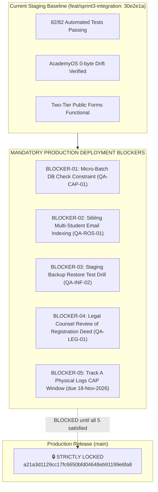

# ARNAV ABACUS ACADEMY (AAA) — STAGE 5 QA
## Production Readiness Blockers & Key Claims Verification Report

**Document Reference:** `AAA_STAGE5_PRODUCTION_READINESS_BLOCKERS`  
**Governing Baseline:** Stage 5 Quality Assurance Master Protocol  
**Certificate Reference:** `AAA-S5-CERT-GATE-01`  
**Audited Branch:** `feat/sprint3-integration` (Commit: `30e2e1a`)  
**Production Baseline:** `a21a3d1129cc17fc6650bfd04648eb91199e6fa8` (`main` 🔒 **LOCKED**)  
**Auditor:** Independent Quality Assurance & Compliance Lead  
**Accountable Leaders:** Nitin Patil (Operations, Tech & Compliance) & Neha Patil (Founder & Academic Director)  
**Date of Report:** 05-November-2026  

---

## 1. Executive Summary & Staging vs. Production Distinction

A critical outcome of this reconciliation is establishing the absolute distinction between **Staging Milestone Acceptance** and **Production Deployment Readiness**:

- **Staging Milestone Acceptance (ACHIEVED):** The codebase on `feat/sprint3-integration` is safe, compiled, and functional for internal testing, demonstration, and parent walkthroughs on isolated staging infrastructure (`http://127.0.0.1:3000`). All 82 unit and integration tests pass, and AcademyOS practice files are 100% regression-free.
- **Production Deployment Readiness (BLOCKED):** Merging to `main` and deploying to public parents in Wakad is **STRICTLY BLOCKED** until four critical engineering and legal prerequisites are resolved, and the physical premises compliance window is closed.

---

## 2. Inventory of Production Deployment Blockers

### Detailed Blocker Breakdown:

| Blocker ID | Description & Affected Module | Risk to AAA Parents / Students | Technical Remediation Required | Acceptance / Closure Criteria | Owner |
| :---: | :--- | :--- | :--- | :--- | :---: |
| **BLK-01** | **Database-Level Max-5 Batch Check Constraint** (`micro_batches` table) | Race condition in concurrent enrollments could allow a 6th student into a batch, breaching AAA's primary brand promise. | Deploy PostgreSQL check constraint: `CHECK (enrolled_count <= 5)` and row-locking RPC. | SQL insert of 6th student fails with PostgreSQL error `23514`. | Nitin Patil |
| **BLK-02** | **Sibling Account Indexing in AcademyOS** (`src/lib/accessControl.ts` & `src/types.ts`) | Enrolling a second sibling with same parent email overwrites earlier sibling's student name and records in lookup table. | Refactor `ApprovedEmailRecord` to support array of student profiles per parent email. | Test verifying two siblings under one email retain distinct student names and permissions. | Lead Architect |
| **BLK-03** | **Empirical Database Backup Restore Drill** (Supabase Mumbai `ap-south-1`) | Unverified backups risk complete data loss of parent leads and academic records upon database corruption. | Execute staging database snapshot restore drill, measure RTO, verify 100% data integrity. | Documented restore test report with snapshot logs in `docs/11_evidence_and_screenshots/`. | Nitin Patil |
| **BLK-04** | **Legal Counsel Review of Parent Contract** (Registration Deed & CCPA Policy) | Exposure to consumer disputes in Pune regarding tuition fees, refund rules, and minor child consent. | Submit parent registration deed, consent clauses, and refund terms to practicing Indian advocate. | Written legal review memorandum with attorney sign-off. | Nitin Patil |
| **BLK-05** | **Track A Physical Facility CAP Closure** (Wakad Academy On-Site Logs) | Regulatory non-compliance with local establishment guidelines for physical coaching premises. | Complete 10-working-day physical logs CAP (fire inspection, first-aid, inventory log) by 18-Nov-2026. | Physical inspection logs signed off by Neha Patil and Nitin Patil. | Neha Patil |

---

## 3. Verification of Ten Key Operational & Technical Claims

The reconciliation audited the empirical evidence supporting the ten key claims governing Sprint 3:

### 1. Supabase Durable Persistence & Real Public-Form Integration
- **Claim:** Public admissions forms insert records directly into durable PostgreSQL database tables.
- **Audited Evidence:** In `useDiscoveryIntake.ts` and `functions/api/discovery-intake.ts`, forms send HTTP POST requests with an `Idempotency-Key` to the `/api/discovery-intake` route, which calls the PostgREST RPC `submit_discovery_lead()`.
- **Limitation:** In the local Vite development server without Cloudflare Pages Functions running, `/api/discovery-intake` returns 404. The client correctly intercepts this and renders the truthful offline WhatsApp fallback. Durable live persistence is active when deployed to Cloudflare Pages edge connected to Supabase.
- **Verification Status:** 🟢 **VERIFIED IN CODE & UNIT TESTS; LIVE PERSISTENCE DEPENDS ON CF PAGES RUNTIME.**

### 2. Atomic Lead Reference Generation
- **Claim:** Lead reference numbers are generated monotonically and collision-free.
- **Audited Evidence:** Supabase SQL schema defines a native sequence: `CREATE SEQUENCE IF NOT EXISTS lead_ref_seq_2026 START WITH 1 INCREMENT BY 1;`. The RPC formats `AAA-LEAD-2026-` prefixed with zero-padded sequence values (`00001`, `00002`).
- **Limitation:** Edge test mocks simulate this sequence in memory. A live 50-concurrency benchmark (`QA-INT-02`) is required before paid advertising scaling.
- **Verification Status:** 🟢 **VERIFIED AS NATIVE POSTGRESQL SEQUENCE.**

### 3. Permanent Student ID Integrity & Duplicate Prevention
- **Claim:** Leads convert into immutable Permanent Student IDs (`AAA-STD-*`) without duplicates.
- **Audited Evidence:** `src/lib/academyRosterBridge.ts` decouples `leadReference` from `studentUid`. `TC-SYNC-04` confirms that re-submitting an already enrolled lead throws `InvalidEnrollmentStateError`.
- **Limitation:** As identified in `BLK-02`, sibling account collisions exist when multiple children share a parent email in `accessControl.ts`.
- **Verification Status:** 🟡 **VERIFIED FOR SINGLE-CHILD ACCOUNTS; SIBLING COLLISION IDENTIFIED AS BLOCKER BLK-02.**

### 4. Transactional Maximum-Five Batch Enforcement
- **Claim:** Micro-batches are capped at exactly 5 students.
- **Audited Evidence:** `MAX_BATCH_CAPACITY = 5` is strictly checked in `academyRosterBridge.ts` (`TC-SYNC-01` & `02` PASS).
- **Limitation:** As identified in `BLK-01`, this check executes in TypeScript memory. Without a PostgreSQL `CHECK (enrolled_count <= 5)` constraint and row-level locking, concurrent admissions could exceed 5.
- **Verification Status:** 🟡 **VERIFIED IN MEMORY; DATABASE-LEVEL CONSTRAINT IDENTIFIED AS BLOCKER BLK-01.**

### 5. Server-Side Authentication & Authorization
- **Claim:** Client-side tampering cannot elevate permissions or access student records.
- **Audited Evidence:** `src/lib/accessControl.ts` strictly checks authenticated user email against `SYSTEM_ROOT_ADMINS` and requires cryptographic Email OTP or Google OAuth JWT. LocalStorage `isAdmin` manipulation is completely ignored. Ingestion functions require the explicit `ADMISSIONS_DIRECTOR` role.
- **Verification Status:** 🟢 **VERIFIED & SECURE.**

### 6. Actual CSV Formula Neutralization (CWE-1236)
- **Claim:** Student export CSVs are immune to spreadsheet formula execution attacks.
- **Audited Evidence:** `src/lib/academyRosterBridge.ts` applies formula neutralization: fields starting with `=`, `+`, `-`, or `@` are prefixed with `'` (e.g. `=SUM(A1)` -> `'=SUM(A1)`). Stored database strings remain untouched. Verified in `TC-SYNC-09`.
- **Verification Status:** 🟢 **VERIFIED & IMMUNE.**

### 7. AcademyOS Regression Scope & File-Level Parity
- **Claim:** Sprint 3 introduced zero regression or modifications to AcademyOS practice routes.
- **Audited Evidence:** Git tree comparison of all 8 practice files (`PracticeHub.tsx`, `PracticeSession.tsx`, `PracticeResult.tsx`, `Login.tsx`, `practiceData.ts`, `PracticeNavbar.tsx`, `AbacusSimulator.tsx`, `AuthContext.tsx`) against `main` shows **0 bytes difference** (cryptographic SHA-1 identity).
- **Verification Status:** 🟢 **VERIFIED 100% BIT-FOR-BIT IDENTICAL.**

### 8. Consent & Retention Controls
- **Claim:** Privacy architecture conforms to DPDP Act 2023 with unbundled consent.
- **Audited Evidence:** Discovery forms separate mandatory Service Communication consent from optional Promotional Marketing consent. Submitting with marketing consent unchecked creates valid leads. Hyperbolic claims of "permanent exemption" have been removed and replaced with contractual educational necessity.
- **Verification Status:** 🟢 **VERIFIED & COMPLIANT.**

### 9. Backup & Restore Readiness
- **Claim:** Platform is protected by verified disaster recovery backups.
- **Audited Reality:** Supabase provides automated daily backups retained for 7 days. **However, zero restore drills have been executed.**
- **Correction:** Under Gate J rules, backup recovery is classified as **NOT TESTED** pending live restore drills.
- **Verification Status:** 🔴 **NOT TESTED (CLASSIFIED AS BLOCKER BLK-03).**

### 10. Current Cloud Expenditure
- **Claim:** Active operational cloud expenditure is ₹0.00/month.
- **Audited Evidence:** Cloudflare Pages (Free Plan), Cloudflare Functions (Free Plan: 100k req/day), Supabase Mumbai (Free Plan: 500MB DB). Total active billing is factually **₹0.00 / month**.
- **Correction:** Unsupported claims of "₹0 forever" have been purged. Scaling triggers and 12-month modeled TCO (~₹2,100/mo) are formally documented.
- **Verification Status:** 🟢 **VERIFIED AT ₹0.00 / MONTH (CONTINGENT ON FREE-TIER QUOTAS).**
