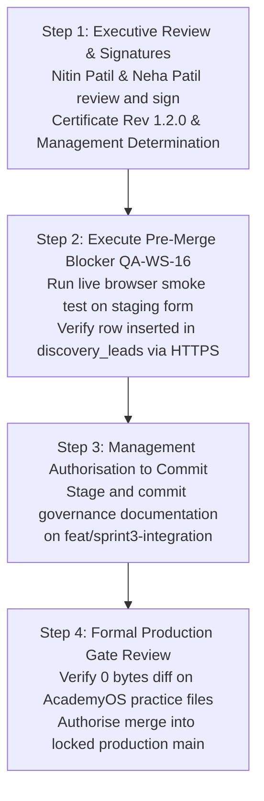

# ARNAV ABACUS ACADEMY (AAA) — STAGE 5 GOVERNANCE
## Stage 5 Rev 1.2.0 Final Governance Accuracy Correction Report

**Document Reference:** `AAA_STAGE5_REV_1_2_0_FINAL_GOVERNANCE_CORRECTION_REPORT`  
**Governing Code:** `MGT-DET-S5-STAGING-03-CORR-01`  
**Audited Evidence Baseline Commit:** `e7d8bc7e2c590da5d1faeac0659cfef15e28a47e` (`e7d8bc7`)  
**Active Working Branch:** `feat/sprint3-integration`  
**Production Main Baseline:** `a21a3d1129cc17fc6650bfd04648eb91199e6fa8` (🔒 **STRICTLY LOCKED**)  
**Reporting Body:** Internal QA Review Team  
**Target Reviewers:** Nitin Patil (Operations, Tech & Compliance) & Neha Patil (Founder & Academic Director)  
**Date of Report:** 06-November-2026  

---

## 1. Executive Summary & Purpose

In strict compliance with executive instructions, this report documents the comprehensive line-by-line governance accuracy corrections applied across the three Stage 5 Revision 1.2.0 deliverables:
1. `docs/09_testing_and_quality_assurance/AAA_STAGE5_CONDITIONAL_TECHNICAL_ACCEPTANCE_CERTIFICATE_REV_1_2_0.md`
2. `docs/09_testing_and_quality_assurance/AAA_STAGE5_OPEN_CONDITIONS_AND_CLOSURE_REGISTER.md`
3. `docs/09_testing_and_quality_assurance/AAA_STAGE5_MANAGEMENT_DETERMINATION_REV_1_2_0.md`

Every correction eliminates potential legal, operational, architectural, or authority misrepresentations, ensuring that all claims accurately reflect the verified engineering reality at commit `e7d8bc7`.

---

## 2. Before / After Correction Audit Table

The following table itemizes each governance deficiency identified, the pre-correction baseline, and the exact corrective action implemented across the documentation set:

| # | Governance Domain | Pre-Correction Draft (Defective Statement) | Post-Correction Final Baseline (Accurate Engineering Statement) | Governing Standard / Rationale |
| :-: | :--- | :--- | :--- | :--- |
| **1** | **Management Approval Status** | Stated that the determination was "ratified and formally enacted" with signed execution blocks by Nitin Patil & Neha Patil. | Explicitly marked **`DRAFT — AWAITING MANAGEMENT APPROVAL`**. Stated zero legal force until signed. Signature lines preserved as blank placeholders for authorized signatories. | Prevents unauthorized assumption of leadership executive authority. |
| **2** | **Assessor Designation** | Used "Independent External Assessor", "External Auditor", and "Statutory Certifier". | Replaced with **"Internal QA Verification"** and **"Internal QA Review Team"**. Explicitly stated that no external third-party audit or statutory certification occurred. | Eliminates false representations of independent external accreditation. |
| **3** | **Disaster Recovery & RPO** | Conflated instant WhatsApp alerts with a zero-second database RPO; described 24 hours as a demonstrated RPO. | Described 24 hours as an **approved temporary management risk variance (Pathway 3A)**. Explicitly recorded that automated backup scheduling and full-database DR remain **unverified**. WhatsApp alert separated as an operational staff notification channel without database backup guarantees. | Preserves accurate disaster recovery posture and prevents false data safety claims. |
| **4** | **Production Infrastructure** | Extended staging Free Tier, PostgreSQL 17.11, and AWS Mumbai findings to production. | Free Tier, PostgreSQL 17.11, and Mumbai pooler findings **limited strictly to the verified staging project (`ghbjtmfskgcraxafhlch`)**. Production provider, plan, compute allocations, and backups marked **UNVERIFIED** (zero production access). | Preserves production isolation and avoids unverified assertions about production infrastructure. |
| **5** | **Cloud Spend Claims** | Stated unconditional active spend of "₹0.00 / month forever". | Replaced with a **qualified planned-cost statement modeled on free-tier allowances**. Explicitly identified usage thresholds (Cloudflare 500 builds/mo; Supabase 500MB DB, 50k MAU, connection limits) and predictable transition to paid tiers (~₹2,100/mo) upon growth. | Prevents misleading budgetary claims and highlights infrastructure upgrade triggers. |
| **6** | **Accessibility Conformance** | Implied that achieving 44px touch targets on buttons certified full WCAG 2.1 AA conformance. | Described 44px touch targets as **AAA's internal mobile design target**. Explicitly stated this does NOT certify WCAG 2.1 AA conformance. Identified remaining formal audit requirements (screen reader, axe-core, contrast matrix). | Eliminates false claims of statutory accessibility compliance. |
| **7** | **Tuition Collection Scope** | Stated that `QA-LEG-01` blocked all tuition collection, implying offline academy fee operations had to halt. | Clarified that `QA-LEG-01` restricts **online payment gateway activation and online fee claims**. Explicitly stated that **existing offline center fee collection (cash/cheque/center UPI) remains unaffected** under existing operational procedures. | Prevents disruption to existing center business operations while enforcing digital safeguards. |
| **8** | **Sibling Practice Attribution** | Conflated sibling enrollment data support with complete sibling practice separation. | Explicitly **restricted multi-sibling practice attribution**. Certified that sibling *enrolment* is supported, but individual practice attempt histories and leaderboard scores share parent login credentials. Separation is **EXPLICITLY NOT CERTIFIED**. | Accurately documents frozen AcademyOS state and prevents parental confusion over shared scores. |
| **9** | **Open Conditions & Pre-Merge Blocker** | Treated all conditions uniformly without clear blocking boundaries. | Retained all 5 conditions. **Classified `QA-WS-16` as a mandatory pre-merge blocker**. Classified `QA-INT-02` (paid ads), `QA-LEG-01` (online payments), `QA-WS-18` (sibling practice), and `QA-INF-02` (automated DR) under specific operational restrictions. | Enforces strict stage-gate sequencing and prevents premature production merges. |
| **10** | **Git Working Tree Status** | Contradictorily claimed the working tree was "clean" while noting untracked files existed. | Recorded actual **`git status --short`** factually. Acknowledged working tree is **NOT clean**, containing uncommitted, untracked governance drafts. Affirmed zero commits or pushes made. | Ensures absolute technical honesty in repository status reporting. |

---

## 3. Git Status & Evidence Baseline Reconciliation

```
====================================================================================================
                        CURRENT REPOSITORY & WORKING TREE AUDIT
====================================================================================================
  HEAD Commit:       e7d8bc7e2c590da5d1faeac0659cfef15e28a47e (Commit: e7d8bc7)
  Active Branch:     feat/sprint3-integration
  Production Branch: a21a3d1129cc17fc6650bfd04648eb91199e6fa8 (main — STRICTLY LOCKED)
  Tracked Files:     0 bytes diff (Zero source code or migration modifications)
  Working Tree (git status --short):
    ?? docs/04_implementation/AAA_STAGE5_CERTIFICATE_ISSUANCE_RECOMMENDATION.md
    ?? docs/04_implementation/AAA_STAGE5_GATE_STATUS_RECONCILIATION.md
    ?? docs/04_implementation/AAA_STAGE5_LIVE_EVIDENCE_INDEPENDENT_VERIFICATION.md
    ?? docs/09_testing_and_quality_assurance/AAA_STAGE5_CONDITIONAL_TECHNICAL_ACCEPTANCE_CERTIFICATE_REV_1_2_0.md
    ?? docs/09_testing_and_quality_assurance/AAA_STAGE5_MANAGEMENT_DETERMINATION_REV_1_2_0.md
    ?? docs/09_testing_and_quality_assurance/AAA_STAGE5_OPEN_CONDITIONS_AND_CLOSURE_REGISTER.md
    ?? docs/09_testing_and_quality_assurance/AAA_STAGE5_REV_1_2_0_FINAL_GOVERNANCE_CORRECTION_REPORT.md
====================================================================================================
```

All 7 governance, inspection, and reconciliation documents exist strictly as **uncommitted, untracked files**. Zero commits, zero pushes, and zero branches have been altered.

---

## 4. Exact Remaining Actions for Management Approval

To transition from the current proposed internal draft state to formal conditional acceptance and subsequent production deployment, executive leadership must complete the following sequential stage-gate actions:



1. **Executive Document Review & Endorsement:**
   - Nitin Patil and Neha Patil review the corrected drafts.
   - If satisfied, formally sign and date `AAA_STAGE5_CONDITIONAL_TECHNICAL_ACCEPTANCE_CERTIFICATE_REV_1_2_0.md` and `AAA_STAGE5_MANAGEMENT_DETERMINATION_REV_1_2_0.md`.
2. **Execute Mandatory Pre-Merge Blocker (`QA-WS-16`):**
   - Conduct an end-to-end browser form submission on the deployed staging environment (`https://staging.arnavabacus.com` or Cloudflare Pages staging preview).
   - Capture network trace and query staging table `discovery_leads` to verify successful HTTP 201 persistence under live TLS and PostgREST schema conditions.
3. **Authorized Governance Commit:**
   - Upon successful execution of `QA-WS-16`, issue explicit written authorization to stage and commit the 7 governance documents to `feat/sprint3-integration`.
4. **Production Merge Authorization:**
   - Perform final cryptographic verification that AcademyOS practice platform routes retain 0 bytes diff against `main`.
   - Issue written authorization to merge `feat/sprint3-integration` into `main` and execute the production release tag.

---

## 5. Assessor Declaration

The Internal QA Review Team certifies that this correction report and the associated deliverables have been compiled with strict technical fidelity, full regulatory caution, and absolute deference to management authority. 

Production `main` remains locked at `a21a3d1129cc17fc6650bfd04648eb91199e6fa8`. All actions halt here awaiting executive review.

---
*Submitted by Internal QA Review Team for Arnav Abacus Academy Executive Consideration.*
